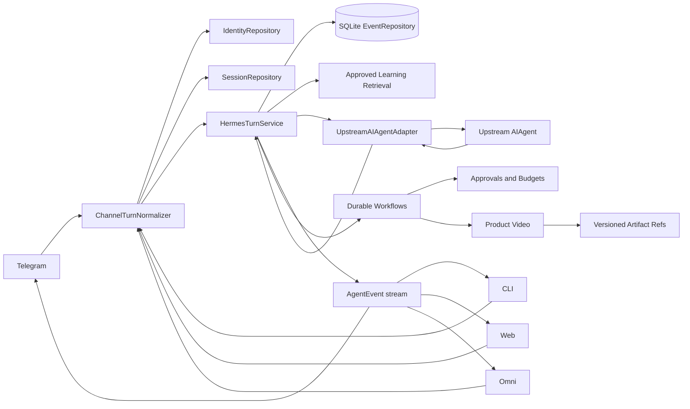
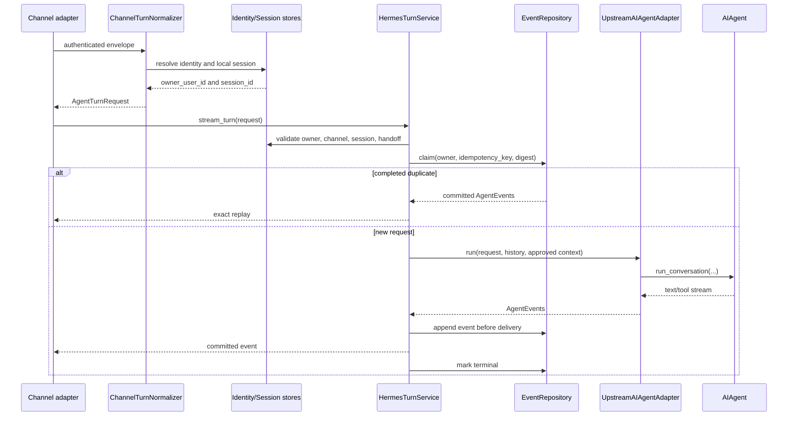
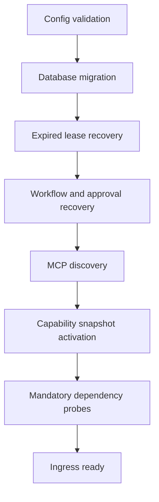
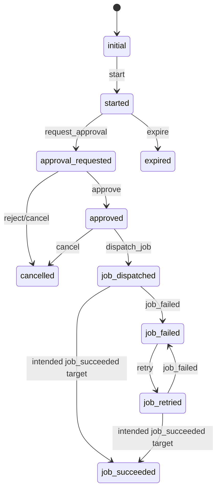
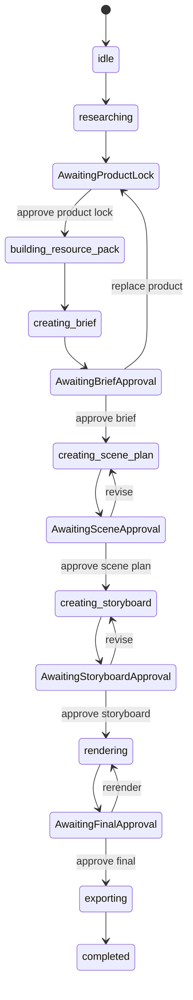

# Hermes Personal Architecture

## Scope

This document describes the implemented `hermes_personal` bounded context. It
does not replace the upstream Hermes architecture in `run_agent.py`, `gateway/`,
or `hermes_cli/`. The central rule is that upstream `AIAgent` remains the sole
general-purpose reasoning engine.

## Architectural invariants

1. Every channel is normalized into `AgentTurnRequest`.
2. Every general conversation enters `HermesTurnService` and invokes the public
   upstream `AIAgent.run_conversation` API through `UpstreamAIAgentAdapter`.
3. Channels may render events differently, but business behavior does not live
   in a channel adapter.
4. Identity and session ownership are validated before inference or workflow
   continuation.
5. Events are committed before they are yielded to callers.
6. Workflow state, command deduplication, outbox records, approvals, budgets,
   and governed learning use explicit durable contracts.
7. Product-video milestones require human approval and immutable artifact refs.

## Bounded contexts

| Context | Responsibility | Primary source |
| --- | --- | --- |
| Contracts | Channel-neutral principals, turns, commands, events, capabilities | `hermes_personal/contracts/` |
| Gateway | Authentication envelope normalization and channel capabilities | `hermes_personal/gateway/` |
| Identity and sessions | External identity mapping, owner isolation, explicit cross-channel handoff | `hermes_personal/identity/`, `hermes_personal/sessions/` |
| Orchestration | Canonical agent turn and upstream adapter | `hermes_personal/orchestration/` |
| Storage | SQLite schema and repositories | `hermes_personal/storage/` |
| Capabilities | Snapshot catalog, policy, MCP discovery, governed search | `hermes_personal/capabilities/` |
| Workflows | Durable aggregate, events, commands, outbox, approval, budget, jobs | `hermes_personal/workflows/` |
| Product video | Product Intelligence to Video Factory state and artifact chain | `hermes_personal/product_video/` |
| Learning | Candidate, evidence, evaluation, publication, retrieval, rollback | `hermes_personal/learning/` |
| Runtime | Startup sequencing, readiness, process topology, supervision | `hermes_personal/runtime/` |
| Application | Health, event streaming/replay, operator commands, artifact metadata | `hermes_personal/application/` |

## System view

## Canonical agent-turn sequence

## Trigger mechanisms

| Trigger | Entry contract | Dispatch behavior |
| --- | --- | --- |
| Natural-language turn | `AgentTurnRequest` | Canonical `HermesTurnService` path |
| Operator action | `OperatorCommand` | Authenticated command handler with expected version |
| Workflow command | Command dictionary with `command_id`, `workflow_id`, `type`, `args` | `WorkflowEngine` and atomic repository commit |
| Background stage | `JobSpec` / product-video `JobContext` | In-process `JobDispatcher` thread |
| Startup | `StartupCoordinator.prepare()` | Strict ordered readiness gate |
| Recovery | persisted workflows and outbox | `WorkflowRecoveryService` |

## Startup and readiness

`StartupCoordinator` accepts dependency callbacks. A step with no callback is a
completed no-op, so a successful unit-level startup report alone is not proof
that migrations, discovery, recovery, or external probes ran. Production wiring
must inject each mandatory callback. The current CLI executes this coordinator
before spawning children, while `Supervisor` does not run the declared process
probes; therefore the present sequence is not an end-to-end readiness proof.

## Workflow state models

There are two separate state abstractions. Do not merge them implicitly.

### Generic durable workflow

The generic `WorkflowEngine` accepts commands, checks duplicate `command_id`,
commits events and aggregate versions, and applies its own compact state model.
The current implementation has two known consistency defects: it commits the
pre-transition cached aggregate before validating/applying the transition, and
`job_succeeded` maps to `job_dispatched` while the allowed-state table expects a
target named `job_succeeded`. A successful command can therefore be rejected,
and restart recovery can observe a stale aggregate. Do not use this engine for
production state transitions until both defects and their recovery tests are
fixed.

### Product-video workflow

The product-video state machine is domain-specific and has five mandatory HITL
waiting states.

## Design versus runtime evidence

The master design and gate plans under `docs/superpowers/` define the target
program. Runtime claims require all of the following:

- an importable implementation,
- a production wiring path,
- focused automated tests,
- and, for user-facing processes, a real startup or HTTP smoke test.

The cutover inventory and process topology are declarative validators. Their
presence does not prove that all declared routes or child modules are mounted.
See [Infrastructure](infrastructure.md#known-runtime-gaps).
