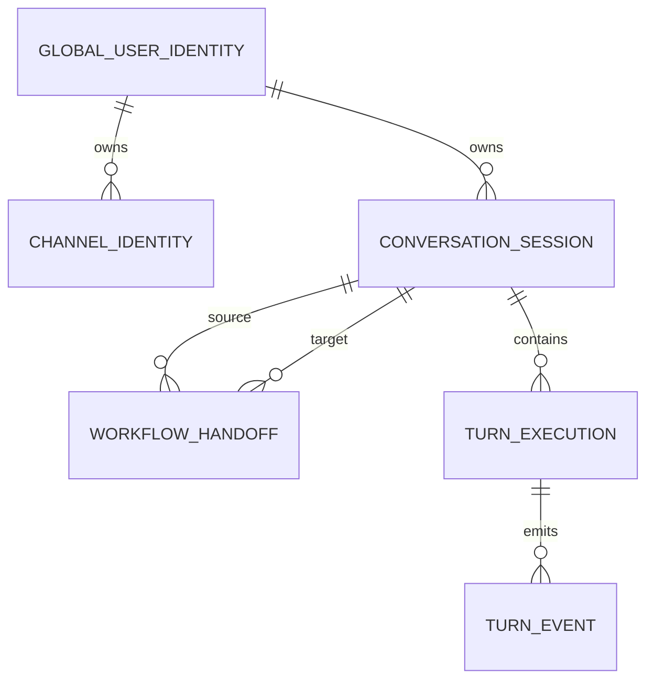

# Hermes Personal Data Mapping

## Mapping principles

1. Authenticate first; never map caller-supplied owner/session IDs directly.
2. Normalize every channel to the same canonical turn contract.
3. Preserve correlation IDs across turn, event, workflow, job, approval, and
   artifact boundaries.
4. Persist canonical state before producing a delivery projection.
5. Store refs and digests across bounded contexts, not mutable provider objects.

## Channel envelope to AgentTurnRequest

| Source | Canonical target | Transformation |
| --- | --- | --- |
| authenticated external subject | `principal.actor_id` | exact authenticated subject |
| adapter channel | `principal.channel` | telegram/cli/web/omni |
| `(channel, external_subject)` lookup | `principal.owner_user_id` | resolve through identity repository |
| external conversation ID | `principal.session_id` | get/create owner-scoped local session |
| platform text | `message` | preserve user content after transport decoding |
| platform media | `attachments[]` | map ID, kind, MIME, URI, size, optional SHA-256 |
| client request ID | `idempotency_key` | preserve stable retry key; otherwise generated turn ID |
| locale | `locale` | adapter value or `vi-VN` |
| platform features | `channel_capabilities` | normalizer-owned capability flags |
| requested workflow | `workflow_id` | accept only active workflow or explicit handoff |

The `conversation_history` supplied by an ingress is not the durable source of
truth. `HermesTurnService` loads canonical persisted session history and may add
approved learning context before invoking the upstream agent.

## Turn to SQLite

| Contract field | Table.column | Notes |
| --- | --- | --- |
| `principal.owner_user_id` | `turn_execution.owner_user_id` | part of idempotency primary key |
| `idempotency_key` | `turn_execution.idempotency_key` | owner-scoped |
| semantic request | `turn_execution.request_digest` | canonical SHA-256 digest |
| `turn_id` | `turn_execution.turn_id` | unique |
| `session_id` | `turn_execution.session_id` | composite owner/session foreign key |
| `message` | `turn_execution.user_message` | user message projection |
| execution lifecycle | `turn_execution.status` | in_progress/completed/failed |
| `AgentEvent.sequence` | `turn_event.sequence` | primary key with turn ID |
| `AgentEvent.event_id` | `turn_event.event_id` | globally unique |
| serialized event | `turn_event.payload_json` | immutable payload |

`occurred_at`, retry-specific `turn_id`, and the idempotency key itself are
excluded from the semantic request digest. This allows a retry with the same
business request to match the original execution.

## Agent output to AgentEvent

| Agent output | Event target |
| --- | --- |
| output event type | `event_type` |
| output payload | immutable `data` |
| request owner | `principal_id` |
| request session/turn/workflow | corresponding correlation fields |
| output job/approval/tool call IDs | optional correlation fields |
| service counter | monotonic `sequence` starting at zero |

The event repository is written first. Transcript append is a secondary
projection; its failure is logged and does not roll back the canonical event.

## SQLite identity and session mapping

Cross-channel session IDs are intentionally different. Continuity is represented
by the same owner plus an explicit workflow handoff, not by reusing a session ID.

## Workflow command mapping

| Command input | Persistence target |
| --- | --- |
| `workflow_id` | `workflow.workflow_id`, `workflow_event.workflow_id` |
| `command_id` | `processed_command.command_id` |
| current aggregate | `workflow.aggregate_json` |
| optimistic version | `workflow.version` |
| command-derived event | `workflow_event` row |
| outbound message | `workflow_outbox` row in the same transaction |

Duplicate `(workflow_id, command_id)` returns a duplicate result without applying
another repository commit. Version mismatch raises a conflict instead of
overwriting state. Known defect: `WorkflowEngine` currently serializes and
commits its cached aggregate before it validates/applies the requested state
transition, so `aggregate_json` can lag the event/version after restart. Treat
the repository transaction as atomic storage, not proof that engine ordering is
correct.

## Product Intelligence to Video Factory mapping

| Source artifact | Binding field | Owner | Downstream invalidated when replaced |
| --- | --- | --- | --- |
| locked resource pack | `lock_ref` | product_intelligence | brief, scene plan, storyboard, render, export |
| creative brief | `brief_ref` | video_factory | scene plan, storyboard, render, export |
| scene plan | `scene_plan_ref` | video_factory | storyboard, render, export |
| storyboard | `storyboard_ref` | video_factory | render, export |
| render | `render_ref` | video_factory | export |
| export | `export_ref` | video_factory | none |

The legacy `create_binding(product_id, resource_pack)` adapter canonicalizes the
resource pack with sorted JSON keys, computes SHA-256, constructs a PI
`ArtifactRef`, and delegates to `create()`. New code should pass an explicit
versioned `ArtifactRef`.

## HTTP mapping

| HTTP input | Internal contract |
| --- | --- |
| Bearer/query token plus `owner_id` | `auth_validator(token, owner_id)` |
| replay query `after_seq`, `limit` | owner-scoped event-store query |
| operator JSON | `OperatorCommand` with Web principal |
| artifact path ID plus owner | owner-isolated `ArtifactRecord` lookup |
| committed event | SSE `id`, `event`, JSON `data` frame |

The current FastAPI factory does not map an HTTP `/api/turn` endpoint. That path
exists in the target cutover inventory only.

## Learning mapping

| Source | Target |
| --- | --- |
| task/workflow outcome | `task_outcome` |
| proposed reusable knowledge | `learning_candidate` |
| supporting/contradicting source | `evidence_ref` |
| evaluator decision | `candidate_evaluation` |
| approved immutable content | `learning_version` |
| lifecycle transition | `learning_event` |

Only approved active versions are mapped into future turn context.
