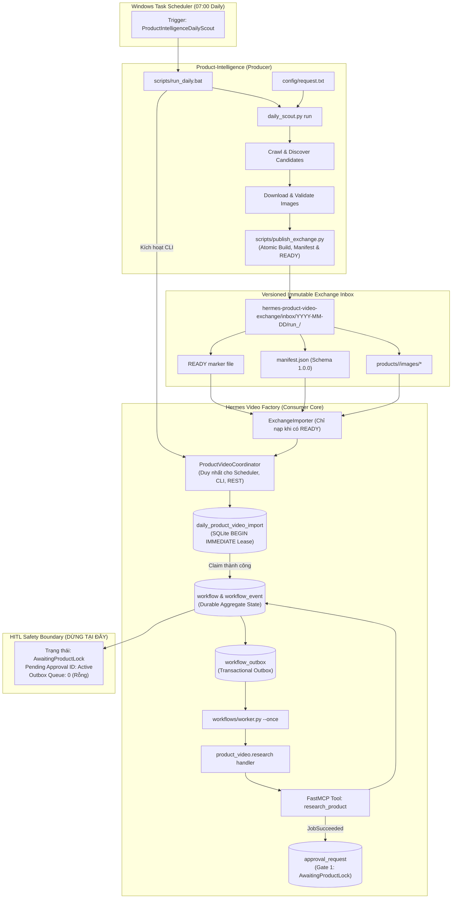

# Kiến Trúc Hiện Tại: Product-Intelligence & Hermes Video Factory Automation

**Phiên bản:** 2.0  
**Ngày cập nhật:** 2026-09-12  
**Trạng thái:** Runtime / Integration Verified; Scheduled Path Configured  
**Ranh giới hợp đồng trao đổi:** `D:\work\Personal\hermes-product-video-exchange\inbox\`  
**Producer:** `D:\work\Personal\Product-Intelligence`  
**Consumer:** `D:\work\hermes-upstream-rearchitecture`  

---

## 1. Tổng quan & Triết lý kiến trúc

Hệ thống được thiết kế dựa trên nguyên tắc phân định trách nhiệm rõ ràng (**Bounded Contexts**) qua hợp đồng dữ liệu bất biến (**Versioned Immutable Exchange Contract**):

1. **Product-Intelligence (Producer Edge)**:
   - Chịu trách nhiệm khám phá thị trường hằng ngày (TikTok Shop, Shopee, eCommerce trends) theo tiêu chí tại `request.txt`.
   - Tìm kiếm, tải về và xác thực chất lượng hình ảnh tham chiếu (đối chiếu URL, tính `match_score`, lưu file cục bộ).
   - Đóng gói dữ liệu kết quả thành đợt xuất bản độc lập thông qua script publisher riêng của Product-Intelligence: `scripts/publish_exchange.py`.
   - Ghi dữ liệu vào thư mục tạm `.tmp_<batch_id>`, sao chép toàn bộ ảnh vào `products/<canonical_key>/images/`, xuất `manifest.json`, đổi tên atomic thành `run_<batch_id>`, và ghi file tín hiệu `READY` cuối cùng.

2. **Hợp đồng trao đổi (Exchange Inbox Contract Boundary)**:
   - Đường dẫn chuẩn: `D:\work\Personal\hermes-product-video-exchange\inbox\YYYY-MM-DD\run_<batch_id>\`.
   - Cấu trúc thư mục:
     ```text
     inbox/YYYY-MM-DD/run_<batch_id>/
       ├── manifest.json
       ├── products/
       │   └── <canonical_product_key>/
       │       └── images/
       │           ├── image_1.jpg
       │           └── ...
       └── READY (File tín hiệu ghi cuối cùng)
     ```
   - Định danh sản phẩm chuẩn hóa: `canonical_product_key = "{brand_slug}:{model_slug}"` (tự động loại bỏ brand prefix trùng lặp trong model name, ví dụ `baseus:bowie-wm02`). Khóa lưu trữ `product_key = sha256(canonical_product_key)`.

3. **Hermes Personal Video Factory (Consumer Upstream Core)**:
   - Đóng vai trò là trung tâm sản xuất nội dung video có độ bền vững cao (**Durable Video Production**).
   - `ExchangeImporter`: Chỉ phát hiện và nạp các batch có file tín hiệu `READY`. Tuyệt đối không đọc trực tiếp vào thư mục nội bộ `daily_runs` của Product-Intelligence trong môi trường production.
   - `ProductVideoCoordinator`: Đầu não điều phối duy nhất cho Task Scheduler, CLI và REST API, đảm bảo cùng một quy tắc nghiệp vụ.
   - **Atomic Claim/Lease trong SQLite**: Bảng `daily_product_video_import` thực hiện đặt khóa nguyên tử với `worker_id`, `claimed_at`, `lease_expires_at` dưới SQLite `BEGIN IMMEDIATE` / `IMMEDIATE TRANSACTION` để bảo vệ chống trùng lặp tuyệt đối khi Scheduler, CLI, Web gọi đồng thời.
   - **Thứ tự ưu tiên**: `start_auto` bảo toàn 100% thứ tự ưu tiên của Manifest do Product-Intelligence phát hành; không rerank lại tại Hermes.
   - **Bảo vệ tại thời điểm ghi**: `start_selection` revalidate từng candidate, bỏ qua các candidate lỗi thời (`NOT_FOUND_IN_MANIFEST`, `ALREADY_STARTED`) có lý do cụ thể mà không làm fail cả batch.
   - Quản lý quy trình sản xuất qua **State Machine 14 trạng thái** và **5 cổng Human-In-The-Loop (HITL)**.
   - Sử dụng **SQLite Transactional Outbox** để điều phối các tác vụ nền qua FastMCP Tools mà không phụ thuộc vào hàng đợi bên ngoài (Zero RabbitMQ/Redis).
   - **Ranh giới an toàn tuyệt đối:** Workflow tự động chạy qua bước nghiên cứu và bắt buộc dừng lại tại `AwaitingProductLock` để chờ Operator kiểm tra và phê duyệt trước khi tốn tài nguyên GPU/API tạo Brief, Storyboard và Video.

---

## 2. Sơ đồ luồng dữ liệu End-to-End chuẩn (Canonical Production Flow)



---

## 3. Chi tiết các thành phần chính

### 3.1. Windows Task Scheduler & Kịch bản khởi chạy
- **Tên tác vụ:** `ProductIntelligenceDailyScout`
- **Thời gian chạy:** 07:00 hằng ngày (có cấu hình retry 3 lần, mỗi lần cách 15 phút nếu gặp lỗi mạng tạm thời).
- **File thực thi:** `D:\work\Personal\Product-Intelligence\scripts\run_daily.bat`
- **Các kiểm tra tiền khả thi (Preflight Checks 10-50):**
  - Code 10: Kiểm tra sự tồn tại của môi trường Python Product-Intelligence (`.venv\Scripts\python.exe`).
  - Code 20: Kiểm tra sự tồn tại của môi trường Python Hermes (`hermes-upstream-rearchitecture\.venv\Scripts\python.exe`).
  - Code 30: Kiểm tra sự tồn tại của thư mục cấu hình và file `config\request.txt`.
  - Code 40: Kiểm tra tính sẵn sàng của Exchange Inbox root directory.
  - Code 50: Kiểm tra khả năng import của entry point Hermes CLI (`hermes_cli.main`).
- **Cơ chế tuần tự:**
  1. `"%PYTHON_EXEC%" scripts\daily_scout.py run`: Quét thị trường theo `request.txt`, tải ảnh và tạo thư mục ngày nội bộ.
  2. `"%PYTHON_EXEC%" scripts\publish_exchange.py`: Đóng gói và phát hành atomic vào exchange inbox độc lập kèm file tín hiệu `READY`.
  3. `"%HERMES_PYTHON%" -m hermes_cli.main personal video start --auto --limit 3`: Gọi Coordinator của Hermes để tự động nhận diện sản phẩm ưu tiên cao nhất, tạo workflow và chạy worker research & resource pack đến cổng `AwaitingProductLock`.

### 3.2. Cơ chế khóa đồng thời (SQLite Atomic Lease / Claim)
Khác với các hệ quản trị CSDL có cú pháp `SELECT ... FOR UPDATE`, SQLite xử lý khóa đồng thời bằng giao dịch trực tiếp:
```sql
CREATE TABLE IF NOT EXISTS daily_product_video_import (
    product_key TEXT PRIMARY KEY,
    canonical_product_key TEXT NOT NULL,
    source_date TEXT NOT NULL,
    source_batch_id TEXT NOT NULL,
    source_product_id TEXT NOT NULL,
    source_path TEXT NOT NULL,
    workflow_id TEXT NOT NULL UNIQUE,
    status TEXT NOT NULL CHECK(status IN ('discovered', 'imported', 'claimed', 'started', 'error')),
    worker_id TEXT,
    claimed_at TEXT,
    lease_expires_at TEXT,
    last_error TEXT,
    created_at TEXT NOT NULL,
    updated_at TEXT NOT NULL
);
```
- Cơ chế tự động rebuild migration: Nếu phát hiện schema cũ còn `CHECK(status IN ('reserved', 'started', 'error'))`, hệ thống tự động tái tạo bảng qua bảng tạm, sao lưu dữ liệu nguyên vẹn và bổ sung giá trị `'claimed'`.
- Mọi thao tác tranh chấp diễn ra bên trong khối `with connection:` chạy dưới chế độ `BEGIN IMMEDIATE`.
- Khi nhiều tiến trình (Scheduler, CLI, Web) cùng gọi, chỉ duy nhất một tiến trình chèn/cập nhật được trạng thái `claimed` với `worker_id` và `lease_expires_at`.
- Các tiến trình khác lập tức nhận về `already_claimed` hoặc `already_started`.

### 3.3. Quy trình chuyển tiếp sau Product Lock
Thứ tự state machine chuẩn mực bảo đảm quyền kiểm soát của Operator:
1. `DRAFT` $\rightarrow$ `RESEARCHING` $\rightarrow$ `BUILDING_RESOURCE_PACK` $\rightarrow$ `AwaitingProductLock` (Dừng lại an toàn tại Gate 1 để Operator kiểm tra Resource Pack thực tế).
2. Gate 1 phê duyệt Resource Pack: Operator phê duyệt tài liệu Resource Pack (claims, thông tin sản phẩm, hình ảnh eligible). Khi duyệt bằng lệnh `hermes personal video approve <id>`, hàm `approve_and_advance_workflow` chuyển trạng thái sang `LOCKING_RESOURCE_PACK` và enqueue tác vụ `product_video.lock` vào Transactional Outbox.
3. Sau khi Resource Pack được khóa thành công, pipeline tiến hành tạo `CREATING_BRIEF` hướng tới Gate 2 (`AwaitingBriefApproval`).
4. Tuyệt đối không có luồng tắt (fast-path) gọi trực tiếp render hay bỏ qua worker.

---

## 4. Bằng chứng kiểm thử & Vận hành

- **Unit / Integration Tests:** 735 passed, 0 failed trong toàn bộ suite `tests/hermes_personal`.
- **Product-Intelligence Tests:** 234 passed, 0 failed trong `tests/` của Product-Intelligence.
- **Exchange & Concurrency Suite:** Passed trong `tests/hermes_personal/product_video/test_exchange_automation.py` & `test_daily_scheduler_e2e.py`.
- **Mã nguồn sạch:** `uv run ruff check` đạt 100% All checks passed! trên cả hai repository.
