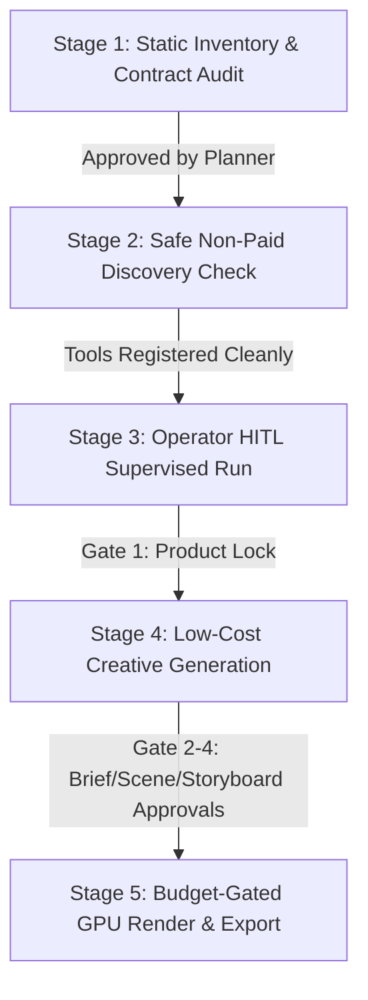

# Product-To-Video Production Pipeline: Architecture & Operator Runbook

## 1. Overview
The Product Intelligence to Video Factory (PI-to-VF) pipeline orchestrates automated video generation from initial product links (such as TikTok Shop, Amazon, or Shopify PDPs) to finished high-definition export formats.

The pipeline traverses a deterministic **14-state workflow** protected by **5 Human-In-The-Loop (HITL) approval gates**, robust budget controls, and full crash-restart recovery.

---

## 2. 14-State Workflow & 5 HITL Approval Matrix

| Step | Workflow State | State Type | Action / Trigger | Human In The Loop (HITL) Gate |
|---|---|---|---|---|
| 1 | `idle` | Initial | Pipeline initialized via PDP URL | - |
| 2 | `researching` | Automated | Market & PDP research | - |
| 3 | `AwaitingProductLock` | HITL Gate 1 | Pauses for product attributes lock | **Web Portal Approval** |
| 4 | `building_resource_pack` | Automated | Compiles assets & scenes | - |
| 5 | `creating_brief` | Automated | Generates creative brief ($5 budget) | - |
| 6 | `AwaitingBriefApproval` | HITL Gate 2 | Pauses for script & angle approval | **CLI / Chat Approval** |
| 7 | `creating_scene_plan` | Automated | Decomposes script into scenes ($5 budget) | - |
| 8 | `AwaitingSceneApproval` | HITL Gate 3 | Pauses for scene layout review | **Web Portal Approval** |
| 9 | `creating_storyboard` | Automated | Generates storyboard frames ($10 budget) | - |
| 10 | `AwaitingStoryboardApproval` | HITL Gate 4 | Pauses for frame approval | **Telegram Channel Approval** |
| 11 | `rendering` | Automated | GPU video rendering ($50 budget) | - |
| 12 | `AwaitingFinalApproval` | HITL Gate 5 | Pauses for final video review | **Telegram Channel Approval** |
| 13 | `exporting` | Automated | Encoding to MP4 specs ($20 budget) | - |
| 14 | `completed` | Terminal | Artifact delivered (Total cost: $90) | - |

---

## 3. Safety Guarantees & Gate 5 Invariants

1. **Zero Live Network Calls in Tests**:
   - All tests run against deterministic local in-memory providers (`ProductIntelligenceClient` and `VideoFactoryClient`). No paid live LLM/GPU APIs are called during test execution.
2. **Strict HITL Gate Protection**:
   - In any of the 5 `Awaiting*` states, the handler enforces `0 client calls` and `0 budget reserved`, returning `HITL_APPROVAL_REQUIRED` until an explicit human approval command transitions the state.
3. **Optimistic Concurrency & Version Invalidation**:
   - Modifying upstream assets increments the aggregate version. Stale approvals or outdated jobs referencing older versions are rejected immediately with `VERSION_CONFLICT`.
4. **Budget Reservation & Failure Release**:
   - Budgets are reserved prior to any paid GPU/generation calls and committed upon success. If a provider fails, the allocated budget is safely released back to the channel pool.
5. **Durable Crash-Restart Recovery**:
   - Workflow state and command execution history are persisted in SQLite. When workers crash, restart, or failover, pipelines resume exactly from the persisted state without duplicate paid side-effects across all 12 awaiting and executing states.

---

## 4. Verification Path Reconciliation
The current Gate 5 test suites are organized as follows:
- **Product Video E2E & Recovery**: `tests/hermes_personal/product_video/test_product_to_video_e2e.py`, `test_restart_recovery.py`, `test_handlers.py`, `test_job_handlers.py`, `test_capabilities.py`, `test_binding.py`.
- **Legacy Migration & Reconciliation**: `tests/hermes_personal/migration/test_reconciliation.py`.
- **Gate 4 Workflow & Job Engines**: `tests/hermes_personal/workflows/test_workflow_engine.py`, `test_repository.py`, `test_budgets.py`, `test_jobs.py`, `test_approvals.py`, `test_recovery.py`.
- **Capability Catalog & Policy**: `tests/hermes_personal/capabilities/`.

### Complete Verification Command:
```bash
uv run pytest tests/hermes_personal/product_video tests/hermes_personal/migration tests/hermes_personal/workflows tests/hermes_personal/capabilities -q
```

---

## 5. Single-Machine Operator Runbook & Execution

### Minimum Configuration & Prerequisites
- Environment setting: `HERMES_HOME` pointing to runtime directory (default `~/.hermes`).
- SQLite storage: persistent database at `$env:HERMES_HOME/hermes.db`.
- Default budget policy: initialized via `init_default_engine(BudgetPolicy(max_total=1000, per_channel={"video_factory": 500, "product_intelligence": 500}))`.

### Starting the Pipeline Producer & Worker
1. **User Entry Point (`POST /api/operator/command`)**:
   ```bash
   curl -X POST http://127.0.0.1:8642/api/operator/command \
     -H "Authorization: Bearer $HERMES_API_KEY" \
     -H "Content-Type: application/json" \
     -d '{
       "owner_id": "local-owner",
       "command_type": "start_workflow",
       "target_id": "wf_prod_01",
       "expected_version": 0,
       "payload": {
         "product_name": "TikTok Wireless Earbuds",
         "keywords": ["bluetooth", "anc"],
         "pdp_url": "https://shop.tiktok.com/view/product/17294829104"
       }
     }'
   ```
2. **Durable Worker Process**:
   ```powershell
   # Explicit fake mode for offline verification
   $env:HERMES_PROVIDER_MODE = "fake"
   uv run python -m hermes_personal.workflows.worker --db-path ~/.hermes/hermes.db --poll-interval 1.0
   ```
   The `durable_worker` process automatically binds `job.dispatch` topic handlers to `ProductVideoJobHandlers` via `create_product_video_topic_handlers`.

### Operator Approval, Status Inspection & Progression
- **Check Workflow Status & Artifacts**:
  ```bash
  curl http://127.0.0.1:8642/api/artifacts/{artifact_id}?owner_id=local-owner
  ```
- **Data Progression Chain & HITL Approvals**:
  - `start_workflow` -> `product_video.research` -> HITL `AwaitingProductLock`
  - `approve` `AwaitingProductLock` -> `product_video.resource_pack` -> `product_video.lock` -> `product_video.creative_brief` -> HITL `AwaitingBriefApproval`
  - `approve` `AwaitingBriefApproval` -> `product_video.scene_plan` -> HITL `AwaitingSceneApproval`
  - `approve` `AwaitingSceneApproval` -> `product_video.storyboard` -> HITL `AwaitingStoryboardApproval`
  - `approve` `AwaitingStoryboardApproval` -> `product_video.render` -> HITL `AwaitingFinalApproval`
  - `approve` `AwaitingFinalApproval` -> `product_video.export` -> `COMPLETED`
- **Operator HITL Approval & Workflow Progression (`POST /api/operator/command`)**:
  ```bash
  curl -X POST http://127.0.0.1:8642/api/operator/command \
    -H "Authorization: Bearer $HERMES_API_KEY" \
    -H "Content-Type: application/json" \
    -d '{
      "owner_id": "local-owner",
      "command_type": "approve",
      "target_id": "req_approval_id_or_wf_id",
      "expected_version": 1
    }'
  ```
  `approve` validates approval request state, verifies `expected_version`, marks request `APPROVED`, validates state transition via `transition()`, enqueues the next outbox job, and commits atomically in SQLite.

### MCP Tool & Live Provider Resolution Matrix

| Workflow Stage | Job Name | Live Adapter | Dispatched MCP / Local Wire Tool | Fallback / Behavior in `provider_mode="configured"` |
|---|---|---|---|---|
| 1. Market Research | `product_video.research` | `MCPProductIntelligenceAdapter` | `mcp__product_intelligence__research_product` / `product_intelligence_research` / `web_search` | Fails closed with `MISSING_PROVIDER_CONFIG` |
| 2. Resource Pack Draft | `product_video.resource_pack` | `MCPProductIntelligenceAdapter` | `mcp__product_intelligence__build_resource_pack` / `product_intelligence_build_resource_pack` | Uses deterministic build if tool unmapped |
| 3. Lock Resource Pack | `product_video.lock` | `MCPProductIntelligenceAdapter` | `mcp__product_intelligence__lock_resource_pack` / `product_intelligence_lock_resource_pack` | Uses deterministic lock if tool unmapped |
| 4. Creative Brief | `product_video.creative_brief` | `MCPVideoFactoryAdapter` | `mcp__video_factory__create_brief` / `video_factory_create_brief` | Fails closed with `MISSING_PROVIDER_CONFIG` |
| 5. Scene Plan | `product_video.scene_plan` | `MCPVideoFactoryAdapter` | `mcp__video_factory__create_scene_plan` / `video_factory_create_scene_plan` | Fails closed with `MISSING_PROVIDER_CONFIG` |
| 6. Storyboard | `product_video.storyboard` | `MCPVideoFactoryAdapter` | `mcp__video_factory__create_storyboard` / `video_factory_create_storyboard` | Fails closed with `MISSING_PROVIDER_CONFIG` |
| 7. GPU Render | `product_video.render` | `MCPVideoFactoryAdapter` | `mcp__video_factory__render` / `video_factory_render` / `video_generate` | Polls `mcp__video_factory__get_job_status` if async; fails closed if unconfigured |
| 8. MP4 Export | `product_video.export` | `MCPVideoFactoryAdapter` | `mcp__video_factory__export` / `video_factory_export` | Fails closed with `MISSING_PROVIDER_CONFIG` |

---

### Sample Configuration Template (`config.yaml`) & Secrets

> [!NOTE]
> The configuration below is an **illustrative template**. Live execution requires deploying actual MCP server implementations providing the tools listed in the matrix above.

In `~/.hermes/config.yaml` (behavioral settings only; no secrets):
```yaml
# ~/.hermes/config.yaml (Template Example)
mcp_servers:
  product_intelligence:
    command: "python"
    args: ["-m", "my_mcp_servers.product_intelligence"]
    env:
      API_ENDPOINT: "https://api.product-intel.example.com/v1"
  video_factory:
    command: "python"
    args: ["-m", "my_mcp_servers.video_factory"]
    env:
      GPU_ENDPOINT: "https://gpu-render.example.com/v1"

# Provider mode for background worker: 'configured' (live MCP) or 'fake' (offline test)
provider_mode: "configured"
```

In `~/.hermes/.env` (credentials only; never committed to git):
```bash
# Credentials loaded into environment variables via load_hermes_dotenv()
HERMES_API_KEY=hermes_operator_secret_token_here
VIDEO_FACTORY_API_KEY=vf_live_secret_key_here
PRODUCT_INTELLIGENCE_API_KEY=pi_live_secret_key_here
```

---

### Verification Tiers & Readiness Status

1. **Adapter Implemented**:
   - `MCPProductIntelligenceAdapter` and `MCPVideoFactoryAdapter` implement canonical payload mapping, `_decode_mcp_output` parsing for text blocks, JSON result strings, and `structuredContent`, async job status polling, and fail-closed validation on empty or missing outputs.
2. **Runtime Integration Verified Offline**:
   - Full 9-stage data progression, 5 HITL gates, optimistic concurrency (`expected_version`), atomic SQLite transactions, outbox lease/claim/quarantine, monotonic deadline enforcement, heartbeat renewal, structured terminal error handling, and registered MCP wire tool mocks.
   - Tested and verified with 106 targeted tests without calling paid external APIs.
3. **Live Verified**:
   - Requires user to launch live MCP servers with external credentials and execute a complete real-world video generation.

---

## 6. MCP Setup Readiness & Staged Validation Plan (PERSONAL_HAPPY_PATH_V1)

### 6.1 Concrete Required Tool Inventory & Stage Contracts

| Stage | Canonical Tool Name | Expected Input Shape | Expected Output Shape | Sync / Async Polling | Cost / Paid Operation | HITL Gate Gated |
|---|---|---|---|---|---|---|
| 1. Market Research | `mcp__product_intelligence__research_product` | `{"product_id": str, ...}` | `{"report": str/dict, "brief_config": dict}` | Sync | Free / Local | Pre-Gate 1 |
| 2. Resource Pack Draft | `mcp__product_intelligence__build_resource_pack` | `{"product_id": str, "research_data": dict}` | `{"resource_pack": dict, "assets": list}` | Sync | Free / Local | Pre-Gate 1 |
| 3. Lock Resource Pack | `mcp__product_intelligence__lock_resource_pack` | `{"resource_pack": dict, ...}` | `{"status": "locked", "resource_pack_id": str}` | Sync | Free / Local | **Gate 1 (ProductLock)** |
| 4. Creative Brief | `mcp__video_factory__create_brief` | `{"product_id": str, "brief_config": dict}` | `{"brief_id": str, "script": str, ...}` | Sync | Free / Low-cost LLM ($5 max) | **Gate 2 (Brief)** |
| 5. Scene Plan | `mcp__video_factory__create_scene_plan` | `{"brief_id": str, ...}` | `{"scene_plan_id": str, "scenes": list}` | Sync | Free / Low-cost LLM ($5 max) | **Gate 3 (ScenePlan)** |
| 6. Storyboard | `mcp__video_factory__create_storyboard` | `{"scene_plan_id": str, ...}` | `{"storyboard_id": str, "frames": list}` | Sync | Free / Image Gen ($10 max) | **Gate 4 (Storyboard)** |
| 7. GPU Render | `mcp__video_factory__render` | `{"storyboard_id": str, "render_params": dict}` | `{"status": "pending", "job_id": str}` | **Async (polls `get_job_status`)** | **Paid GPU ($50 reserved)** | **Gate 5 (Final Video)** |
| 7b. Render Status Poll | `mcp__video_factory__get_job_status` | `{"job_id": str}` | `{"status": "completed", "video_url": str}` | Sync (polled at interval) | Included in Render | Pre-Gate 5 |
| 8. MP4 Export | `mcp__video_factory__export` | `{"render_id": str, "export_params": dict}` | `{"status": "completed", "final_video_url": str}` | Sync or Async | **Paid Encoding ($20 reserved)** | Post-Gate 5 Terminal |

> [!NOTE]
> Registered tool names above represent canonical naming (`mcp__{server_name}__{tool_name}`). If an existing local server registers under a different server key (e.g. `hermes_video_factory` instead of `video_factory`), configure alias mapping in `wire_tools` or align the `mcp_servers` key in `config.yaml`.

### 6.2 Local Setup Inspection & Verified Environment Facts

- **Hermes Home Resolution**: Platform-native path is `%LOCALAPPDATA%\hermes` (Windows) or `~/.hermes` (macOS/Linux).
- **Configuration File**: `%LOCALAPPDATA%\hermes\config.yaml` is parsed and contains:
  - `mcp_servers.product_intelligence` (Configured: Python module `product_scout.mcp_server` under `D:\work\Personal\Product-Intelligence`).
  - `mcp_servers.hermes_video_factory` (Configured: Python module `mcp_servers.video_factory.server` under `D:\work\hermes-agent`).
- **Secret Management**: Stored locally in `%LOCALAPPDATA%\hermes\.env` or `~/.hermes/.env` (never committed to version control, loaded via `load_hermes_dotenv()`).

### 6.3 Staged Operator Validation Plan with Clear Stop Gates



1. **Stage 1 (Static Readiness - Completed)**:
   - Verify tool schemas, input/output decoders, error taxonomy, and fail-closed behavior via offline unit/mock test suites.
   - Zero external network requests or paid token consumption.
2. **Stage 2 (Non-Paid Tool Discovery & Liveness Probe - Next Step)**:
   - Run safe discovery probe (`tools.mcp_tool.discover_mcp_tools()`) to verify both MCP child processes launch cleanly via stdio and register expected tool names without invoking tool bodies.
   - Stop Gate: If discovery fails or expected tool names are missing, halt without starting background worker.
3. **Stage 3 (Operator-Supervised Workflow Execution)**:
   - Initiate workflow via `POST /api/operator/command` (`start_workflow`).
   - Stop Gate: Require human review and approval at each of the 5 HITL gates (`AwaitingProductLock`, `AwaitingBriefApproval`, `AwaitingSceneApproval`, `AwaitingStoryboardApproval`, `AwaitingFinalApproval`).
   - Stop Gate: Hard budget cap enforced by SQLite `BudgetEngine` ($90 total max, $50 render max) before any GPU render call.

### 6.4 Missing User Inputs Checklist Before Live Execution

To proceed from Static Readiness to Live Execution, confirm the following inputs:
1. **Server Key Alignment**: Confirm whether `video_factory` should be aliased to `hermes_video_factory` in `config.yaml` or if tool mapping `wire_tools` should be used.
2. **Local Credential Presence**: Ensure all required third-party API keys (e.g. AI provider / video generation credentials) are populated in `%LOCALAPPDATA%\hermes\.env` or `~/.hermes/.env` (do NOT share in chat).
3. **Explicit Live Execution Authorization**: Explicit operator confirmation authorizing live external provider calls and confirming the spending budget limit prior to starting the pipeline.

---

### Starting the Live Worker

```powershell
# Run durable background worker in live configured mode
uv run python -m hermes_personal.workflows.worker --db-path ~/.hermes/hermes.db --poll-interval 1.0 --provider-mode configured
```

---

## 7. Current Static MCP Readiness Evidence

This section records bounded static-readiness facts from source/config inspection only. No live discovery, provider calls, runtime execution, or secret values are included.

### 7.1 Verified Setup Facts

- Canonical `HERMES_HOME` resolution follows `get_hermes_home()`: `HERMES_HOME` env override → platform-native default (`~/.hermes` on POSIX, `%LOCALAPPDATA%\hermes` on Windows).
- Effective local config path is `$HERMES_HOME/config.yaml`. This inspection found config at `C:\Users\ninak\AppData\Local\hermes\config.yaml`.
- Local `.env` exists at the same `HERMES_HOME`.
- `mcp_servers` section contains 6 configured stdio servers; no `url` transport entries observed in inspected config.
- Observed video-related server keys: `hermes_video_factory`, `hermes_video`. Observed Product Intelligence key: `product_intelligence`.
- Configured server executables resolve to existing interpreter paths on this machine. Module targets are present in config as `-m` args. Importability or successful startup is not verified.
- Current `runtime.provider_mode`: not set in inspected config. Its absence means worker runtime must resolve from env/default explicitly; do not assume `configured`.
- Current `runtime.enable_mcp`: not set in inspected config.

### 7.2 Source-Grounded Tool Inventory and Contracts

These names and contracts are observed in repo source, not from live MCP discovery:

- Product Intelligence canonical tools: `mcp__product_intelligence__research_product`, `mcp__product_intelligence__build_resource_pack`, `mcp__product_intelligence__lock_resource_pack`. Accepted aliases include `product_intelligence_*`.
- Video Factory canonical tools: `mcp__video_factory__create_brief`, `mcp__video_factory__create_scene_plan`, `mcp__video_factory__create_storyboard`, `mcp__video_factory__render`, `mcp__video_factory__export`, `mcp__video_factory__get_job_status`. Accepted aliases include `video_factory_*` and `video_generate`.
- Input/output decoding accepts text blocks, JSON strings, and `structuredContent`; empty responses fail closed.
- `render` and `export` support async polling when the provider returns pending/processing/in_progress/queued with a `job_id`. In that case status polling is required; otherwise the adapter fails closed with `MISSING_POLLING_TOOL`.

### 7.3 Unresolved Inputs Requiring Operator Confirmation

- Server key alignment: confirm whether `video_factory` or `hermes_video_factory` is the intended Video Factory key for MCP wiring and alias mapping.
- Confirm `product_intelligence` is the intended live source for Product Intelligence stages, and that it exposes the expected tool names above.
- Credentials: confirm required secrets are present in local `.env` via the secret mechanism only. Do not provide values in chat/logs. Required credential names are not enumerated in repo source; confirm them with the user or server documentation.
- Explicit authorization and spending cap: no live generation/render/export/publish should start without operator approval and a confirmed budget limit.

### 7.4 Staged Validation Plan

1. **Static Contract Check**
   - Verify required tool names and aliases against actual server registration.
   - Stop Gate: mismatch or missing required tools → halt before worker startup.
2. **Safe Non-Paid Discovery**
   - Use reviewed safe discovery command to confirm tool registration without invoking tool bodies.
   - Stop Gate: discovery failure, missing tools, or startup errors → halt.
3. **Operator-Supervised Live Run**
   - Start worker only after explicit operator authorization.
   - Stop Gate: require human review at each HITL gate.
   - Stop Gate: enforce SQLite budget reservation before render/export.
