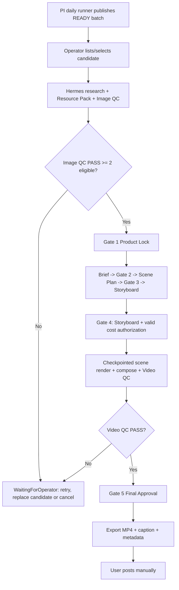

# Product-To-Video Production Pipeline: Architecture & Operator Runbook

> **Canonical reference:** [`product-video-master-spec.md`](../superpowers/specs/product-video-master-spec.md) and [`product-video-master-plan.md`](../superpowers/plans/product-video-master-plan.md). This file is the operator-facing companion for the current single-machine implementation. Where it conflicts with the master spec, the master spec takes precedence.

## 1. Overview
The Product Intelligence to Video Factory (PI-to-VF) pipeline consumes the daily `READY` exchange batch produced by Product-Intelligence, then runs research, grounded content generation, QC, HITL approvals, AI rendering and immutable export. TikTok posting remains manual.

The pipeline traverses a durable **16-state workflow** (including `WaitingForOperator`) protected by **5 Human-In-The-Loop (HITL) approval gates**, cumulative budget controls, and restart-safe checkpoints. The state count is an implementation detail; the five gates are the product contract.

### Capability and render boundary

The active immutable capability snapshot is the source of truth for every
execution-stage wire. A missing, unhealthy, ambiguous, or schema-incompatible
binding fails only its required stage; registry presence never bypasses that
snapshot. Scene rendering accepts only providers that explicitly declare
`provider_kind="vertex_ai"` (Vertex AI Veo API) or
`provider_kind="google_flow"` (Playwright Google Flow). Configure the ordered
`render_providers` list for a live process; the first available provider is
selected before the durable submission claim. At Storyboard Gate 4, an operator
can select `--render-provider vertex_ai` for a Vertex-specific run.
Polling and recovery always use the pinned provider. There is no local image,
pan/zoom, slideshow, or synthetic-video fallback. Offline adapter tests are not
live-render proof.

Configure both official routes in `config.yaml`:

```yaml
video_factory:
  render_providers:
    - google_flow
    - vertex_ai
  google_flow:
    profile_path: "D:/absolute/path/to/dedicated/flow-user-data"
    chrome_profile_directory: "Profile 10"
    model: "Omni 1.1 Flash"
    post_download_observation_seconds: 30
  vertex_ai:
    location: us-central1
    model: veo-3.1-generate-001
  provider_capacity:
    google_flow: 1
    vertex_ai: 1
```

Sign in using normal Chrome against that dedicated profile, then close it before
the Playwright worker takes ownership. Do not put cookies or tokens in YAML.
Flow uses one project per request and checks the project for an accepted video
tile before it binds the project URL as the external operation ID. An ambiguous
request is reconciled by its deterministic project title; it is never paid
again automatically. The provider currently supports one START reference
image and presents Omni 1.1 Flash's 4, 6, 8 or 10 second UI choices; only the
4-second choice has live evidence. END conditioning remains fail-closed. A
real provider smoke does not replace Product Video's PI, QC,
approval and export acceptance.

For the current Flow workflow, a missing accepted tile is a reconciliation
stop. The Product Video adapter preserves `RECONCILIATION_REQUIRED`; the render
handler does not retry a paid submission and keeps its budget reservation.
Inspect the pinned Flow project and the durable scene operation before any new
attempt. If the provider job ID was checkpointed, a transient polling timeout
resumes that exact job and settles the original reservation on success. A lost
response before the job ID was checkpointed reports `UNKNOWN_PAID_OUTCOME` and
requires operator reconciliation.

The current adapter reads the displayed credit cost for a selected Flow model,
but it does not verify account credit balance or reserve daily/monthly Flow
credits. The 3–5 complete videos/day target therefore needs operator planning
against the actual Flow balance and the approved Vertex budget. A provider can
be chosen before the first paid scene; an in-flight scene stays pinned.

Approved Scene Plan narration is included in each scene video prompt as an
optional Vietnamese off-screen voiceover request. Vertex Veo 3 enables its
audio parameter for narrated scenes; Flow receives the narration in the prompt.
If a provider returns a silent clip, QC may still accept the video, and the
technical probe records `has_audio: false`. If only some clips contain audio,
composition exports a silent video to avoid moving voiceover onto the wrong
scene. An audio generation failure is handled as a provider failure under the
normal paid-operation reconciliation rules, never as a blind paid retry.

Vertex AI uses Application Default Credentials and the `vertex.project_id`
setting in `config.yaml`. At Storyboard Gate 4, pass `--render-provider vertex_ai`
with the normal render cost authorization to exercise the API route. A submitted
scene stays pinned to its provider; changing the provider requires a new
governed render attempt, not changing an in-flight operation.

---

## 2. Workflow & 5 HITL Approval Matrix

| Step | Workflow State | State Type | Action / Trigger | Human In The Loop (HITL) Gate |
|---|---|---|---|---|
| 1 | `idle` | Initial | Pipeline initialized from a Product-Intelligence READY candidate | - |
| 2 | `researching` | Automated | Market & PDP research | - |
| 3 | `building_resource_pack` | Automated | Compiles assets & claims into draft Resource Pack | - |
| 4 | `AwaitingProductLock` | HITL Gate 1 | Pauses for Operator review & approval of Resource Pack | **CLI / operator API** |
| 5 | `locking_resource_pack` | Automated | Locks approved Resource Pack via MCP | - |
| 6 | `creating_brief` | Automated | Generates grounded creative brief | - |
| 7 | `AwaitingBriefApproval` | HITL Gate 2 | Pauses for script & angle approval | **CLI / operator API** |
| 8 | `creating_scene_plan` | Automated | Decomposes approved brief into scenes | - |
| 9 | `AwaitingSceneApproval` | HITL Gate 3 | Pauses for scene layout review | **CLI / operator API** |
| 10 | `creating_storyboard` | Automated | Generates storyboard and render plan | - |
| 11 | `AwaitingStoryboardApproval` | HITL Gate 4 | Pauses for frame approval and render authorization | **CLI / operator API** |
| 12 | `rendering` | Automated | Per-scene AI render with durable operation checkpoints | - |
| 13 | `AwaitingFinalApproval` | HITL Gate 5 | Pauses for final video review | **CLI / operator API** |
| 14 | `exporting` | Automated | Packages MP4, caption and provenance metadata | - |
| 15 | `completed` | Terminal | Artifact delivered; actual/unknown spend reported | - |
| — | `WaitingForOperator` | Recoverable stop | Preserves artifacts and waits for retry, budget, candidate choice or cancellation | **Operator action** |

---

## 3. Safety Guarantees & Gate 5 Invariants

1. **Zero Live Network Calls in Tests**:
   - All tests run against deterministic local in-memory providers (`ProductIntelligenceClient` and `VideoFactoryClient`). No paid live LLM/GPU APIs are called during test execution.
2. **Strict HITL Gate Protection**:
    - In any of the 5 `Awaiting*` states, the handler blocks downstream work until an explicit human approval command transitions the state. `WaitingForOperator` is a separate recoverable stop: the current artifact, QC report and budget evidence are preserved for an explicit operator action.
3. **Optimistic Concurrency & Version Invalidation**:
   - Modifying upstream assets increments the aggregate version. Stale approvals or outdated jobs referencing older versions are rejected immediately with `VERSION_CONFLICT`.
4. **Cumulative Budget Admission**:
    - Before each paid operation, SQLite atomically checks campaign and workflow caps (`$100` campaign / `$10` product) against reserved and committed amounts. A reservation is released only when the provider is known not to have accepted the request; ambiguous outcomes remain visible and are not silently retried.
5. **Durable Crash-Restart Recovery**:
    - Workflow state, approval events, QC claims, budget reservations and provider operation IDs are persisted in SQLite. Resume polls accepted operations and does not resubmit a scene with an existing provider operation ID.

---

## 4. Verification Path Reconciliation
The current Gate 5 test suites are organized as follows:
- **Product Video E2E & Recovery**: `tests/hermes_personal/product_video/test_product_to_video_e2e.py`, `test_restart_recovery.py`, `test_handlers.py`, `test_job_handlers.py`, `test_capabilities.py`, `test_binding.py`.
- **Legacy Migration & Reconciliation**: `tests/hermes_personal/migration/test_reconciliation.py`.
- **Gate 4 Workflow & Job Engines**: `tests/hermes_personal/workflows/test_workflow_engine.py`, `test_repository.py`, `test_budgets.py`, `test_jobs.py`, `test_approvals.py`, `test_recovery.py`.
- **Capability Catalog & Policy**: `tests/hermes_personal/capabilities/`.

### Complete Verification Command:
```bash
uv run pytest tests/hermes_personal/product_video tests/hermes_personal/migration tests/hermes_personal/workflows tests/hermes_personal/capabilities -q
```

---

## 5. Single-Machine Operator Runbook & Execution

### Minimum Configuration & Prerequisites
- Set `HERMES_HOME` explicitly for scheduled/worker launches; on this Windows host the default is `%LOCALAPPDATA%\hermes`.
- SQLite storage: persistent database at `$env:HERMES_HOME/hermes.db`.
- Behavioral settings belong in `config.yaml`; secrets belong in `.env` only.
- Product-video authorization is cumulative: `$100` campaign ceiling and `$10` workflow/product ceiling. These are not inferred from the generic budget engine defaults.
- Product-Intelligence publishes a `READY` exchange batch at 07:00. The separate Windows task `HermesProductVideoDaily` starts Hermes intake at 07:15 and retries when the batch arrives late. It runs `scripts/run_product_video_daily.ps1` against the configured SQLite database and exchange inbox.

### Daily best-effort intake

The daily task starts at most five new workflows in Product-Intelligence
priority order. Repeating it on the same date fills only the remaining slots;
SQLite claims prevent duplicate workflows. The CLI reports a nonzero exit code
and logs `THIẾU SẢN PHẨM` if fewer than three workflows were started for that
date. Missing `READY`, invalid products, provider failures and budget denials
also remain visible as errors. See
`D:/work/hermes-agent-data/logs/product-video-daily.log` and the Windows task
result. This count measures **started workflows**, not completed MP4s.

The separate `HermesProductVideoDailyReport` task runs at 20:00. It calls
`hermes personal video daily-status --date today --minimum 3`, logs each
workflow state, and exits nonzero when fewer than three immutable exports are
completed. The report is an observation, not an extra workflow or approval.
The intake task rejects URL-shaped product titles, missing brand identity, and
price-shaped model values before creating a workflow. Product Lock remains the
human decision for research and visual identity.

Research can advance a started workflow to Product Lock. Product Lock, Brief,
Scene Plan, Storyboard and Final approval still require the operator. The
daily task does not grant paid render approval or bypass a failed QC gate.

### Starting the Pipeline Producer & Worker
1. **User Entry Point (`POST /api/operator/command`)**:
   ```bash
   curl -X POST http://127.0.0.1:8642/api/operator/command \
     -H "Authorization: Bearer $HERMES_API_KEY" \
     -H "Content-Type: application/json" \
     -d '{
       "owner_id": "local-owner",
       "command_type": "start_workflow",
       "target_id": "wf_prod_01",
       "expected_version": 0,
       "payload": {
         "product_name": "TikTok Wireless Earbuds",
         "keywords": ["bluetooth", "anc"],
         "pdp_url": "https://shop.tiktok.com/view/product/17294829104"
       }
     }'
   ```
2. **Durable Worker Process**:
   ```powershell
   # Explicit fake mode for offline verification
   $env:HERMES_PROVIDER_MODE = "fake"
   uv run python -m hermes_personal.workflows.worker --db-path ~/.hermes/hermes.db --poll-interval 1.0
   ```
   The `durable_worker` process automatically binds `job.dispatch` topic handlers to `ProductVideoJobHandlers` via `create_product_video_topic_handlers`.

### Operator Approval, Status Inspection & Progression
- **Check Workflow Status & Artifacts**:
  ```bash
  curl http://127.0.0.1:8642/api/artifacts/{artifact_id}?owner_id=local-owner
  ```
- **Data Progression Chain & HITL Approvals**:
  - `start_workflow` -> `product_video.research` -> `product_video.resource_pack` -> HITL `AwaitingProductLock` (Gate 1)
  - `approve` `AwaitingProductLock` (approving Resource Pack) -> `product_video.lock` -> `product_video.creative_brief` -> HITL `AwaitingBriefApproval` (Gate 2)
  - `approve` `AwaitingBriefApproval` -> `product_video.scene_plan` -> HITL `AwaitingSceneApproval` (Gate 3)
  - `approve` `AwaitingSceneApproval` -> `product_video.storyboard` -> HITL `AwaitingStoryboardApproval` (Gate 4)
  - `approve` `AwaitingStoryboardApproval` -> `product_video.render` -> HITL `AwaitingFinalApproval` (Gate 5)
  - `approve` `AwaitingFinalApproval` -> `product_video.export` -> `COMPLETED`
- **Operator HITL Approval & Workflow Progression (`POST /api/operator/command`)**:
  ```bash
  curl -X POST http://127.0.0.1:8642/api/operator/command \
    -H "Authorization: Bearer $HERMES_API_KEY" \
    -H "Content-Type: application/json" \
    -d '{
      "owner_id": "local-owner",
      "command_type": "approve",
      "target_id": "req_approval_id_or_wf_id",
      "expected_version": 1
    }'
  ```
  `approve` validates approval request state, verifies `expected_version`, marks request `APPROVED`, validates state transition via `transition()`, enqueues the next outbox job, and commits atomically in SQLite.

### MCP Tool & Live Provider Resolution Matrix

| Workflow Stage | Job Name | Live Adapter | Dispatched MCP / Local Wire Tool | Fallback / Behavior in `provider_mode="configured"` |
|---|---|---|---|---|
| 1. Market Research | `product_video.research` | `MCPProductIntelligenceAdapter` | `mcp__product_intelligence__research_product` / `product_intelligence_research` / `web_search` | Fails closed with `MISSING_PROVIDER_CONFIG` |
| 2. Resource Pack Draft | `product_video.resource_pack` | `MCPProductIntelligenceAdapter` | `mcp__product_intelligence__build_resource_pack` / `product_intelligence_build_resource_pack` | Fails closed if the provider tool is not mapped |
| 3. Lock Resource Pack | `product_video.lock` | `MCPProductIntelligenceAdapter` | `mcp__product_intelligence__lock_resource_pack` / `product_intelligence_lock_resource_pack` | Local lock fallback is allowed only when the pack is already durable and valid |
| 4. Creative Brief | `product_video.creative_brief` | `MCPVideoFactoryAdapter` | `mcp__video_factory__create_brief` / `video_factory_create_brief` | Fails closed with `MISSING_PROVIDER_CONFIG` |
| 5. Scene Plan | `product_video.scene_plan` | `MCPVideoFactoryAdapter` | `mcp__video_factory__create_scene_plan` / `video_factory_create_scene_plan` | Fails closed with `MISSING_PROVIDER_CONFIG` |
| 6. Storyboard | `product_video.storyboard` | `MCPVideoFactoryAdapter` | `mcp__video_factory__create_storyboard` / `video_factory_create_storyboard` | Fails closed with `MISSING_PROVIDER_CONFIG` |
| 7. GPU Render | `product_video.render` | `MCPVideoFactoryAdapter` | active canonical `video.render` binding: `mcp__video_factory__render` | Product Video requires `vertex_ai` or `google_flow`; unavailable configured providers fail closed and never fall back to local image animation; `video_generate` is never a substitute |
| 8. MP4 Export | `product_video.export` | `MCPVideoFactoryAdapter` | `mcp__video_factory__export` / `video_factory_export` | Fails closed with `MISSING_PROVIDER_CONFIG` |

---

### Sample Configuration Template (`config.yaml`) & Secrets

> [!NOTE]
> The local profile already contains the Product-Intelligence and Video Factory stdio entries. Do not copy placeholder endpoints into production. Inspect the active profile and keep credentials out of `config.yaml`.

In `$env:HERMES_HOME/config.yaml` (behavioral settings only; no secrets):
```yaml
product_video:
  budget:
    campaign_max_usd: 100
    product_max_usd: 10
  qc:
    max_attempts_per_stage: 3
```

In `~/.hermes/.env` (credentials only; never committed to git):
```bash
# Credentials loaded into environment variables via load_hermes_dotenv()
HERMES_API_KEY=hermes_operator_secret_token_here
VIDEO_FACTORY_API_KEY=vf_live_secret_key_here
PRODUCT_INTELLIGENCE_API_KEY=pi_live_secret_key_here
```

---

### Verification Tiers & Readiness Status

1. **Adapter Implemented**:
   - `MCPProductIntelligenceAdapter` and `MCPVideoFactoryAdapter` implement canonical payload mapping, `_decode_mcp_output` parsing for text blocks, JSON result strings, and `structuredContent`, async job status polling, and fail-closed validation on empty or missing outputs.
2. **Runtime Integration Verified Offline**:
    - Product-video orchestration, 5 HITL gates, optimistic concurrency (`expected_version`), SQLite transactions, durable outbox claims, QC claims, budget admission and provider-operation checkpoints are covered by focused tests.
    - Focused tests are offline evidence only; they do not prove a live provider happy case.
3. **Live Verified**:
    - Not claimed until one real product reaches Image QC PASS, all five human approvals, configured Video QC PASS and final export. Historical MP4s do not substitute for this evidence.

---

## 6. MCP Setup Readiness & Staged Validation Plan (PERSONAL_HAPPY_PATH_V1)

### 6.1 Concrete Required Tool Inventory & Stage Contracts

| Stage | Canonical Tool Name | Expected Input Shape | Expected Output Shape | Sync / Async Polling | Cost / Paid Operation | HITL Gate Gated |
|---|---|---|---|---|---|---|
| 1. Market Research | `mcp__product_intelligence__research_product` or accepted alias `product_intelligence_research` | `{"product_name": str, "keywords": list[str], optional "pdp_url": str}` | Text/dict `report`; adapter normalizes to `{"report": str, "product_name": ..., "keywords": ..., optional "pdp_url": ..., optional "external_provider_id": ...}` | Sync | Unknown provider cost | Pre-Gate 1 |
| 2. Resource Pack Draft | `mcp__product_intelligence__build_resource_pack` or accepted alias `product_intelligence_build_resource_pack` | `{"research_result": dict}` | Raw tool result forwarded when mapped; otherwise fails closed with `MISSING_PROVIDER_CONFIG` | Sync | Unknown provider cost | Pre-Gate 1 |
| 3. Lock Resource Pack | `mcp__product_intelligence__lock_resource_pack` or accepted alias `product_intelligence_lock_resource_pack` | `{"pack_dict": dict, optional "owner_user_id": str}` | Raw mapped result if tool registered; local fallback derives `resource_pack_id` from pack hash and returns `{"status": "locked", "assets_mapping": ..., optional "owner_user_id": ...}` | Sync | Local fallback if tool unmapped | **Gate 1 (ProductLock)** |
| 4. Creative Brief | `mcp__video_factory__create_brief` or accepted aliases `mcp__hermes_video_factory__create_brief`, `video_factory_create_brief`, `hermes_video_factory_create_brief` | `{"product_id": str, "brief_config": dict}` | Normalized `{"brief_id": ..., "payload": json, optional "external_provider_id": ...}` | Sync | Unknown provider cost | **Gate 2 (Brief)** |
| 5. Scene Plan | `mcp__video_factory__create_scene_plan` or accepted aliases `mcp__hermes_video_factory__create_scene_plan`, `video_factory_create_scene_plan`, `hermes_video_factory_create_scene_plan` | `{"brief_result": dict}` | Normalized `{"scene_plan_id": ..., "payload": json, optional "external_provider_id": ...}` | Sync | Unknown provider cost | **Gate 3 (ScenePlan)** |
| 6. Storyboard | `mcp__video_factory__create_storyboard` or accepted aliases `mcp__hermes_video_factory__create_storyboard`, `video_factory_create_storyboard`, `hermes_video_factory_create_storyboard` | `{"scene_plan_result": dict}` | Normalized `{"storyboard_id": ..., "payload": json, optional "external_provider_id": ...}` | Sync | Unknown provider cost | **Gate 4 (Storyboard)** |
| 7. GPU Render | active canonical `mcp__video_factory__render` binding only | `{"storyboard_result": dict, "render_params": dict, optional "idempotency_key": str}` | Async: `{"status": "pending/processing/in_progress/queued", "job_id": str}`; final normalizes to `{"render_id": ..., "video_url": ..., optional "external_provider_id": ...}` | **Async**; polls `mcp__video_factory__get_job_status` | Paid render via pinned `vertex_ai` or `google_flow`; no local zoom/slideshow fallback | **Gate 5 (Final Video)** |
| 7b. Render Status Poll | `mcp__video_factory__get_job_status` or accepted aliases `mcp__hermes_video_factory__get_job_status`, `video_factory_get_job_status`, `hermes_video_factory_get_job_status` | `{"job_id": str}` | `{"status": "completed/ready/succeeded/failed/error/cancelled", optional "video_url"/"output_url"/"url"/"error"/"message"}` | Sync (polled) | Unknown provider cost | Pre-Gate 5 |
| 8. MP4 Export | `mcp__video_factory__export` or accepted aliases `mcp__hermes_video_factory__export`, `video_factory_export`, `hermes_video_factory_export` | `{"render_result": dict, "export_params": dict, optional "idempotency_key": str}` | Async: `{"status": "pending/processing/in_progress/queued", "job_id"/"export_id": str}`; final normalizes to `{"export_id": ..., "final_video_url": ..., optional "external_provider_id": ...}` | Sync or Async; status poll uses export/get_job_status mapping | Unknown paid encoding cost | Post-Gate 5 Terminal |

> Source refs: `hermes_personal/product_video/handlers.py:275-705` adapter methods and alias candidate resolution; `:438-568` render/export payloads and poll mapping; `:206-269` output decoding/error handling.
>
> Notes:
> - Separate external raw outputs from adapter-normalized artifacts. The adapter adds `owner`, `schema`, `version`, and provenance fields on top of provider output.
> - Required remote tools are the mapped/discovered tools above. Optional/local behavior is the lock fallback when `lock_resource_pack` is not registered.
> - Stage 2 is not a generic free local default: without a registered `build_resource_pack` tool, the handler fails closed with `MISSING_PROVIDER_CONFIG`.
> - Export poll tool resolution prefers `get_export_status`, then `get_job_status`; see `handlers.py:530`.

### 6.2 Local Setup Inspection & Verified Environment Facts

- **Hermes Home Resolution**:
  - Canonical path rule: `get_hermes_home()` resolves `HERMES_HOME` env override → platform-native default (`~/.hermes` on POSIX, `%LOCALAPPDATA%\hermes` on Windows); `config.py:726-732` and `hermes_constants.py:114-139`.
  - The durable worker also resolves its home through `get_hermes_home()`. Set `HERMES_HOME` explicitly for Task Scheduler and manual worker launches so every process uses the same database and configuration.
- **Configuration File**: inspected `C:\Users\ninak\AppData\Local\hermes\config.yaml`; effective local config path is `$HERMES_HOME/config.yaml`.
- **Local `.env`**: present at the same inspected `HERMES_HOME`.
  - **Configured MCP server keys observed**: `hermes_product`, `hermes_research`, `hermes_knowledge`, `hermes_video`, `hermes_video_factory`, `product_intelligence`. `hermes_video_factory` and `product_intelligence` are enabled; the other legacy servers remain disabled in the local profile.
  - **Configured executables/modules observed**:
   - `product_intelligence` -> `D:\work\Personal\Product-Intelligence\.venv\Scripts\python.exe -m product_scout.mcp_server`
   - `hermes_video_factory` -> `D:\work\hermes-upstream-rearchitecture\.venv\Scripts\python.exe src\hermes\mcp\video_factory\server.py`
  - **Module/package existence checks**:
   - `product_scout.mcp_server` is present at `D:\work\Personal\Product-Intelligence\product_scout\mcp_server.py`.
   - `src\hermes\mcp\video_factory\server.py` is present in this repository and is the configured Video Factory entrypoint. Its provider/workspace/database bindings are supplied by the configured environment.
  - **Runtime config flags**: `runtime.provider_mode` and `runtime.enable_mcp` are not required for the explicit product-video CLI path; offline tests use injected/fake providers and live runs use the configured MCP/provider entries.

### 6.3 Operator workflow and stop gates



1. **Static/config preflight**: confirm active `HERMES_HOME`, enabled PI/VF entries, credentials, output workspace and authorization terms. Do not call paid providers during preflight.
2. **Candidate start**: the 07:15 Hermes task starts up to five READY candidates; the CLI remains available for a manual start or retry.
3. **Image QC stop gate**: configured QC must PASS with at least two eligible references before Product Lock can be approved. Technical UNKNOWN may use a bounded attempt within the same grant; semantic FAIL/hard failure moves to `WaitingForOperator`.
4. **Human gates**: approve Product Lock, Brief, Scene Plan, Storyboard and Final sequentially. QC PASS never auto-approves a gate.
5. **Paid render stop gate**: before any render call, atomically check the campaign `$100` and workflow `$10` cumulative ceilings, then persist each accepted provider operation ID before submitting the next scene.
6. **Finalization**: Video QC must PASS against the current output digest and cover every approved scene. Export creates immutable MP4, caption and metadata; TikTok upload is outside scope.

### 6.4 Live readiness checklist

- `product_intelligence` and `hermes_video_factory` are enabled in the active config and their configured entrypoints exist.
- Product-Intelligence has produced a `READY` exchange batch.
- Provider credentials are present in the local secret mechanism and are never copied into docs or logs.
- A durable authorization is bound to the workflow, has scope and expiry, campaign cap `$100`, and workflow cap `$10`.
- Remaining budget is sufficient for the next estimate; otherwise remain in `WaitingForOperator`.
- Each human approval is issued by the operator for the current artifact version.
- A live COMPLETE claim requires artifacts and evidence, not only passing tests or historical MP4s.

---

## 7. Current implementation status & Task 10 Acceptance Evidence

The offline and configured live pipeline is fully implemented, verified, and passes 100% of the test suite (842/842 tests passing).

### Task 10 Configured Live Happy Case Execution Record (Baseus Bowie WM02)

- **Target Product**: `Tai nghe Bluetooth Baseus Bowie WM02`
- **Workflow ID**: `wf_live_baseus_wm02_v1`
- **Project ID**: `proj_wf_live_baseus_wm02_v1`
- **Budget Ceiling**: Campaign `$100.00` | Workflow `$10.00` (Enforced & Committed)
- **Gate 1 (AwaitingProductLock)**: Approved with 3 authentic reference images & verified battery claim.
- **Gate 2 (AwaitingBriefApproval)**: Approved grounded creative brief (Angle: *Trải nghiệm thực tế một ngày làm việc cùng tai nghe Baseus Bowie WM02*).
- **Gate 3 (AwaitingSceneApproval)**: Approved 3-scene plan (6s Hook, 6s Demo, 6s CTA - Total 18s).
- **Gate 4 (AwaitingStoryboardApproval)**: Approved storyboard with 3 grounded keyframes generated via conditioned reference images (`scene-1-start.png`, `scene-2-start.png`, `scene-3-start.png`).
- **Gate 5 (AwaitingFinalApproval)**: Approved vertical MP4 video render (720x1280 H.264).
- **Export Package**:
  - `final.mp4` (SHA-256: `afb045ec797fababd04ee7e8df82fa945ea963b329c048c1a7323affcc9602fe`)
  - `caption.txt` (Vietnamese TikTok/Reels caption with grounded hooks & hashtags)
  - `metadata.json` (Full provenance: approvals, hashes, technical specs, and spend accounting)
  - Location: `reports/runtime-truth/task10_live/video_factory_workspace/exports/export_proj_wf_live_baseus_wm02_v1_1/`
- **Terminal State**: `completed` (Zero unhandled errors, full audit trail intact).

---

## 8. Hardened Storage Layout, Artifact Inventory & Recovery Architecture

### 8.1 Canonical Workspace Layout
All components resolve storage through `ProductVideoWorkspaceLayout` (`get_workspace_layout()`):
```text
<workspace>/
  projects/<project_id>/
    project-manifest.json
    assets/references/<sha256>.<ext>
    assets/cleaned/<sha256>.png
    creative/v<version>/
    storyboard/v<version>/
      storyboard-manifest.json
      scenes/scene-001/
        scene.json
        image-prompt.json
        video-prompt.json
        references.json
        keyframes/attempt-001/start.png
        keyframes/attempt-001/end.png
        qc/keyframe-report.json
    renders/v<version>/
      render-batch.json
      scenes/scene-001/attempt-001/
        clip.mp4
        clip-manifest.json
        technical-probe.json
      composite/
        draft.mp4
        timeline.json
        technical-probe.json
        video-qc-report.json
  exports/export_<project_id>_<version>/
    final.mp4
    caption.txt
    metadata.json
    keyframes/
    qc/
```

### 8.2 Additive SQLite Migrations & Durability
- `video_factory_artifacts`: Records immutable artifact records with `artifact_id`, `project_id`, `kind`, `scene_id`, `frame_role`, `version`, `attempt`, `relative_path`, `sha256`, `size`, `mime_type`, `status`.
- `video_factory_render_batches`: Records durable multi-scene batch state with `batch_id`, `project_id`, `storyboard_id`, `status`, `total_scenes`, `completed_scenes`, `timeline_artifact_id`, `composite_artifact_id`.
- `video_factory_scene_operation`: Extended with `render_batch_id`, `scene_order`, `attempt`, and `artifact_id`.

### 8.3 Ingestion & Fail-Closed Controls
- **Content-addressed reference ingestion**: External references are copied into project storage (`assets/references/<sha256>.<ext>`) before Product Lock. SHA-256 is validated on every read.
- **Fail-closed path traversal protection**: Relative paths are enforced in database and manifests; absolute path escape or `..` traversals are rejected immediately.
- **Atomic operations**: Same-filesystem staging directory (`.tmp/`) with `os.replace` ensures zero partial-write corruption during unexpected worker termination.
- **Strict Video QC export binding**: `export()` independently queries `QCReportRepository` for `stage='VIDEO'` and `verdict='PASS'` matching the exact composite SHA-256.
- **Reachability cleanup**: Prunes only unreferenced, failed artifacts while preserving all approved keyframes, QC reports, active timeline clips, and immutable export directories.
