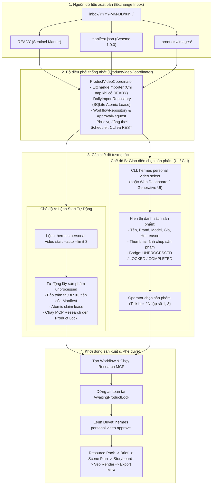

# Kế Hoạch Triển Khai & Đặc Tả Kỹ Thuật: Product Selection & Video Factory Auto-Start

**Mã tài liệu:** SPEC-PV-SELECTION-20260912  
**Phiên bản:** 2.0  
**Ngày cập nhật:** 2026-09-12  
**Mục tiêu:** Cung cấp hai cơ chế điều khiển cho Operator thông qua một đầu não điều phối duy nhất (`ProductVideoCoordinator`):  
1. **Lệnh `start --auto`**: Tự động nhận diện các sản phẩm mới chưa từng tạo video để bắt đầu chuỗi sản xuất theo đúng thứ tự ưu tiên của Manifest.  
2. **Giao diện lựa chọn (Interactive UI / CLI Selection)**: Đọc toàn bộ danh sách sản phẩm từ Exchange Inbox, hiển thị trực quan (kèm ảnh, giá, trạng thái sản xuất) để Operator tick chọn sản phẩm mong muốn trước khi tạo video.

---

## 1. Bối cảnh & Yêu cầu người dùng (User Requirements)

### 1.1. Hiện trạng
- Product-Intelligence tự động quét thị trường lúc 07:00 hằng ngày và đóng gói thành batch trao đổi bất biến tại `hermes-product-video-exchange/inbox/YYYY-MM-DD/run_<batch_id>/` kèm file tín hiệu `READY`.
- Hermes `ExchangeImporter` nạp manifest và validate hình ảnh, tên biến thể.
- `ProductVideoCoordinator` quản lý atomic lease/claim và khởi động workflow bền vững.
- `worker.py` thực hiện xong bước research MCP và dừng an toàn tại cổng `AwaitingProductLock`.

### 1.2. Các khả năng tương tác đã hoàn thiện
1. **Lệnh tương tác trực tiếp (`hermes personal video start`)**: Operator có thể gõ `start --auto --limit N` để tự động lọc và khởi động các sản phẩm chưa từng tạo video, bảo toàn thứ tự ưu tiên.
2. **Giao diện đọc danh sách & chọn thủ công (`list` / `select`)**: Operator nhìn thấy danh sách sản phẩm đã quét, xem ảnh, phân loại trạng thái (`unprocessed`, `invalid`, `awaiting_product_lock`, `in_production`, `completed`) và tự tay chọn sản phẩm để đưa vào sản xuất.
3. **Cơ chế duyệt cổng `AwaitingProductLock` (`approve`)**: Lệnh duyệt kích hoạt tuần tự bước downstream hợp lệ qua State Machine: `BUILDING_RESOURCE_PACK` $\rightarrow$ `CREATING_BRIEF` $\rightarrow$ `AwaitingBriefApproval`.

---

## 2. Kiến trúc giải pháp (Solution Architecture)



---

## 3. Đặc tả chi tiết từng thành phần

### 3.1. Bộ điều phối thống nhất (`ProductVideoCoordinator`)
- **Vị trí file:** `hermes_personal/product_video/automation/coordinator.py`
- **Nhiệm vụ:**
  1. `list_candidates(target_date, status_filter)`: Đọc manifest từ batch `READY` mới nhất, đối chiếu SQLite ledger (`daily_product_video_import`), trả về danh sách candidate có 5 trạng thái chuẩn hóa.
  2. `start_auto(limit)`: Lấy $N$ sản phẩm `unprocessed` đầu tiên theo đúng thứ tự ưu tiên của Manifest, đặt atomic lease trong SQLite transaction `BEGIN IMMEDIATE`, tạo workflow và chạy research worker.
  3. `start_selection(product_keys)`: Kiểm tra tính hợp lệ tại thời điểm ghi (write-time revalidation), bỏ qua candidate không tồn tại hoặc đã xử lý mà không làm gián đoạn cả batch.
  4. `approve_product_lock(target_id)`: Phê duyệt cổng an toàn, chuyển state machine sang `BUILDING_RESOURCE_PACK` và enqueue tác vụ kế tiếp vào Outbox.

### 3.2. Data Contract (Candidate Model)
```python
@dataclass(frozen=True)
class CandidateItem:
    priority: int
    source_date: str
    source_batch_id: str
    source_product_id: str
    canonical_product_key: str
    product_key: str
    name: str
    brand: str
    model: str
    variant: str | None
    price_display: str
    price_min: int | None
    price_max: int | None
    hot_reason: str
    key_features: str
    keywords: list[str]
    images: list[dict[str, Any]]
    status: str  # 'unprocessed' | 'invalid' | 'awaiting_product_lock' | 'in_production' | 'completed'
    internal_state: str
    rejection_reason: str | None = None
    workflow_id: str | None = None
    approval_id: str | None = None
    gate: str | None = None
```

### 3.3. Cây lệnh CLI chuẩn hóa (`hermes personal video`)
- `hermes personal video list [--status ...]`
- `hermes personal video start --auto [--limit N]`
- `hermes personal video select`
- `hermes personal video approve <id>`
- `hermes personal video status <workflow_id>`
