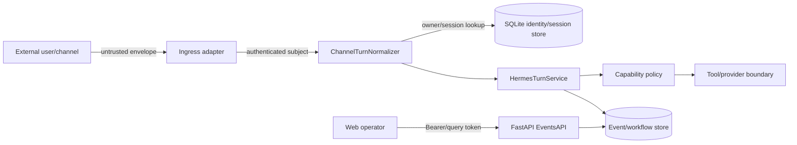

# Hermes Personal Security and Authentication

## Scope

This document narrows the repository-wide [security policy](../SECURITY.md) to
the `hermes_personal` bounded context. It records implemented controls and known
limitations; it is not a certification claim.

## Trust boundaries

External channel payloads, HTTP JSON, attachment URIs, capability arguments,
provider responses, persisted metadata, and replay cursors are untrusted.

## Identity and session authentication

Ingress adapters must authenticate their platform-specific subject before
normalization. The normalizer accepts the resulting `(channel,
external_subject)` and resolves it through `IdentityRepository`; it does not
trust caller-supplied `owner_user_id` or `session_id`.

Sessions are unique per owner, channel, and external conversation. A workflow
may continue on another channel only when an explicit `workflow_handoff` exists
and both sessions belong to the same owner.

## HTTP authentication

The application accepts a token either from `Authorization: Bearer <token>` or
the `auth_token` query/body field. The query token exists for current clients but
is discouraged because URLs are commonly logged.

Critical limitation: the default `EventsAPI` validator accepts any non-empty
token. Production composition must inject an `auth_validator(token, owner_id)`
that validates the credential, binds it to `owner_id`, enforces expiry and
revocation, and uses constant-time comparison where applicable. Until that
wiring exists, the default application factory is suitable for tests/local
integration only and must not be exposed to an untrusted network.

## Authorization model

Implemented authorization is owner- and policy-based:

- event replay filters by owner;
- artifact retrieval checks `artifact.owner_user_id == owner_id`;
- sessions and workflow handoffs enforce owner identity;
- capability policy checks principal mode, skill/workflow allowlists, health,
  schema version, approval status, budget, risk, and cost tier.

`PrincipalContext.roles` transports role metadata, but there is no complete RBAC
policy engine in this bounded context. Do not claim administrator/operator RBAC
until route- and capability-level role enforcement and tests are added.

## Secrets

Secrets belong in environment variables or the upstream Hermes secret store,
never in source, YAML committed to Git, command-line argv, events, workflow
payloads, or artifact metadata.

The runtime checks configured secret names for presence. Process topology also
rejects argv values that resemble common secret formats. Logging and
`CapabilityError` serialization use recursive redaction; new error paths must use
the same sanitizer.

Minimum production controls:

1. inject secrets at process start with least privilege;
2. restrict filesystem ACLs for database, artifacts, and logs;
3. rotate API and platform tokens without rebuilding images;
4. redact tokens before structured logging or telemetry export;
5. never return provider credentials in `details`, health responses, or failures;
6. disable query-string authentication when all clients support headers.

## Capability and provider access

All capability execution must pass the policy matrix before invocation.
High-risk, metered, or paid work requires the configured approval and budget
preconditions. Skills and workflows may only call declared capability IDs.

The product-intelligence and video-factory clients in this checkout are
deterministic local contracts. They do not perform paid provider calls and must
not be represented as production provider authentication.

## Attachments and artifacts

- Validate attachment kind, media type, size, URI scheme, and lowercase SHA-256
  when supplied.
- Resolve local paths beneath configured roots; reject path traversal and foreign
  owner references.
- Serve metadata only after owner authorization.
- Treat digests and versions as integrity metadata, not as authorization.
- Scan or sandbox active document/media content before external processing.

## Audit and observability

Security-relevant operations should retain principal, owner, session, turn,
workflow, command, approval, job, and event IDs. Audit events must record the
decision and policy reason without recording secret values or unnecessary user
content.

## Production security gate

Do not expose the application until all of these are true:

- a real HTTP auth validator is injected and tested for owner mismatch;
- TLS terminates at the service or a trusted reverse proxy;
- database/artifact/log ACLs are verified;
- required startup callbacks and dependency probes are wired;
- CORS and trusted-proxy behavior are explicitly configured;
- rate limits and request-size limits are enforced at the edge or application;
- `/api/turn` is mounted only with the same identity and idempotency controls;
- secret redaction and negative authorization tests pass.

