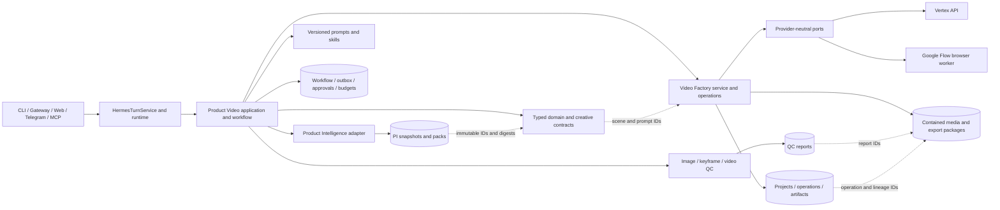

# Hermes / Product Video: Tech Lead Architecture Review

**Review date:** 2026-09-23  
**Scope:** Current working tree, including the recent uncommitted move/refactor. Source and exercised runtime paths take precedence over plans. No production code was changed for this review.  
**Decision:** The architecture has a sound core and is suitable for focused correction, but I would **not approve expansion of the configured production video path yet**. Close the provider, cross-store consistency, concurrency, grounding, and lineage gaps below first. There is no demonstrated P0 data-loss defect in this review.

# Executive Summary

Hermes Personal now has a recognizable split: channel-neutral `HermesTurnService`; Product Video application handlers and a durable workflow/outbox; Product Intelligence and Video Factory adapters; versioned creative contracts; provider ports; QC repositories; and content-addressed media with a validated export. Five operator approvals are enforced. Most of this should remain in place.

The implementation is not yet a reliably operable, fully traceable production line. The configured Google Flow adapter can report availability with Playwright installed yet has no wired browser session, so its default submission cannot complete. The creative storyboard path swallows a failed Video Factory write and can let the workflow advance with a missing factory storyboard. The dossier builder replaces claim-specific evidence with one global evidence list and hard-codes `mi.com` as the official source domain. Keyframe submission lacks a durable atomic claim, while Video Factory saves replace entire project rows without an expected-version check. Final export metadata proves the final bytes but omits important upstream lineage. These are targeted fixes, not reasons to rewrite the system.

**Judgment against the requested qualities:** coherent at the major-service boundary; maintainable if cross-store invariants are tightened; testable offline today; appropriate for the workflow and five approval gates; scalable across a few independent products through durable leases, but unproven for ten products, parallel scenes and a shared browser profile.

**Evidence standard:** Findings below identify code paths and line anchors. “Risk” means the code admits that outcome; it does not assert that it occurred in a production run. Tests use fake providers and local stores; no paid provider or live browser was exercised.

# Current Architecture

## Entry points, owners, and actual path

| Layer | Current owner and behavior |
| --- | --- |
| Hermes conversation | `hermes_personal/orchestration/turn_service.py` is the channel-neutral agent turn path. CLI, gateway, Web, Telegram and Omni are ingress surfaces, not separate Product Video brains. |
| Runtime composition | `hermes_personal/runtime/processes.py` supervises gateway, App API, optional MCP, workers, Telegram and Web; `runtime/gateway_server.py` exposes candidate, batch, status, asset and approval routes. `workflows/worker.py:23-137` resolves configured dependencies and dispatches work. |
| Product intake | `product_video/automation/importer.py:56-167` reads READY exchange manifests and identity/media; `automation/coordinator.py:285-500` claims a product and starts/advances a workflow. `candidate_service.py:50-105` selects this route in configured mode, while retaining a legacy source-root route. |
| Product Intelligence | `product_video/mcp_adapters.py:229-515` requests a persisted snapshot, builds a pack and locks it through the external PI MCP contract. `product_video/handlers.py:725-913` owns the workflow jobs. |
| Product Video application | `product_video/handlers.py` executes creative, storyboard, render, QC and export jobs and emits workflow events. `application/operator_handler.py:158-417` handles approvals and preconditions. |
| Workflow durability | `workflows/repository.py:28-120` stores versioned workflow aggregate/events/outbox atomically; `workflows/outbox_repository.py` and `outbox_dispatcher.py` lease/retry/quarantine delivery; `workflows/budgets.py` reserves paid spend. |
| Creative reasoning | `product_video/creative/contracts.py`, `generator.py`, `prompts.py`, `dossier.py`, `storyboard.py` and `validation.py` define V2 structured content, prompt schemas, generation, reference selection and grounding checks. |
| Video Factory | `integrations/video_factory/domain.py`, `service.py`, `repository.py`, `server.py`, `scene_renderer.py`, `keyframe_provider.py`, `composer.py`, `export_package.py`, and `storage/layout.py` own project state, media operations, render/composition and export. `server.py` is also the large MCP interface. |
| Providers and QC | `integrations/video_factory/ports.py` normalizes provider requests/results; Vertex and Google Flow adapters implement video generation, Vertex keyframes use their own port. `product_video/qc/*` owns persisted image, keyframe and video reports. |

The configured flow enters through the automation coordinator or operator API, creates a workflow, calls PI for a persisted research snapshot and locked pack, stores/imports references, waits at Product Lock, creates content direction and script/scene plan, waits at Brief and Scene Plan, builds a storyboard and keyframes, performs keyframe QC, waits at Storyboard, renders scene clips, composes a draft, performs video QC, waits at Final approval, and exports a verified package. The **workflow aggregate** is the process source of truth; the **Video Factory project and operation rows** are media execution state. This is a deliberate split, but the link between them must always be validated.

## Stage-by-stage runtime/data map

In the table, **WF** means SQLite workflow aggregate/events/outbox, **VF** means SQLite Video Factory project/operation/artifact tables, **QC DB** means persisted QC tables, and **FS** means contained versioned workspace/export files. “Retry” describes current behavior, not a desired guarantee.

| Stage | Owner; input → output | Persistence and state | Dependency; retry, failure and idempotency |
| --- | --- | --- | --- |
| Product/input | `automation/importer.py`, `coordinator.py`; READY manifest/product identity/images → claimed product/workflow | Import/claim ledger + WF start; source files | Filesystem exchange. Coordinator claims once per product key; invalid manifest fails import. The `daily_importer.py` route remains separate. |
| PI snapshot | `handlers.py` + `mcp_adapters.py`; product identity → persisted `ResearchSnapshot` ID/report | External PI persistence ID copied into WF research result | PI MCP in configured mode. Snapshot persistence is required before advance; job/outbox retry uses stable workflow identity. External PI creation idempotency depends on its contract. |
| ResourcePack and lock | Same adapter + handler; snapshot ID → pack/lock receipt | External PI pack, copied WF resource data, VF pack later | PI MCP; explicit Product Lock approval. A missing snapshot/pack fails closed. Multiple copies mean consistency must be checked. |
| Product references | Importer, VF `resource_pack_save`, `storage/layout.py`; selected source URLs/files → `AssetReference`/workspace media | VF project/artifacts + content-addressed FS, image QC DB | Network/file acquisition; hash and containment checks; image QC gate. Reference IDs/digests give reuse; some origin metadata is dropped during copy. |
| Content direction | `creative/generator.py`, `contracts.py`, `handlers.py`; locked dossier → V2 direction/brief | WF aggregate + VF brief/project JSON; Brief HITL | Configured creative model with schema and one repair attempt; validation failure blocks job. Stable job IDs avoid duplicate workflow events. |
| Script and ScenePlan | Same generator/handlers; dossier + approved brief → structured script/scenes | WF aggregate + VF scene plan; Scene Plan HITL | Model/schema validation. No separate first-class ShotPlan; shot intent lives in scene/storyboard fields. A legacy VF fallback can synthesize generic scenes. |
| Image prompt and reference selection | `creative/storyboard.py`, keyframe request compiler; script/scene + eligible references → scene/frame prompts and ranked IDs | WF storyboard payload + VF storyboard; FS references | Deterministic selection from image-QC-eligible assets; prompt/model version is in creative contract. VF storyboard write failure is currently swallowed in one branch. |
| Keyframe generation | `keyframe_provider.py`/VF handler; prompt + selected refs → provider operation/image | Keyframe operation rows + FS image; WF storyboard state | Vertex generateContent; digest/checkpoint prevents simple resubmit after ambiguous crash, but no atomic submission claim across workers. |
| Keyframe QC | `qc/keyframe_qc.py`, `qc/service.py`; frame + source/reference images → report/recovery plan | QC DB, WF may enter `WAITING_FOR_OPERATOR` | Evaluator plus structural checks. Report fingerprint/claim is durable; failed QC proposes reselection/regeneration. |
| Video prompt | `creative/storyboard.py` and VF `server.py:1842-2473`; approved storyboard + frames → grounded scene request | VF render plan/operation rows | Prompt incorporates frame/reference constraints; provider-neutral request is hashed. Prompt is not an independent top-level `VideoPrompt` record for every scene. |
| Video generation/composition | VF `scene_renderer.py`, `server.py:2431-3395`, `composer.py`; scene requests → clips/composite | Durable scene operations, VF artifacts/project, FS clips/composite; WF `RENDERING` | Vertex API or Google Flow selection. Render operations have claim/reconcile/CAS; provider failures can block. Flow’s default adapter cannot complete. |
| Final QC | `qc/video_qc.py`, `qc/service.py`; composite + references → stage report and actions | QC DB; WF pass/fail/operator wait | Technical full-file checks and sampled visual evaluation; bounded technical unknown retry. Scene-specific retry suggestions are strings, not typed execution commands. |
| Final artifact | VF `server.py:3396-3910`, `export_package.py`; approved, QC-passing composite → immutable export | Export FS package + VF final artifact/project + WF completion | Full decode and SHA check; staged atomic package. Idempotent by version/digest where implemented. Package provenance is incomplete for upstream replay. |

**Conceptual-flow differences:** `ProductVariant` and `ProductFacts` are implicit in identity/facts dictionaries rather than stable independent entities. `ResearchSnapshot` is external PI state, then reduced to a WF copy; the dossier is reconstructed from that copy. `ShotPlan`, `ImagePrompt`, `GenerationRequest/Result`, `RetryDecision`, and `StageExecution` exist as nested contracts/operations or ad hoc structures, not one uniform entity family. That is acceptable where a stage is unambiguous, but it hurts claim-level grounding, lineage and retry analysis at the points identified below. Image generation here means keyframe generation; there is no separate general generated-image stage in the configured path.

# Data Architecture

The system distinguishes several data categories, but not consistently end to end:

| Category | Current representation | Assessment |
| --- | --- | --- |
| Raw input | Exchange manifests/files and PI reports | Preserved at ingress/external PI, but their exact identity is not carried into every downstream artifact. |
| Normalized product | Candidate/product keys, identity and fact dictionaries | Enough for a product lock; variant identity and individual fact IDs are weak. |
| Immutable snapshot | PI snapshot ID and locked pack receipt | Sound boundary in `mcp_adapters.py`; later dossier reconstruction breaks the direct immutable-snapshot chain. |
| Planning | V2 dossier, direction, script/scene plan, storyboard | Versioned schemas/digests are a strength. WF and VF hold parallel JSON copies; write success must be coupled or reconciled. |
| Generation | Typed VF requests/results and operation rows, with provider metadata | Video rendering has robust operation semantics; keyframes need the same atomic claim. |
| QC | `QCReport` with stage, verdict, artifact/ref digests and evaluator/rubric/policy versions | Durable and testable. Findings/recovery are generic dictionaries or strings rather than a small stable violation/action contract. |
| Execution state | WF enum, outbox, job attempts, VF project status, provider operation status | Each has a reason to exist, but cross-store invariants are not always enforced. |
| Final artifact | Versioned workspace files, typed VF artifact and export package | Byte integrity is strong; packaged lineage is partial. |

`VideoFactoryArtifact` carries owner/workflow/project/scene/frame/version/attempt, hash, MIME, status and parent IDs (`integrations/video_factory/domain.py:445-468`). This is a good common media primitive. `AssetReference` is smaller; at `server.py:585-635`, the imported local copy retains hash/size but drops `original_source`, so finding an image’s origin may require the older pack or import manifest. Avoid replacing all media models with a new universal `MediaAsset`; extend the existing artifact/reference contracts at the few missing provenance links.

The key data concern is **copied JSON without an authoritative linkage**. The WF aggregate contains PI/resource/creative state, VF stores its own pack/brief/scene/storyboard/project JSON (`repository.py:218-289`), and the final package carries a summary. Copies can be useful for historical reads, but every copy should retain source ID/digest and the write boundary must either be transactional within one database or reconciled before advancing. `Creative ResearchDossier` has a digest and workflow ID, but not a first-class snapshot/pack ID (`creative/contracts.py:176-189`).

## Final-video lineage test

| Question | Current answer |
| --- | --- |
| Product, run, scene, provider job and final bytes? | Usually recoverable from VF project/artifact/operation rows and export SHA, if all stores are retained. |
| Variant and fact-by-fact evidence? | Not guaranteed: variant/fact IDs are not consistently first-class, and dossier claim evidence is reassigned globally. |
| Exact PI snapshot and pack? | Snapshot ID exists in WF, pack ID in export, but the package does not carry the snapshot ID or dossier digest. Cross-store joins are manual. |
| Source and selected references? | Selected references are in export provenance; origin URL can be lost at the VF copy. Reference digest is available in QC/artifact records. |
| Exact script, scene, image/video prompt, model/settings? | Recoverable only by joining WF/VF operation rows and perhaps prompt payloads; not all are captured in final export metadata. |
| Keyframe, keyframe QC, retry attempt and rejection reason? | Operation/QC rows can hold pieces; export metadata includes image/video QC IDs only and no keyframe QC or retry chain. |

The traceability break occurs at `_locked_research_dossier()` (`handlers.py:325-359`), the VF reference copy (`server.py:585-635`), parallel WF/VF project writes, and final `provenance` assembly (`server.py:3824-3858`). The package builder can copy optional QC/keyframes (`export_package.py:149-295`), but the current caller supplies QC **IDs** and no `keyframes` entry; the package does not become a self-contained evidence bundle. Do not claim exact replay from the export alone.

# Dependency Review

The main direction is healthy: runtime/external adapters construct application services; application handlers depend on PI and VF clients; domain contracts do not import browser or SQLite code; providers implement ports (`integrations/video_factory/ports.py:59-180`). There is no demonstrated circular import or broken dynamic import in the focused/full test runs.

The weak spots are responsibility concentration and cross-store coordination. `product_video/handlers.py` (over 2,300 lines) combines job orchestration, dossier reconstruction, creative handling, QC triggers and adapter calls. `integrations/video_factory/server.py` (nearly 4,000 lines) combines MCP entry, provider selection, render polling, composition, export and return formatting. Their size is not itself a reason to move files; the concrete reason to extract is to make storyboard commit, provider operation and export provenance invariants reviewable and independently testable. The VF server’s provider selection at `server.py:1705-1788` is an infrastructure concern and is appropriately outside domain; it still needs operational validation.

There are multiple state owners by design. The workflow should own **what stage is approved/eligible**; VF should own **what media operation actually happened**; PI should own **what research was locked**; QC should own **what was evaluated**. Current handlers sometimes assume a VF write succeeded without checking it, which violates that division. Domain and application code also accept broad dictionaries at adapter boundaries; these should be normalized at ingress, not propagated deep into creative/QC decisions.

# Workflow / Runtime Review

`product_video/workflow_state.py` defines explicit stage states including five HITL stops and `WAITING_FOR_OPERATOR`; `workflow.py` defines legal transitions. The WF repository’s optimistic version update and event/outbox transaction are solid (`workflows/repository.py:28-120`). Outbox leases, heartbeat, backoff and quarantine (`workflows/outbox_repository.py`, `outbox_dispatcher.py:70-178`) support restarts and partially completed products. Operator approval checks stage and digest (`application/operator_handler.py:158-417`). Paid budget reservations exist (`workflows/budgets.py`).

Safe resumption is **stage-dependent**, not a universal yes. WF/outbox and video scene operations have durable idempotency/reconciliation; `scene_renderer.py:296-1080` uses request digests, provider claims and monotonic status. An unknown paid-provider outcome intentionally blocks blind replay. The keyframe runtime also stops at an ambiguous checkpoint, but its first submission is not atomically claimed across workers (`keyframe_provider.py:310-353`). Google Flow’s no-page path is only in-memory and cannot reconcile after restart. A VF project write can overwrite an intervening update (`repository.py:365-410`). The storyboard exception can produce WF/VF disagreement (`handlers.py:1283-1295`).

`RENDERING` is a coarse workflow state; keyframe generation, scene submission, polling, composing and QC are tracked in other tables rather than distinct WF states. This is not inherently wrong. A run-status view should join these durable sources and expose `FAILED`, retryable, reconciliation-required, operator-blocked and complete explicitly. File existence alone must never mark success; the current render/export hash and decode checks mostly honor that rule.

At scale, product claims and outbox leases support distinct products and multiple workers. A batch of three is a current scheduling cap, not a concurrency proof for ten. Shared-provider quotas, browser profile exclusivity, queue capacity and per-product work-in-progress limits are not centrally enforced. Whole-project VF saves make concurrent scenes on one project especially risky. Cleanup is present and dry-run/status aware (`integrations/video_factory/cleanup.py:26-175`), but disk/capacity monitoring and retention policy still need an operated runbook.

## Failure and configuration contracts

There is no single persisted failure vocabulary spanning PI, WF, QC and VF. WF outbox failure/quarantine, provider `unknown`/`failed`, QC `UNKNOWN`/`FAIL`, and operator waiting each have valid local meanings, but a run view must distinguish retryable remote failure, permanent validation failure, paid-submission ambiguity and human block. The caught storyboard write at `handlers.py:1283-1295` is the strongest example of a failure being erased. Keep raw provider diagnostics in an infrastructure record, map to a stable stage/error code with affected operation ID and attempt, and make retry permission an explicit workflow decision. Do not convert unknown paid outcomes into blind resubmissions.

Configuration is resolved from `runtime/config.py`, `product_video/provider_runtime.py`, the worker composition at `workflows/worker.py:52-100`, provider selection, and several path/environment bridges. This supports local and deployed topologies, but an operator cannot yet retrieve one immutable effective configuration for a run. User-facing non-secret choices should be owned by `config.yaml`; secrets stay in secret sources; any internal env bridge should be recorded as its resolved value or safe fingerprint in run metadata. Record provider kind, model, prompt/rubric version, budget/threshold policy, paths and browser profile identity without logging credentials.

# AI Skills Review

The installed research and video-production skills in `.agents/skills/` and `skills/research|video/` describe human/agent responsibilities and review gates. Runtime creative execution is **not** driven by free-form skill output: `creative/generator.py:33-149` calls one configured model with versioned prompt/schema contracts in `creative/prompts.py`, validates V2 typed outputs, and allows one repair attempt. The skills are instruction surfaces, while the contracts and handler jobs are execution truth. This is an appropriate separation.

The skill copies overlap on reference quality, evidence and QC, and both copies may drift. Before consolidation, verify which directories the CLI/gateway actually load; merging files for tidiness could change active agent behavior. The more important gap is context-building: `_locked_research_dossier()` reconstructs a synthetic snapshot instead of handing the model a persisted, claim-specific PI view. Fix that typed input boundary first. Prompt/version IDs and schema validation should continue; any model or prompt change should be recorded with the generated artifact. Provider-specific instructions belong in adapters or provider settings, while generic scenes express product/visual intent.

# Provider Architecture Review

The video port normalizes requests/results, separates provider IDs, and supports async polling/lookup (`ports.py:59-180`). `provider_selection.py`, `vertex_provider.py`, and VF `server.py:1705-1788` select configured Vertex or Google Flow at infrastructure composition. Video scene operations persist request digests and reconcile uncertain submissions. The keyframe port similarly normalizes Vertex `generateContent`, but lacks cross-worker claim semantics. The current official provider selection is Vertex API or Google Flow Playwright; a Visual Browser MCP is not wired as a third video provider (`provider_selection.py:1-20`).

The Google Flow adapter is currently an architectural stub for a real run. Its default `is_available()` checks the importability of Playwright (`google_flow_provider.py:60-68`); `from_config()` is constructed without a page object (`server.py:1757`). With `_page_object is None`, `submit()` returns an in-memory `submitted` result (`google_flow_provider.py:100-124`), `get_status()` returns in-memory `submitted` or a perpetual `running` after restart (`:126-157`), and `lookup_by_request_id()` has no durable lookup (`:159-173`). An in-memory exercise confirmed `submitted` before restart and `running` on a fresh instance. Provider configuration should fail at startup/selection unless a real authenticated browser session and stable lookup/polling contract are wired. Browser profile locking and request reconciliation are part of that contract, not optional polish.

Vertex API calls and browser automation have genuinely different failure semantics. Keep the shared request/result port, but use provider-specific infrastructure tests for timeout, ambiguous submission, quota and restart. Do not leak raw provider status/payload into domain state. Provider switching should be an explicit recovery decision with a fresh attempt and cost authorization, never an invisible retry of the same operation ID.

# QC Architecture Review

QC is already a subsystem: `qc/models.py:10-100` defines stage/report/verdict and provenance; repository/fingerprint/claim logic persists one evaluation result; image, keyframe and video evaluators are separate; `qc/service.py` reserves budget, authorizes and applies bounded technical retries. Image QC gates eligible references, keyframe QC produces a recovery plan (`qc/keyframe_qc.py:178-232`), and video QC samples scene frames plus technical validity (`qc/video_qc.py:442-477`). A passing persisted report is checked before creative generation (`handlers.py:347-349`); nonpassing reports route to operator review in handlers.

The remaining contract is too generic for deterministic recovery. `QCReport.findings` and recovery actions are dictionaries/strings such as `retry_scene_N`; there is no typed `QCViolation`/`RetryDecision` with violation code, affected scene/frame, severity, retryability, action, attempt/cost bound and evidence IDs. This makes it harder to prove that `RESELECT_REFERENCE`, `REWRITE_PROMPT`, `REGENERATE_KEYFRAME`, `REGENERATE_VIDEO`, `CHANGE_PROVIDER`, `MANUAL_REVIEW` or `FAIL` is executed consistently. Add a small versioned decision schema at the QC-to-workflow boundary; leave stage-specific evaluators where they are. Final operator approval remains a separate gate. Do not automate an unlimited evaluator loop.

# Persistence / Artifact Review

SQLite is the durable source for workflow, outbox, approvals, QC, budgets, VF projects and operations. `ProductVideoWorkspaceLayout` contains paths and supports content-addressed references/versioned outputs (`storage/layout.py:90-315`). `VideoFactoryArtifact` records hashes and relationships; export validates a full decodable source MP4 and SHA and stages an immutable package (`server.py:3396-3910`, `export_package.py:149-295`). Those are substantial strengths.

The main persistence defect is VF’s `save()` updating the entire project row by ID/owner only, without `WHERE version = expected` or a merge of independent fields (`repository.py:365-410`). It can silently lose a concurrent storyboard/scene/status update. This matters once scene work or multiple workers touch the same project. Add an explicit revision and CAS, or narrow update methods, then prove conflict/reload behavior. Separately, make the export manifest link snapshot, pack, selected source asset IDs/origin/digests, dossier/brief/script/scene/storyboard/prompt digests, provider/model/settings, all attempts, QC report IDs and final SHA. Store references to canonical durable records rather than copying huge payloads into every artifact; package enough immutable metadata for auditing after other databases rotate.

# Observability Review

`observability/context.py` already defines owner/session/turn/workflow/job/approval/tool correlation. WF events, outbox rows, provider-operation rows and QC reports provide an audit trail if a developer joins them manually. Logs and APIs do not yet expose one coherent product → run → scene → provider job → QC → export trace with attempts, timings and failure codes. The currently used correlation context has no explicit scene/provider-operation/attempt fields, and handler/VF paths have sparse consistent structured logging. A run-status endpoint or CLI view should join durable records; structured events should include IDs, stage, attempt, duration, provider operation and QC decision, with no prompt/media secrets. This is a P2 operability improvement, not a reason for a new telemetry backend.

# Test Architecture Review

The suite has domain/contract tests for V2 creative models, provider request/result normalization, QC and storage; application/workflow tests for approvals, outbox, budgets, restart and idempotency; fake-provider E2E tests for product-to-video and export integrity. The full focused package passed **1,074 tests** in this checkout (`uv run pytest tests/hermes_personal -q`); the provider-selection/restart/export subset passed **64 tests**; `uv run ruff check hermes_personal tests/hermes_personal` passed. The full test run emitted 46 FastAPI `on_event` deprecation warnings, not failures.

Important missing proof is configured-mode acceptance with the real provider surface: a live or controlled browser-profile Google Flow contract (submit/poll/restart/lookup), a paid-provider timeout/unknown-outcome run, concurrent keyframe submissions, VF same-project write conflicts, and a final export that answers the lineage matrix from package plus canonical stores. Fake providers are good for offline gates but cannot prove browser authentication, remote persistence or job reconciliation. No live provider was called during this review.

# Post-Refactor Cleanup

The compatibility modules `integrations/product_video/handlers.py`, `integrations/product_video/binding.py`, `integrations/video_factory/layout.py`, and `src/hermes/mcp/video_factory/server.py` forward to canonical code. The last MCP shim is **still used by the configured runbook** (`docs/hermes-personal/product-video-runbook.md:225-228`), so it is not safe to remove simply because it looks redundant. The older `ProductIntelligenceClient` fake/placeholder pack path and `candidate_service.py` source-root branch remain for local/legacy use; `product_video/daily_importer.py` is another active import/start path. There is no demonstrated broken import or cycle after the move. Inventory caller/import/test/config references for each wrapper, then retire one path at a time with a compatibility test. The goal is one configured ingress path and explicit local/test alternatives, not indiscriminate deletion.

The master plan (`docs/superpowers/plans/product-video-master-plan.md`) mixes accomplished implementation prose with unchecked tasks. The spec (`docs/superpowers/specs/product-video-master-spec.md`) describes stronger snapshot-grounding, explicit stage visibility and complete export metadata than source currently implements. Classifying the differences:

| Class | Difference; action |
| --- | --- |
| A. Implementation improved beyond plan | Durable outbox/leases, scene-operation reconciliation, content-addressed storage, stage-specific persisted QC and a fully decoded export are stronger than a simple linear plan; document them as current design. |
| B. Plan outdated | Some tasks remain unchecked despite implemented contracts/tests; reconcile checklist against source and runtime proof. |
| C. Incomplete | Configured Google Flow session, full export lineage, stage-level run view and live acceptance are incomplete; code and tests should change. |
| D. Violates intended architecture | Synthetic dossier claim evidence and swallowed VF storyboard write violate locked-grounded and gate invariants; code should change. |
| E. Needs decision | Whether ShotPlan must be a separate persisted entity and whether every media substage needs its own WF state. Keep the current nested/operation model unless an operator/recovery use case proves otherwise; clarify docs. |

# Architecture Issues

Severity: **P0** correctness/data loss/major runtime risk; **P1** important architecture issue with concrete impact; **P2** maintainability/scalability/operability; **P3** cleanup. No system-wide P0 is demonstrated here; A1 is a major defect for runs that select Flow and is P1 because Vertex-backed and offline paths can operate. Scope estimates are relative implementation size, not schedule promises.

| ID / severity | Issue and source evidence | Why it matters; runtime/maintenance impact | Recommended change; scope; timing |
| --- | --- | --- | --- |
| A1 / P1 | Configured Flow factory passes no page object (`server.py:1757`); adapter calls availability on import only and returns synthetic/in-memory statuses (`google_flow_provider.py:60-173`). | A selected live provider can accept a job that never yields video and cannot reconcile after restart. | Wire authenticated browser session/worker, profile lock and durable lookup; reject configuration if unavailable. Medium–large. **Now, before Flow-backed features.** |
| A2 / P1 | Storyboard job catches all exceptions from `video_client.create_storyboard()` and continues (`handlers.py:1283-1295`); render expects an approved VF storyboard (`server.py:1917-1924`). | WF can advance while VF lacks the required storyboard, so approval fails late and recovery is opaque. | Treat failed write as job failure; persist/reconcile write receipt and assert WF/VF digest agreement before advance. Small–medium. **Now.** |
| A3 / P1 | Dossier uses `host.endswith('mi.com')`, global `supporting_evidence_ids` for every claim, synthetic snapshot (`handlers.py:325-359`). | A non-Xiaomi product can lose official sources; unsupported claims can be marked supported; generated content lacks claim-level grounding. | Build dossier from immutable PI snapshot/pack with per-claim evidence IDs and product-specific source authority. Medium. **Now.** |
| A4 / P1 | Keyframe runtime `get` → `save_result` → `provider.submit` has no CAS claim (`keyframe_provider.py:310-353`). | Two workers may submit the same paid keyframe operation; post-crash ambiguity is separately blocked but concurrent start is not. | Introduce durable claim/lease and provider request lookup or idempotency key; test two workers and restart. Medium. **Now.** |
| A5 / P1 | VF `save()` updates all project columns with ID/owner predicate only (`repository.py:365-410`). | Concurrent scene/storyboard/status writers can overwrite one another and break state/lineage. | Revision CAS or targeted field updates; fail and reload on conflict. Medium. **Now before parallel scenes/workers.** |
| A6 / P1 | Export provenance includes pack ID, refs, operation IDs and image/video QC IDs but omits snapshot, dossier/script/prompt/model/keyframe QC/attempt chain (`server.py:3824-3858`); package copies optional metadata only when supplied (`export_package.py:149-295`). | Final package alone cannot prove exact upstream inputs or why regeneration occurred. | Version an export lineage manifest with canonical IDs/digests/settings and QC/attempt links; verify from fixture. Medium. **Now before claiming reproducibility.** |
| A7 / P2 | Configured coordinator plus `candidate_service.py` legacy branch and `daily_importer.py` each import/start products (`candidate_service.py:50-105`, `automation/coordinator.py:285-500`, `daily_importer.py:117-269`). | Divergent idempotency/identity rules and duplicated maintenance grow as automation scales. | Define one configured coordinator and explicit local/test adapter; migrate callers, then remove obsolete path. Medium. **Phase 0/4.** |
| A8 / P2 | QC findings/recovery actions are generic dicts/strings (`qc/models.py:10-100`, `qc/keyframe_qc.py:178-232`, `qc/video_qc.py:442-477`). | Recovery semantics are hard to validate, audit and automate safely. | Version a minimal violation/decision contract at QC/workflow boundary; retain evaluators. Medium. **Later, after P1.** |
| A9 / P2 | `AssetReference` copy loses origin metadata (`server.py:585-635`), while export selected refs are only a summary (`server.py:3838-3858`). | Product image provenance can require a manual join to import data and may vanish after cleanup. | Retain origin URI/asset ID/hash and parent links through VF artifact and export manifest. Small–medium. **With A6.** |
| A10 / P2 | Correlation context lacks scene/provider/attempt and production status requires manual joins (`observability/context.py`, `runtime/gateway_server.py`, `server.py`). | Operators cannot quickly locate a stuck scene, provider job, cost or QC reason across ten products. | Add a joined run-status projection and structured stage events; no new backend required. Medium. **After P1, before scale.** |
| A11 / P2 | Behavior configuration is split among runtime config, worker defaults, environment bridges and provider selectors (`runtime/config.py`, `workflows/worker.py:52-100`, `provider_runtime.py`, `candidate_service.py:70-74`). | It is hard to know which provider, paths and thresholds an actual run used; env-only behavior conflicts with repo config policy. | Record effective run configuration/version; make `config.yaml` the user-facing owner and limit env to secrets/internal bridge. Small–medium. **Phase 3.** |
| A12 / P2 | Multiple workers/products have no centralized provider quota/profile lock; `RENDERING` combines several media stages (`workflows/worker.py`, `workflow_state.py`, `google_flow_provider.py`). | Ten-product load may exhaust quotas/profile or obscure a stuck substage. | Add bounded provider concurrency and exclusive browser profile lease; expose operation-stage status. Medium. **Before 10-product deployment.** |
| A13 / P3 | Forwarding wrappers and mirrored skill copies remain; master plan checklist drifts (`integrations/product_video/*`, `src/hermes/mcp/video_factory/server.py`, `.agents/skills/*`, `skills/research|video/*`). | Confusing ownership and stale guidance, but some wrappers are active compatibility entry points. | Inventory consumers; remove only proven-dead wrappers and synchronize docs/skills. Small. **Phase 0/4.** |

# Architecture Strengths

- Keep the channel-neutral `HermesTurnService` and thin ingress adapters.
- Keep the WF aggregate, optimistic event/outbox transaction, durable leases, approval gates and budget reservations.
- Keep PI as the owner of persisted research/pack and VF as the owner of media operations; repair the links between them.
- Keep V2 creative schemas, digest/version validation and localized prompt contracts.
- Keep provider-neutral request/result ports and the video scene operation/reconciliation design.
- Keep stage-specific QC evaluators and persisted reports, with operator review on nonpass.
- Keep contained, content-addressed workspaces and full-decode, hash-verified immutable export.
- Keep offline fake-provider E2E tests; add real-boundary tests rather than replacing them.

# Target Architecture

The target is the current system with stronger invariants:

1. **One configured product coordinator** imports and claims product identity; PI returns immutable snapshot/pack IDs plus claim-specific evidence. Workflow copies carry source IDs/digests, not recreated “supported” claims.
2. **WF owns eligibility and approvals.** VF owns media execution. Every cross-store transition records a receipt and verifies expected source/target version/digest before WF advances; failure is visible and retryable/reconcilable.
3. **Scene plans remain typed V2** with stable scene/frame IDs. Prompt, selected reference, keyframe, clip and QC rows/artifacts carry those IDs, provider/model/settings, attempt and parent digest. A separate ShotPlan is added only if scene-level shot decisions need independent approval or retries.
4. **Providers implement the existing ports** with durable idempotency/lookup and explicit capability checks. Google Flow has a real authenticated browser session and profile lease or is unavailable; Vertex keeps its API adapter. Keyframe and video submissions both use atomic claims and ambiguity reconciliation.
5. **QC emits a versioned decision** tied to artifact digest and scene/frame, with bounded action/cost. The workflow/operator handler authorizes each recovery action.
6. **Export publishes a versioned lineage manifest** linking canonical PI/WF/VF/QC records and enough immutable digests/settings to audit after cleanup. A joined run-status projection exposes progress and failures.

This is an incremental contract/operability change. It does not require a new event bus, database, generic media hierarchy, layer-only file move or second agent brain.

# Recommended Refactor Plan

| Phase | Changes | Independent acceptance gate |
| --- | --- | --- |
| **0 – post-move leftovers** | Inventory active imports, CLI/MCP entry points, dynamic loaders and skill locations; label canonical configured versus local/legacy paths; retire only proven-dead forwarding code; update checklist truth. | Existing import/CLI/MCP/smoke and `tests/hermes_personal` remain green; no configured entry point changes unnoticed. |
| **1 – architecture-critical** | Fix A2 storyboard write/advance invariant and A3 claim evidence; add A4 keyframe atomic claim and A5 VF project CAS; make A1 Flow unavailable until concrete browser submit/poll/reconcile works. | Fault-injection tests for failed storyboard write; per-claim provenance test for non-Xiaomi product; two-worker keyframe test; same-project conflict test; browser restart contract. |
| **2 – data contracts/lineage** | Carry snapshot/pack/claim/variant/origin IDs and digests through dossier, scene artifacts and A6/A9 export manifest; add cross-store consistency checks. | Given a final package and canonical stores, automated lineage query answers every question in the matrix, including rejected attempts. |
| **3 – workflow/QC/providers** | Typed QC violation/recovery decision, explicit operation-stage status, bounded provider concurrency/profile lease, effective config snapshot, structured run-status view. | Crash/timeout/retry matrix and 3-/10-product fake-provider load test; one controlled live provider acceptance per enabled provider. |
| **4 – cleanup/docs** | Remove obsolete local route only after migration; synchronize skill copies and spec/plan/runbook with verified current behavior; reduce oversized functions only where new invariants make that useful. | Full tests, lint, supported-shell repository test gate before upstream PR; runbook exercised from clean startup to verified export. |

# Final Architecture Diagram

## Actual runtime/data flow and gates

```mermaid
flowchart LR
  P[Product + READY manifest] --> RS[PI persisted ResearchSnapshot]
  RS --> RP[PI ResourcePack and lock]
  RP --> R[Imported/ranked references + Image QC]
  R --> PL{Product Lock approval}
  PL --> CD[Content direction + brief]
  CD --> B{Brief approval}
  B --> SP[Script + ScenePlan with shot intent]
  SP --> S{Scene Plan approval}
  S --> IP[Image prompts + selected references]
  IP --> K[Keyframes]
  K --> KQ[Keyframe QC]
  KQ --> SB{Storyboard approval}
  SB --> VP[Grounded video prompts]
  VP --> VG[Provider scene jobs + clips]
  VG --> C[Composition]
  C --> VQ[Video QC]
  VQ --> FA{Final approval}
  FA --> EX[SHA-verified final export]
  KQ -. failure/recovery .-> IP
  VQ -. scene retry/operator review .-> VP
  RS -. current snapshot link weakens in dossier .-> CD
  EX -. current package lineage partial .-> RP
```

# Final Answers

1. **What is implemented?** One Hermes turn service, configured PI-backed Product Video workflow with durable WF/outbox and HITL approvals, typed creative generation, VF media operations, provider ports, QC and immutable export; local/legacy intake paths remain.
2. **Clear owners?** Mostly yes: WF eligibility, PI research, VF media, QC evaluation. Cross-store storyboard commits, dossier grounding and final lineage are ownership gaps.
3. **Healthy dependency direction?** Mostly yes; provider and SQLite details stay out of the main domain contracts. Large handlers/MCP server and broad dictionaries weaken the boundary but do not justify wholesale relocation.
4. **Coherent data architecture?** Partly. V2 creative/QC/VF artifacts are structured, but variant/fact evidence, cross-store copies and the export manifest need stronger IDs/digests.
5. **Can every artifact be traced?** No. Many links exist in separate stores, but per-claim evidence, image origin, exact prompts/model settings, keyframe QC and retries are not reliably present in the final lineage.
6. **Can jobs safely retry/resume?** WF/outbox and video scene operations largely can; keyframe concurrent submission, Flow restart and VF same-project writes cannot yet be called safe.
7. **Providers isolated?** The port design is good. Google Flow’s configured adapter lacks a real browser implementation and keyframes need durable submission claims.
8. **QC coherent?** Yes as a persisted stage-specific subsystem. Its decision-to-recovery contract should be typed and bounded.
9. **Duplicate/legacy paths?** Yes: daily import/source-root candidate path, fake PI helper, forwarding modules and mirrored skill files. The MCP shim is still an active entry point.
10. **Fix before features?** A1–A6: real/disabled Flow, storyboard consistency, claim grounding, keyframe atomicity, VF CAS and complete export lineage.
11. **Do not refactor further?** Keep canonical turn service, workflow/outbox/approval core, provider ports, V2 creative contracts, QC evaluators, layout/artifact hashes and export integrity checks.
12. **Next implementation phase?** Phase 1, led by the failed storyboard write and claim-grounding fixes, then submission/CAS/provider acceptance; Phase 0 inventory can run alongside without changing production behavior.
