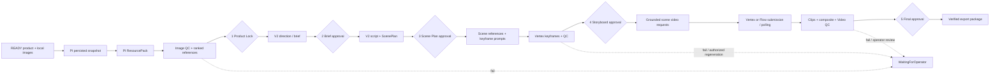

# Hermes / Product Video: Post-refactor feature and runtime verification

**Reviewed:** 2026-09-23, current working tree. **Method:** traced configured entry points and data handoffs; ran repository tests, targeted offline smoke tests, startup imports and a read-only Google Flow adapter exercise. Master spec/plan were used as intended-behavior references. **No production code was changed.**

**Verification decision:** The offline, provider-substituted five-gate path works, but the system is **not verified as a configured live end-to-end product**. Google Flow-selected runs are blocked by a nonfunctional browser edge; an end-keyframe scene cannot pass the current V2 render package check; and the full combined test gate is red from five stale MCP tests. Vertex has a concrete API adapter, but no live credential/network/video acceptance was performed here. Several groundedness and recovery issues remain.

Status terms: **IMPLEMENTED** = reachable and covered by current offline tests; **IMPLEMENTATION VERIFIED — RUNTIME NOT VERIFIED** = source and substituted boundary pass, external service not exercised; **PARTIALLY IMPLEMENTED** = a specified subcase or recovery path is absent; **LEGACY / FALLBACK** = reachable only through an explicit older/local path; **NOT WIRED** = code exists but production path has no caller; **BROKEN** = reachable path has a demonstrated blocking behavior. A passing mock does not make a live provider “working.”

# 1. System Specification

Hermes Personal accepts turns through CLI, gateway/API, Web/Telegram/Omni adapters into the channel-neutral `HermesTurnService` (`hermes_personal/orchestration/turn_service.py`). Product Video is a separate governed workflow. Its configured intake reads a PI-published READY exchange manifest containing product identity, variant, source URL, priority, features and already downloaded images; users can list/select/start up to three products through CLI or REST (`product_video/automation/importer.py:27-167`, `automation/coordinator.py:213-399`, `runtime/gateway_server.py:381-500`). The worker processes durable SQLite outbox jobs (`workflows/worker.py:23-137`).

For each workflow, the Product Intelligence MCP adapter obtains or reuses a **persisted ResearchSnapshot**, builds a ResourcePack, and locks it after operator Product Lock approval (`product_video/mcp_adapters.py:215-515`). Image QC checks the pack’s local images and requires at least two eligible references. A versioned model contract then generates grounded content direction/brief and script/scene plan. After approvals, scene-specific reference selection and prompts lead to Vertex keyframes, keyframe QC, an operator-approved storyboard, provider-neutral video scene requests, async provider clips, composition, video QC, final operator approval and a hash-checked immutable export (`product_video/handlers.py:913-2202`, `creative/*`, `integrations/video_factory/server.py:1842-3910`). The configured video provider is Vertex AI API or Google Flow Playwright; no local slideshow is accepted (`integrations/video_factory/provider_selection.py:1-20`).

**Five operator gates:** Product Lock, Creative Brief, Script/Scene Plan, Storyboard/Keyframes, Final Video. Approval records are bound to workflow, owner, project, gate, version and artifact (`application/operator_handler.py:193-306`). Image, keyframe and video QC PASS is required for gates 1, 4 and 5. Rejection/revision invalidates downstream approvals through the workflow/VF service paths (`product_video/workflow.py`, `integrations/video_factory/service.py`, `application/operator_handler.py`).

**Automated:** PI jobs, QC evaluation, creative model calls, keyframe generation, video submission/polling, composition and export. **Persistent:** workflow aggregate/events/outbox/approvals/budgets, PI snapshot/pack IDs, VF project/scene/operation/artifact rows, QC reports, source/reference/keyframe/clip/composite files and export package. Worker restarts reclaim expired leases; paid unknown outcomes generally block blind replay. QC failure goes to `WaitingForOperator`, and keyframe failure has an explicit authorized regeneration path. Other QC recovery is more limited, as detailed below.

# 2. End-to-End Product Video Flow

**Actual divergence:** The Product Lock occurs **before** PI pack lock; the research snapshot and provisional pack precede it. “Content Direction” and “Script/Scene Plan” are separate model calls, but there is no standalone ShotPlan. Image generation means generated keyframes, not a second general-image stage. Scene-specific references are selected while compiling keyframe requests. The generated end-keyframe option is modeled but is not consumed correctly by render. In configured mode, generated media never advances on a non-PASS QC verdict; in fake mode, several gates are simulated and are not acceptance evidence.

| Stage | Reachable trigger; input → output | Durable handoff; success/failure/retry/resume |
| --- | --- | --- |
| Intake/claim | CLI/API/coordinator reads READY manifest and validates product/images → workflow ID (`automation/coordinator.py:213-399`). | Claim ledger and WF/outbox; atomic claim prevents ordinary duplicate start, retries recover workflow-created/ledger-marked crash window (`:358-397`). |
| Research snapshot | Research outbox → PI MCP `research` or `get_research` with explicit ID (`mcp_adapters.py:215-324`). | Snapshot ID and `saved/persisted` required; WF stores result. Missing/mismatched identity fails when PI supplies canonical product data; transient errors retry via outbox. External service was substituted in tests. |
| ResourcePack | Snapshot ID → PI build (`mcp_adapters.py:326-393`); at least two media assets. | Pack ID/status/variant copied to WF; invalid/missing pack blocks. |
| Images/QC | Candidate local assets → decode/hash/dedup + model quality/identity rubric (`qc/image_qc.py:60-395`). | QC report and eligible ranked manifest; <2 eligible or non-PASS routes to operator, Product Lock cannot be approved. Re-evaluation is fingerprinted; reacquisition is only recommended, not automated. |
| Product Lock/PI lock | Operator approves exact pack + image QC; lock job calls PI (`operator_handler.py:271-298`, `handlers.py:837-911`). | Approval receipt and locked pack in WF; VF pack mirrored before creative work. Failure retries or blocks; approval cannot be skipped by normal handler state validation. |
| Direction/brief | Locked dossier → `SingleModelCreativeGenerator.create_direction` (`handlers.py:913-1072`). | V2 brief/digest in WF and VF; model has two structured attempts, failure retries job; Brief approval required. A dossier construction defect is described in §4. |
| Script/ScenePlan | Approved brief + dossier → V2 script/scenes (`handlers.py:1074-1205`). | WF and VF scene-plan records; schema/grounding validation, Scene Plan approval. Legacy VF fallback can generate generic scenes if V2 inputs are absent. |
| References/prompts/keyframes | Approved scenes → ranked eligible refs + start/optional end prompts (`creative/storyboard.py:58-305`) → Vertex keyframe operations (`handlers.py:1261-1384`). | Keyframe operation row and files plus storyboard package in WF; missing/changed reference fails. Unknown remote outcome blocks replay; concurrent submission remains unsafe. |
| Keyframe QC/Storyboard gate | Generated frames + refs → report (`qc/keyframe_qc.py:37-235`, `handlers.py:2087-2154`). | Exact storyboard digest/report; PASS creates pending gate, FAIL/UNKNOWN waits for operator and persists recovery plan; approved retry enqueues regeneration. VF storyboard write failure is currently swallowed. |
| Video request/render | Approved storyboard + keyframe QC receipt → grounded `VideoGenerationRequest` (`scene_renderer.py:170-250`, `server.py:1842-2473`). | Durable render batch/scene operations, provider pin, clips; polling and restart supported for valid provider operation IDs. Flow cannot produce one by default. Optional end keyframes trigger a package-count failure. |
| Composition/Video QC | Completed clips → ordered MP4; composite plus sampled frames → report (`server.py:3078-3385`, `qc/video_qc.py:226-480`). | VF artifact/hash/timeline and QC report; malformed/tampered bytes fail. QC FAIL/UNKNOWN waits for operator; automatic scene regeneration is not wired. |
| Final approval/export | PASS Video QC + operator receipt + canonical render lineage → immutable package (`operator_handler.py:288-302`, `server.py:3396-3910`). | Full decode/hash, exact artifact/version/QC binding and versioned package; same version+bytes idempotent, changed bytes reject/requires new version. |

# 3. Feature Matrix

## Source-derived feature inventory

The matrix lists actual runtime reachability. “SQLite” means the Hermes Personal database unless PI owns the record externally.

| Feature / purpose | Entry point and main implementation | Input → output | Persistence; external dependency | Status |
| --- | --- | --- | --- | --- |
| Daily candidate list | CLI `list/select/start`, REST; `candidate_service.py` → `automation/coordinator.py` | READY manifest → candidates/batch result | Claim ledger; exchange filesystem | IMPLEMENTED |
| Atomic product start | `coordinator.start_auto/start_selection`, `start_product_video_workflow` | Product key → workflow/outbox | SQLite; no provider at claim | IMPLEMENTED |
| Research/reuse | Worker `product_video.research`; `MCPProductIntelligenceAdapter.research` | Identity or snapshot ID → persisted snapshot receipt | PI service + WF copy; PI MCP | IMPLEMENTATION VERIFIED — RUNTIME NOT VERIFIED |
| Pack/lock | Worker build/lock jobs; PI adapter | Snapshot → pack/lock receipt | PI + WF; PI MCP | IMPLEMENTATION VERIFIED — RUNTIME NOT VERIFIED |
| Image intake/quality | Exchange validator + `ProductVideoQCService`/`run_image_qc` | Local candidates → ranked eligible manifest | QC SQLite; multimodal evaluator | IMPLEMENTATION VERIFIED — RUNTIME NOT VERIFIED for live evaluator |
| Image watermark cleaner | `ProductImageCleaner` only in preprocessing module/tests | Source file → cleaned file | Filesystem; optional evaluator | NOT WIRED to configured product flow |
| Grounded brief | Worker + `SingleModelCreativeGenerator` | Dossier → V2 brief | WF/VF JSON; configured model | IMPLEMENTATION VERIFIED — RUNTIME NOT VERIFIED for live model |
| Script/scene plan | Same generator + VF plan save | Brief/dossier → V2 scenes | WF/VF JSON; model | IMPLEMENTATION VERIFIED — RUNTIME NOT VERIFIED |
| Generic legacy plan | VF `create_scene_plan` fallback | Content blocks → generic scenes | VF project; no configured creative contract | LEGACY / FALLBACK |
| Scene reference/prompt | `creative/storyboard.compile_keyframe_requests` | V2 scene + eligible refs → request(s) | Storyboard payload; local files | IMPLEMENTED for start frames; end-frame integration BROKEN |
| Vertex keyframes | `VertexKeyframeProvider`/`KeyframeRuntime` | Prompt + refs → image/result | VF keyframe op + PNG; Vertex API | IMPLEMENTATION VERIFIED — RUNTIME NOT VERIFIED; concurrency PARTIAL |
| Keyframe QC/recovery | QC service + `resume_storyboard_after_qc_authorization` | Frames → PASS/report or recovery plan | QC/WF; evaluator | IMPLEMENTED offline; live evaluator unverified |
| Video scene render | VF server/scene runtime | Approved package → pinned provider scene jobs | VF operations/FS; Vertex or Flow | Vertex IMPLEMENTATION VERIFIED — RUNTIME NOT VERIFIED; Flow BROKEN |
| Composition | VF `composer.py` + `server.get_job_status` | Clips → draft composite | VF artifact/timeline + FS; ffmpeg/PyAV | IMPLEMENTED offline |
| Video QC/scene retry | `qc/video_qc.py`, QC service, handler | Composite → report/action strings | QC/WF; evaluator | QC IMPLEMENTED offline; scene regeneration PARTIALLY IMPLEMENTED |
| Approval gates | `approve_and_advance_workflow`, operator CLI/API | Pending exact artifact + QC → receipt/next job | Approval + WF/outbox | IMPLEMENTED offline |
| Final export | VF `server.export`, `export_package.py` | Approved, canonical QC-passing render → MP4/caption/metadata | VF/FS; local decoder | IMPLEMENTED offline; packaged lineage PARTIAL |
| Restart/idempotency | Outbox, scene runtime, VF/QC stores | Stale job/operation → resume or block | SQLite; provider lookup where supported | IMPLEMENTED for core WF/video; keyframe/Flow exceptions |
| Multi-product scheduling | Coordinator `limit<=3`, worker leases | Manifest → up to 3 started workflows | SQLite; shared providers/files | IMPLEMENTED for three-product offline cases; larger scale unverified |
| Legacy daily import | `daily_importer.py`, `candidate_service.py` source-root branch | `products.json` → workflow | SQLite/files; no configured exchange requirement | LEGACY / FALLBACK |
| MCP/CLI/API surfaces | `src/hermes/mcp/video_factory/server.py` shim, CLI, gateway | Commands/tool calls → results | Canonical services | IMPLEMENTED; some older MCP tests stale |

## Expected behavior versus current behavior

| Feature | Expected behavior from master spec/plan | Current implementation | Status | Evidence |
| --- | --- | --- | --- | --- |
| Five human gates | Exact ordered Product, Brief, Scene, Storyboard, Final approvals | Five states, receipt/version binding, QC at gates 1/4/5 | MATCHES DESIGN | `workflow_state.py:12-24`; `operator_handler.py:248-406` |
| Persisted PI research | Snapshot ID, pack, exact identity/evidence before creative | Adapter requires persisted snapshot and pack, but dossier later reconstructs evidence incorrectly | PARTIAL | `mcp_adapters.py:264-393`; `handlers.py:325-359` |
| Clean references | Wrong variant/duplicates/contamination excluded | Decode/hash/dedup/model risk/score gates and scene ranking; cleaner not in flow | MATCHES core QC; cleaner NOT WIRED | `qc/image_qc.py:155-395`; `qc/evaluator.py:89-122`; `creative/storyboard.py:58-97` |
| Structured creative | Grounded V2 brief/scenes/prompts | Versioned schema/model validation; legacy fallback remains | MATCHES DESIGN, with dossier defect | `creative/generator.py:33-149`; `handlers.py:1120-1197` |
| Keyframe before gate 4 | Actual generated frames and PASS QC | Start frames enforced; optional end frames generated but break render; recovery exists | PARTIAL | `handlers.py:1261-1384`; `server.py:2104-2140` |
| Video provider | Real Vertex or Playwright Flow, pinned and polled | Vertex adapter implemented; default Flow path emits synthetic in-memory submission | PARTIAL / BROKEN for Flow | `server.py:1705-1787`; `google_flow_provider.py:56-173` |
| QC recovery | Failed stages block and support governed correction | Blocks correctly; keyframe regeneration executable; image reacquire/video scene retry are report/operator work, not workflow jobs | PARTIAL | `handlers.py:2001-2199`; `operator_handler.py:644-732`; `qc/video_qc.py:355-436` |
| Exact final export | Valid MP4, approval, QC and provenance | Full integrity/QC binding implemented; full upstream metadata not packaged | PARTIAL | `server.py:3421-3703,3838-3858`; `export_package.py:149-295` |
| Live acceptance | One configured end-to-end export with real providers | Master plan Task 10 remains unclosed; this review did no paid calls | MISSING VERIFICATION | `docs/superpowers/plans/product-video-master-plan.md:840-905` |
| Durable scene recovery | Resume remaining scenes after crash | Persisted batch/scene operations and offline restart tests | IMPLEMENTATION IMPROVED DESIGN | `scene_renderer.py:296-1080`; `test_artifact_storage_and_recovery.py:80,731` |

# 4. Product Intelligence

The exchange manifest already contains canonical product/variant keys and local media paths (`automation/importer.py:68-123`); intake rejects ambiguous names and fewer than two technically readable candidates (`:126-167`). The coordinator passes brand/model/variant/canonical key and source context into the workflow (`automation/coordinator.py:339-372`). The configured PI adapter can reuse `research_snapshot_id` via a `get_research` wire or call research; it requires an explicit `snapshot_id` and `saved/persisted` status and checks returned brand/model when canonical products are present (`mcp_adapters.py:229-323`). Pack build requires the snapshot and at least two assets (`:346-393`); PI lock checks returned owner, pack, snapshot and canonical product where supplied (`:453-515`). These are meaningful cross-product guards.

**Incorrect handoff:** `_locked_research_dossier()` takes a pack-wide `supporting_evidence_ids` list and assigns it to every claim with status `supported`; its official-source filter is `host.endswith('mi.com')`, then it passes a synthetic `research_snapshot` dictionary to the dossier builder (`handlers.py:315-359`). This can misattribute evidence and drop other brands’ official sources even when PI’s persisted research was correct. The creative model receives a structured dossier, but the provenance semantics are wrong. Snapshot reuse is supported; external PI persistence and exact claim mapping were not exercised against a live PI server. The local fake PI helper is a fallback, not configured-mode evidence (`integrations/product_intelligence/client.py`, `product_video/provider_runtime.py`).

# 5. Image / Reference Pipeline

Product Video does **not** download the exchange images on intake; PI/exchange publishing supplies local files. Intake verifies contained paths, readable image bytes and source match score ≥0.5 (`automation/importer.py:126-167`). Image QC validates actual bytes, hashes and exact duplicates, asks the multimodal evaluator about brand/model/variant, clarity and usability, and normalizes risk flags so they override an otherwise high score (`qc/image_qc.py:155-295`, `qc/evaluator.py:89-122`). The rubric explicitly addresses wrong product/variant, low clarity, watermark/shop text, banners/collages, excessive text, occlusion, misleading angle and small/unclear subjects (`qc/rubric.py:9-75`). PASS requires at least two eligible images, each ≥80 with no hard failure, and a persisted report/ranked manifest (`qc/image_qc.py:291-395`). Scene selection ranks only dossier-eligible assets by requested IDs, semantic tags and QC rank; path and SHA are rechecked before keyframe generation (`creative/storyboard.py:58-97,149-183`). This is an effective fail-closed reference boundary in the offline tests.

The optional `ProductImageCleaner` is unit tested but has no production caller outside its package/tests (`preprocessing/image_cleaner.py:180-585` and reference search). Thus there is no automatic watermark removal: contaminated images are rejected and may require new sources. QC emits `reacquire_references`, but no configured job implements that action (`qc/image_qc.py:314`; search of application/CLI/workflow callers). A wrong-product result depends on the external multimodal evaluator’s accuracy; the code enforces its structured hard-failure response, but this review did not measure live false-pass rates. VF’s reference copy keeps content hash but can lose origin URL, weakening later traceability (`mcp_adapters.py:609-620`, `integrations/video_factory/server.py:585-635`).

# 6. Creative / Script / Scene System

The configured worker injects `SingleModelCreativeGenerator` (`workflows/worker.py:78-100`). It uses versioned JSON schemas/prompts and validates both `CreativeBriefV2` and `ScriptScenePlanV2`, retrying one invalid response with error feedback (`creative/generator.py:33-149`, `creative/prompts.py`). Brief data covers audience, problem, angle, hook, promise, tone and CTA; scenes include narration/overlay, role, objective, environment, action, product interaction, start/end state, camera framing/movement, placement, lighting, continuity, visible details and claim/reference IDs (`creative/contracts.py:190-600`). The handler persists digests and projects a VF-compatible scene plan (`handlers.py:961-1048,1120-1175`). Scene IDs are stable in the V2 contract. Prompt generation consumes these fields directly (`creative/storyboard.py:197-248`, `integrations/video_factory/scene_renderer.py:187-250`).

The configured V2 path has enough structure for start-frame/video prompting **if the dossier is correct**. The dossier evidence defect can contaminate every downstream claim. The fallback path at `handlers.py:1177-1197` calls VF plan generation when V2 context is absent, and VF can synthesize generic scenes from content blocks (`integrations/video_factory/server.py:1529-1542`); this is a legacy capability, not equivalent product-fidelity acceptance. The skills in `.agents/skills` and `skills/research|video` overlap instructionally, but runtime generation is governed by typed prompt contracts rather than free-form skill text. No change to the creative subsystem’s basic split is warranted.

# 7. Keyframe Pipeline

`compile_keyframe_requests()` binds exact product identity/variant, shape, color, material, controls/logo, scene action, start/end states, camera, placement, lighting, continuity, negative constraints and selected reference file paths/digests into stable operation IDs (`creative/storyboard.py:100-305`). Configured keyframes use the Vertex `generateContent` API with inline reference bytes and normalized results (`integrations/video_factory/keyframe_provider.py:101-225`); results/checkpoints and SHA-backed local files are persisted (`:228-353`). Image availability/credentials were not tested live.

The keyframe runtime checks an existing operation digest, returns verified completed files, polls known provider IDs and blocks ambiguous checkpoints instead of blind resubmission. It **does not atomically claim a new operation before `provider.submit()`**: two workers can read absent state and both submit (`keyframe_provider.py:310-353`). After generation, the handler packages frame path/SHA/status and keyframe QC verifies every frame against references and exact bytes. A non-PASS report goes to `WaitingForOperator`; authorized keyframe recovery increments attempt and enqueues a new storyboard job with changed operation IDs (`handlers.py:2087-2149`, `operator_handler.py:644-732`). A weak/missing normal keyframe does not pass keyframe QC and cannot receive gate 4 approval.

**Broken optional end frame:** V2 scenes can request an end keyframe (`creative/storyboard.py:270-305`), but the handler derives `scene_id = req.frame_id.removesuffix('-start')` for every result (`handlers.py:1315-1324`). For an end frame, this yields `scene-id-end`; render builds a dictionary keyed by those `scene_id` values, then requires its size to equal the number of storyboard scenes (`server.py:2104-2140`). One scene with start+end thus produces two dictionary entries for one scene and returns `KEYFRAME_PACKAGE_INCOMPLETE`. The actual video request sends only the start keyframe (`scene_renderer.py:241-250`). The existing test proves end-request construction, not a successful end-frame render (`test_remediation_adversarial.py:426-487`).

# 8. Video Generation

The V2 render path requires a VF storyboard and approval, a worker budget reservation, a matching package digest, an immutable keyframe QC receipt and per-scene grounded video requests (`integrations/video_factory/server.py:1842-2473`). Scene operations are pre-persisted, provider kind pinned, and subsequent status calls poll/reconcile rather than resubmit. Completed clips are fully probed, hashed and composed in order; corrupt bytes invalidate approval (`scene_renderer.py:296-1080`, `server.py:2532-3385`). Offline fake-provider tests cover those invariants.

| Configured provider | Wiring and runtime dependencies | Verification outcome |
| --- | --- | --- |
| Vertex AI Veo API (`vertex_ai`) | Constructed by `_video_provider()`; `VertexVideoProvider` resolves ADC/token/project, calls `predictLongRunning`, polls `fetchPredictOperation`, downloads result (`server.py:1768-1787`, `vertex_provider.py:48-300`). | **IMPLEMENTATION VERIFIED — RUNTIME NOT VERIFIED.** Requests and polling are exercised with injected HTTP/credentials in tests; no live project/quota/result here. |
| Google Flow Playwright (`google_flow`) | `server.py:1749-1758` calls `from_config(output_dir=ws)` without page object/session/profile. `is_available()` checks only Playwright import. `submit()` returns a made-up in-memory operation; polling never produces real bytes; restart lookup is empty (`google_flow_provider.py:56-173`). | **BROKEN for configured runs selecting Flow.** Read-only exercise: `submit=submitted`, same-process poll `submitted`, fresh-process lookup `None`, fresh-process poll `running`. Example config selects Flow (`cli-config.yaml.example:1933-1936`). |
| Visual Browser MCP | Not among accepted official video provider kinds. | **NOT WIRED** as a Product Video render provider; no inference from library presence. |

Provider switching is constrained to before paid submission; a pinned operation cannot silently change provider (`provider_selection.py`, `scene_renderer.py`). That is correct. Flow should be declared unavailable until a real authenticated browser/locking/reconciliation implementation exists. Library availability must not qualify it.

# 9. QC / Recovery

| Stage | PASS/FAIL checks and stored evidence | On FAIL/UNKNOWN; executable recovery |
| --- | --- | --- |
| Source/reference image | Decode/hash, duplicate, identity/variant, ≥80, risk flags, ≥2 eligible; report stores per-image scores/reasons and ranked manifest (`qc/image_qc.py:60-395`). | Blocks Product Lock and waits for operator (`handlers.py:2015-2039`). `reacquire_references` is suggested but no automatic acquisition job is wired. Operator can supply new sources/re-run QC. |
| Keyframe | Every generated frame path/SHA/reference exists; evaluator checks identity, prompt consistency, details, composition, animation suitability, ≥80; report stores frame evidence/recovery plan (`qc/keyframe_qc.py:37-235`). | Blocks Storyboard gate; authorized regeneration with new attempt and plan is implemented (`operator_handler.py:644-732`). Technical evaluator UNKNOWN has bounded retry in `qc/service.py:190-212`; paid generation is not blindly looped. |
| Video | Full technical validity and scene sample frames (start/25/50/75/end), identity, action/contact geometry, text/branding, black bars, ≥80; report binds artifact/version/digest and scene findings (`qc/video_qc.py:226-480`, `qc/models.py`). | Blocks Final gate (`handlers.py:2155-2199`). It produces `retry_scene_N` suggestions, but no configured workflow/CLI handler consumes those strings to regenerate a failed scene; operator can re-run QC, not directly launch that correction (`product_video/cli.py:82-135,782-866`). |
| Final output/export | Checks exact Video QC PASS report, owner/project/workflow/artifact/version/SHA, final approval and full decode (`server.py:3421-3703`). | Rejects export; no invalid file is published. |

QC verdicts, fingerprints, evaluator/rubric/model versions and diagnostics are persisted (`qc/models.py`, `qc/repository.py`, `qc/service.py`). The keyframe recovery path is a real workflow action. Video scene retry and image reacquisition are not yet equally executable; they should not be reported as completed automation.

# 10. Workflow / Retry / Resume

SQLite workflow aggregate/version/events/outbox are committed together (`workflows/repository.py:28-120`); delivery uses leases, heartbeat, backoff and quarantine (`workflows/outbox_repository.py`, `outbox_dispatcher.py:70-178`). Approval transitions and next jobs are atomic (`application/operator_handler.py:313-407`). Source import claims protect duplicate daily starts; the coordinator recovers a crash between workflow creation and ledger update (`automation/coordinator.py:314-397`). Video scene operations have durable request digests, provider pin, CAS claim, monotonic status and restart reconciliation; tests cover resuming after two completed scenes (`scene_renderer.py:296-1080`, `test_artifact_storage_and_recovery.py:80-186`). Export replay checks immutable version/SHA (`export_package.py:149-295`).

| Failure/interruption | Current outcome |
| --- | --- |
| Model invalid output | One repair attempt in creative generator; job error then outbox retry/quarantine according to retryability. |
| PI unavailable or missing snapshot/pack | Configured adapter fails closed; retryable transport exception may be retried; terminal missing prerequisite blocks. |
| Keyframe provider timeout/unknown outcome | Local checkpoint remains; no automatic duplicate resubmit. Needs reconciliation/operator if no reliable remote operation ID. Two simultaneous first submissions are still possible. |
| Video provider error/timeout | Pinned scene operation is polled or fails; ambiguous outcome blocks replay. Flow’s fake operation can remain pending forever. |
| Worker stop/process restart | Outbox lease reclaimed; completed stages and video scene operations reused; external acceptance not proven. |
| Image/keyframe/video QC FAIL | Moves to operator wait; keyframe has executable regeneration, image/video correction is manual or not wired as a workflow job. |
| VF same-project concurrent writes | `repository.save()` replaces all fields without expected version (`repository.py:365-410`), so unrelated updates can be lost despite WF CAS. |
| Storyboard VF write exception | Handler ignores it and continues generating keyframes (`handlers.py:1283-1295`); WF/VF can disagree. |

Thus “safe retry/resume” is true for the workflow outbox and most video scene operations, **not** for all provider and cross-store boundaries. No unlimited automatic QC loop was found. There is no proof that ten products, many scenes and shared provider accounts are safe under load.

# 11. Approval Gates

| Gate | Artifact/precondition before approval | Next eligible job; rejection/revision behavior |
| --- | --- | --- |
| 1 Product Lock | PI pack, exact product identity, persisted PASS Image QC and ≥2 references (`operator_handler.py:295-298`, `qc/image_qc.py:291-395`). | PI lock → brief. Missing/stale QC refuses approval. |
| 2 Creative Brief | V2 brief bound to current dossier/pack and artifact receipt (`operator_handler.py:219-269`, `handlers.py:2077-2081`). | Scene plan. Revision invalidates dependent outputs/approvals. |
| 3 Script/Scene Plan | Current scene-plan artifact/version and approval request (`operator_handler.py:280-283`). | Storyboard/keyframes. Revision clears dependent storyboard/render (`integrations/video_factory/service.py`, `test_binding.py`). |
| 4 Storyboard/Keyframes | Generated package, current PASS Keyframe QC, immutable artifact digest (`operator_handler.py:303-306`, `handlers.py:2087-2149`). | Render. Failed QC goes to operator/recovery; no normal skip. |
| 5 Final Video | Current PASS Video QC on exact render artifact and final receipt (`operator_handler.py:299-302`, `server.py:3569-3703`). | Export. Changed clip/composite invalidates approval; export refuses stale bytes. |

All five are reached in the offline configured-style E2E test (`test_happy_path_e2e.py:632-854`). Test fixtures substitute PI/model/keyframe/video/QC providers; they do not prove real operator inspection or live media quality.

# 12. Export / Lineage

Export requires canonical render fields (`owner_user_id`, `project_id`, `workflow_id`, `artifact_id`, integer `artifact_version`, SHA); verifies them against caller, VF artifact, source file, exact PASS Video QC and final approval; fully decodes the MP4; stages a versioned immutable package (`server.py:3421-3910`, `export_package.py:149-295`). Offline tests prove invalid bytes and stale/mismatched QC are rejected, and same-version same-bytes export is idempotent (`test_export_integrity.py`, `test_export_package.py`, `test_production_integrity.py`). This behavior is stronger than the older MCP tests’ permissive expectations.

**Traceability from a final video:** product/project/workflow, pack ID, selected references, provider operations, composite SHA and image/video QC IDs are available in package provenance (`server.py:3824-3858`). To find the exact PI snapshot, claim-to-evidence mapping, full script/scene/prompt digests, model/settings, keyframe QC report and retry/rejection chain, an operator must join WF, PI, VF, QC and operation records. The package itself omits several of these; VF reference copy may omit source URL. The dossier’s synthetic claim evidence makes the fact/evidence link unreliable even with all stores retained. These are practical debugging/reproducibility gaps, not an export byte-integrity failure.

# 13. Multi-product Automation

Configured intake limits each automatic/selected batch to three, preserves published priority and atomically claims product identity (`automation/coordinator.py:213-399`). SQLite outbox leases allow multiple workers; product/workflow/project IDs isolate most rows and workspace paths. A 3-product daily offline test exists (`test_daily_scheduler_e2e.py`). The worker processes a bounded batch, default one row per poll (`workflows/worker.py:75-137`). Scene operations use distinct IDs and versions, but VF’s whole-project save without CAS can race when one project has parallel updates (`integrations/video_factory/repository.py:365-410`). Provider quotas, Google Flow browser-profile locks and a ten-product capacity limit are not implemented/proven. The Flow adapter has only process-local operation maps, so its shared-profile/restart behavior is not safe. No observed path collision occurred in offline tests; that is not a live concurrency guarantee.

# 14. Post-refactor Regression Findings

1. **Five current MCP tests fail** when run with Hermes Personal tests: four expect older export error codes or successful export without newly required canonical SHA/artifact lineage, and one expects a symbolic-reference storyboard to render without V2 keyframe/QC evidence (`tests/mcp_servers/test_video_factory_server.py:377-489,511-643`; `test_video_factory_paid_contract.py:295-325`; current `server.py:3421-3443,2118-2149`). This is a concrete test/contract mismatch. The newer fail-closed source behavior is supported by passing Product Video integrity tests, so do not weaken it to satisfy the old assertions. Update fixtures/assertions and check external MCP callers for the contract change.
2. **End-keyframe integration is broken** as described in §7. The V2 request and test exist, but the render handoff rejects a valid start+end package. This current path is in the moved implementation; git history was not used to establish the exact introducing commit.
3. **Configured storyboard can advance after a failed VF write** (`handlers.py:1283-1295`). This is a real cross-store regression risk; no existing test intentionally injects that failure and asserts the workflow remains blocked.
4. **Image cleaner is unused by configured flow.** Its unit tests prove the helper, not runtime registration. This is a gap only if automatic cleaning was part of accepted product behavior; the current QC path safely rejects contamination.
5. **Compatibility paths remain deliberately reachable:** `src/hermes/mcp/video_factory/server.py` is still the runbook’s MCP entry point (`docs/hermes-personal/product-video-runbook.md:225-228`); `integrations/product_video/handlers.py` and `integrations/video_factory/layout.py` forward to canonical modules; `candidate_service.py` plus `daily_importer.py` retain an explicit legacy source-root path. No wrapper was removed. Import/startup smoke and test collection found no broken import or circular-registration failure.
6. **No proven data migration failure** was observed in this test run. Existing QC migration tests and startup tests passed. Real old databases and live PI/VF data were not migrated or opened for this review, so compatibility of every historical row remains unverified.

# 15. Tests Performed

| Command / exercise | Result | What it proves and does not prove |
| --- | --- | --- |
| `uv run pytest tests/hermes_personal tests/mcp_servers/test_video_factory_server.py tests/mcp_servers/test_video_factory_paid_contract.py -q` | **1108 passed, 5 failed, 46 deprecation warnings**, 162.97 s. | Broad current-tree verification; five failures are the old MCP render/export contract tests listed in §14. |
| `uv run pytest tests/mcp_servers/test_video_factory_server.py tests/mcp_servers/test_video_factory_paid_contract.py -q --tb=short` | **34 passed, 5 failed**, 5.55 s. | Reproduced exact failing assertions independently. |
| `uv run pytest tests/hermes_personal/product_video/test_happy_path_e2e.py::test_product_to_video_complete_happy_path_e2e tests/hermes_personal/product_video/test_daily_scheduler_e2e.py tests/hermes_personal/product_video/test_pi_mcp_contract.py tests/hermes_personal/product_video/test_creative_handler_wiring.py tests/hermes_personal/product_video/test_keyframe_gate_qc.py tests/hermes_personal/product_video/test_scene_render_runtime.py tests/hermes_personal/product_video/test_export_integrity.py tests/hermes_personal/e2e/test_runtime_smoke.py -q --tb=short` | **51 passed**, 23.36 s. | Representative fake/substituted-provider startup, intake, PI handoff, creative, keyframe/QC, render, restart and export smoke. |
| `uv run python -c "import hermes_personal.runtime.gateway_server, hermes_personal.workflows.worker, hermes_personal.product_video.handlers, hermes_personal.integrations.video_factory.server, hermes_personal.product_video.cli; print('startup imports: OK')"` | **Startup imports OK.** | Main modules import; does not start external MCP/provider processes. |
| `uv run python -m hermes_personal.product_video.cli --help` | **Exit 0**, commands listed. | CLI registration/argument parser works. |
| Read-only in-memory `GoogleFlowPlaywrightProvider` exercise with `is_available=True` and no injected page | `submit=submitted`, same-process poll `submitted`, fresh-process lookup `None`, fresh-process poll `running`. | Confirms default Flow adapter cannot reconcile/complete merely because Playwright is present. No browser/network call. |
| `uv run ruff check hermes_personal tests/hermes_personal tests/mcp_servers/test_video_factory_server.py tests/mcp_servers/test_video_factory_paid_contract.py` | **All checks passed.** | Syntax/style gate only. |

**Runtime limitations:** No live PI service, creative model, multimodal evaluator, Vertex keyframe/video API, authenticated Google Flow browser, external job ID, provider quota, production database, or operator-reviewed final video was exercised. Thus “implementation verified” means offline integration behavior; **runtime not verified** for external dependencies. Master plan Task 10 requires a live configured acceptance run and remains open (`docs/superpowers/plans/product-video-master-plan.md:840-905`).

# 16. Issues Found

Priority is scoped to the affected feature: **P0** correctness/data-loss/runtime blocker; **P1** important feature/runtime problem; **P2** should improve; **P3** cleanup. Estimates are relative scope, not schedule.

| ID / priority | Problem: expected → actual; source evidence | Impact | Recommended fix; scope; regression test required |
| --- | --- | --- | --- |
| V1 / **P0 for Flow-selected runs** | Real browser video submission/poll/restart → `from_config()` supplies no page, availability checks only import, `submit()` emits synthetic ID, state is in memory (`server.py:1749-1758`; `google_flow_provider.py:56-173`); read-only repro above. | Configured Flow run can never produce a real scene clip and may remain pending. Example config selects Flow. | Wire authenticated browser session, profile lock, real submit/status/lookup and failure semantics; until then fail provider readiness. **Medium–large.** Test actual browser adapter contract across restart; one controlled live clip. |
| V2 / **P1** | VF storyboard write should complete before workflow advances → exception swallowed (`handlers.py:1283-1295`), while render requires VF storyboard (`server.py:1917-1924`). | Keyframes/QC/approval can proceed into a late render failure with split WF/VF state. | Propagate failure and reconcile/persist VF write receipt. **Small–medium.** Inject VF failure and assert no Storyboard gate, no paid keyframe submission. |
| V3 / **P1** | Each claim needs its own PI evidence and official source → every claim gets global evidence IDs and `mi.com` filter (`handlers.py:325-359`). | Non-Xiaomi official evidence is dropped; inaccurate facts can be treated as supported and embedded in content. | Preserve PI claim→evidence mapping and product-specific source authority from persisted snapshot. **Medium.** Non-Xiaomi, multi-claim, cross-product snapshot tests. |
| V4 / **P1** | Generated end keyframe should bind to its scene and render → handler gives it `scene-id-end`; render counts it as an extra scene and rejects package; video request uses start only (`handlers.py:1315-1324`; `server.py:2104-2140`; `scene_renderer.py:241-250`). | A modeled/advertised end-frame feature blocks a legitimate V2 production path. | Keep original scene ID plus frame role, validate one start and optional end per scene, pass end frame only when provider supports it; otherwise document explicit omission. **Medium.** Full start+end storyboard→QC→render request test. |
| V5 / **P1** | Two workers should submit one paid keyframe operation → `get/save/submit` is not atomic (`keyframe_provider.py:310-353`). | Duplicate paid calls/ambiguous media under concurrency. | Add durable claim/lease or provider idempotency/reconciliation around first submit. **Medium.** Two-worker same-operation barrier test and crash-window test. |
| V6 / **P1** | Parallel VF updates should preserve each field → whole project row replaced without expected revision (`repository.py:365-410`). | Lost storyboard/scene/status updates on one project; partial runs can be corrupted. | CAS revision or narrow updates with conflict reload. **Medium.** Two-reader conflicting-save test. |
| V7 / **P1** | Failed Video QC scene should have an executable governed rerender → QC emits `retry_scene_N` but CLI/workflow only supports re-running QC or keyframe regeneration (`qc/video_qc.py:355-436`; `cli.py:82-135,782-866`; `operator_handler.py:644-732`). | Operator is blocked without a canonical scene-correction action, though unsafe advancement is prevented. | Add bounded operator-authorized scene retry that invalidates composite/QC/final approval, creates new attempt and re-runs QC. **Medium.** FAIL→authorized scene retry→new clip/composite→new QC test. |
| V8 / **P2** | Test gate should reflect current fail-closed contracts → five MCP tests expect old error order or bypass canonical lineage/keyframe evidence (`tests/mcp_servers/test_video_factory_server.py`, `test_video_factory_paid_contract.py`). | Red CI gate masks new regressions and confuses support for direct MCP callers. | Update fixtures and expected codes to current contract; verify direct MCP callers. **Small–medium.** Re-run both MCP files and combined suite green. |
| V9 / **P2** | Export/debug trail should link snapshot, per-claim facts, prompts/model/settings, keyframe QC and attempts → current export provenance has only partial IDs/summaries (`server.py:3824-3858`); VF reference copy can lose origin (`mcp_adapters.py:609-620`). | Reproduction and audit require fragile manual joins; some evidence semantics already wrong (V3). | Add canonical IDs/digests and source origin to existing export metadata/artifact links, not full payload duplication. **Medium.** Given export+stores, assert lineage query to PI claim and provider attempt. |
| V10 / **P2** | Image QC’s `reacquire_references` should be actionable if promised → no configured handler; `ProductImageCleaner` has only unit callers (`qc/image_qc.py:314`; `preprocessing/image_cleaner.py`). | Bad source sets require manual input and can stall a product; safe fail-closed behavior remains. | Document manual source replacement or wire a bounded reacquisition action only if product operations require it. **Small–medium.** FAIL→new source→fresh digest/QC test. |
| V11 / **P2** | Production scale should coordinate shared provider capacity → batch cap three, per-worker leases, but no global provider quota/browser-profile lease; VF same-project save race (`coordinator.py:213-266`, `worker.py:75-137`). | Ten-product or parallel-scene execution may overload provider/profile or collide. | Add bounded per-provider concurrency and profile exclusivity before raising scale cap. **Medium.** Multi-worker/10-product offline stress plus controlled provider acceptance. |
| V12 / **P3** | One canonical configured intake and current docs → legacy source-root/daily importer still reachable and MCP shim still required (`candidate_service.py:50-105`, `daily_importer.py`, `product_video-runbook.md:225-228`). | Maintenance/documentation confusion, not a demonstrated production failure. | Mark legacy-only behavior and refresh docs; remove nothing until caller inventory and migration proof. **Small.** CLI/MCP import tests. |

# 17. Suggested Adjustments

## MUST FIX BEFORE MORE FEATURES

1. Make Flow fail readiness until it has real browser submit/poll/reconciliation; complete a controlled live clip before advertising it (V1).
2. Stop Storyboard advancement after VF write failure, restore claim-specific PI evidence, and correct the end-keyframe render handoff (V2–V4).
3. Protect first keyframe submission and same-project VF writes under concurrent workers (V5–V6).
4. Restore a green MCP test gate by updating old fixtures/assertions to the **current** strict render/export contract (V8). Verify any external direct-MCP caller before changing its input expectations.

## SHOULD FIX SOON

- Add a governed Video QC scene-retry action (V7) and carry important upstream lineage into export (V9).
- Decide whether image reacquisition is an operator procedure or a required automated feature (V10).
- Add bounded provider/profile concurrency before a ten-product target (V11).

## CAN WAIT

- Inventory legacy intake and forwarding modules, synchronize skill/runbook wording, then remove only proven-unused paths (V12).
- Consolidate status/debug output around existing IDs and records after functional gaps close.

## NO CHANGE RECOMMENDED

- Keep the five HITL gates, WF/outbox lease/version model, V2 creative contracts, provider-neutral scene request, stage-specific QC, content-addressed workspace, and strict final export byte/QC checks.

# 18. Features That Are Already Good

- Atomic product claim and recoverable workflow start; daily selection preserves PI priority.
- PI snapshot/pack persistence prerequisites and cross-product owner/identity checks at the adapter boundary.
- Source image decode, exact dedup, risk-flag normalization, ≥80 score and two-reference Product Lock gate.
- Structured V2 brief/scene generation with versioned prompts, schema validation, digests and scene-level visual intent.
- Exact image prompt identity/negative constraints and re-hashing of selected reference files.
- Keyframe QC before gate 4, persisted recovery plan and authorized attempt regeneration.
- Workflow event/outbox transaction, worker leases/heartbeats, video scene provider pin and crash reconciliation.
- Full clip/composite decode and hash checks, approval invalidation after changed media, strict Video QC/final export binding.
- Offline provider-substituted E2E flow and broad test coverage. Preserve these behaviors while fixing the gaps.

# 19. Final Verification Summary

1. **Does the current workflow work end to end?** Yes in the offline configured-style E2E with substituted PI/model/QC/keyframe/video providers; **no live configured end-to-end acceptance was demonstrated**. Flow-selected live rendering is blocked.
2. **Fully verified?** Startup imports, CLI registration, workflow start/claim, five-gate state progression, offline PI handoff, V2 creative/keyframe/QC/render/composition/export, restart and fail-closed integrity paths in selected tests.
3. **Exists but not runtime-verified?** External PI, live creative/evaluator models, Vertex keyframe and Veo API, browser authentication, real provider polling/quotas, operator-reviewed final quality.
4. **Incomplete?** Flow adapter, end-keyframe integration, executable Video QC scene retry, optional image reacquisition, full export lineage, provider capacity controls.
5. **Did the refactor introduce regression?** The current tree has five failing MCP tests and a broken V2 end-frame handoff. Their exact introducing commits were not established. No broken import/registration or database migration was demonstrated.
6. **Safe retries/resume?** Core WF/outbox and video scene operations mostly yes; keyframe concurrent first submit, Flow restart, VF parallel save and swallowed storyboard write no.
7. **QC gates enforced?** Yes for normal configured progression; image/keyframe/video PASS is required for the relevant approvals. Fake mode and manual test fixtures are not live acceptance.
8. **Reference/keyframe/video relationships correct?** Start-frame chain is hash- and QC-bound. End-frame chain is broken; image origin and claim evidence links are incomplete/incorrect.
9. **Configured providers usable?** Vertex implementation is wired but live unverified. Flow’s default configured adapter is not usable. Visual Browser MCP is not wired as a provider.
10. **Final video traceable?** Core project/pack/reference/provider-operation/composite/QC records exist, but complete facts/snapshot/prompt/model/keyframe-QC/retry lineage requires manual joins and is not fully in export.
11. **Concrete fixes now?** V1–V6 and the red MCP test gate; add V7 before promising automatic recovery from failed video QC.
12. **Leave unchanged?** The existing workflow/approval/outbox core, V2 creative contracts, provider-neutral request boundary, QC evaluators and strict media/export validation.

**Go/no-go for one real end-to-end acceptance run: NO-GO today.** The example configuration selects Google Flow, whose default edge cannot submit or complete real browser work. A Vertex-selected diagnostic run is technically possible only with live credentials and operator oversight, but it would not close acceptance while claim evidence may be misassigned, VF storyboard errors can be hidden, and the combined MCP test gate is red. For a formal live run, first make Flow unavailable or wire it fully; fix the dossier and storyboard handoffs; decide whether the selected scenes require end keyframes and fix that path if they do; restore a green combined test gate; then run one controlled configured product through all five approvals with real PI/model/QC/media providers and inspect the exported bytes and provenance. Keyframe concurrency and VF project write protection must be resolved before concurrent or multi-product live execution.
