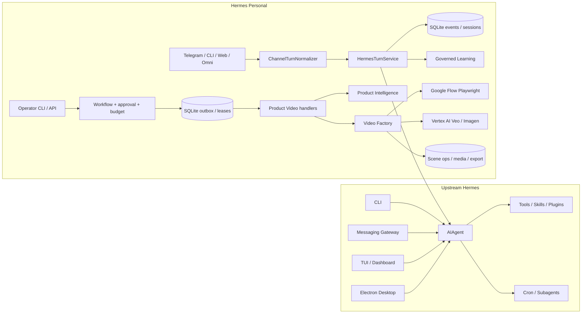
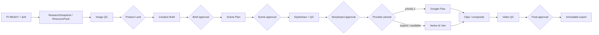

# Hermes: rà soát toàn dự án và trạng thái chạy thực tế

**Ngày:** 2026-09-25. **Đối tượng:** checkout `D:\work\hermes-upstream-rearchitecture` và dữ liệu vận hành cục bộ tại `D:\work\hermes-agent-data`. **Phương pháp:** đọc source, hợp đồng/tài liệu, chạy test, đối chiếu SQLite và kiểm tra trực tiếp MP4 Vertex. Không sửa production code trong lượt rà soát này.

> Đây là ảnh chụp **working tree**, không phải đánh giá một release sạch: tại lúc bắt đầu có 195 mục `git status` (62 tracked, 133 untracked), HEAD `df6a145e73` ngày 2026-09-18. Không coi mọi chức năng trong repository lớn là đã được kiểm thử live chỉ vì một suite con xanh.

## 1. Kết luận điều hành

Hermes có hai phần: upstream agent đa kênh (CLI, gateway, TUI, desktop, công cụ, plugin, cron) và lớp `hermes_personal` quản trị turn, danh tính, workflow, học tri thức, Product Video. Ranh giới một `AIAgent` và SQLite/outbox/approval có đường chạy và test tốt. Product Video **đã hoàn tất một workflow Vertex AI thật**: 4 Veo scene operations, composite và bản xuất 18 giây H.264 720×1280, 24 fps; Video QC cuối ghi PASS 100 và SHA file xuất khớp composite. Kết quả này chứng minh nhánh Vertex dùng được cho một sản phẩm, chưa chứng minh mọi sản phẩm hoặc vận hành nhiều worker.

Hai điểm đang chặn tuyên bố “hệ thống tự động sản xuất video hoàn chỉnh”: (1) Flow là provider ưu tiên nhưng workflow live đang `rendering` với outbox `pending` và lỗi `Flow project has no accepted video tile`; (2) bản Vertex cuối **không có audio**, mặc dù Scene Plan có lời dẫn tiếng Việt. Đồng thời cùng một composite SHA nhận Video QC 90 FAIL, 80 FAIL, 100 PASS; các lần FAIL nói có black bars còn detector kỹ thuật của cả ba lần đều báo không có. Quyết định QC cần cơ chế xử lý mâu thuẫn trước khi tự động duyệt hàng loạt.

## 2. Bản đồ hệ thống

Nguồn: [kiến trúc Personal](../docs/architecture.md), [turn service](../hermes_personal/orchestration/turn_service.py), [worker](../hermes_personal/workflows/worker.py), [Video Factory](../hermes_personal/integrations/video_factory/server.py), [upstream agent](../run_agent.py). Sơ đồ là bản đồ trách nhiệm; mũi tên không có nghĩa tất cả cạnh đã được kiểm thử live trong lượt này.

Hợp đồng năm gate nằm ở [operator handler](../hermes_personal/application/operator_handler.py) và [state machine](../hermes_personal/product_video/workflow_state.py). Provider selection/pinning nằm ở [server](../hermes_personal/integrations/video_factory/server.py) và [provider selection](../hermes_personal/integrations/video_factory/provider_selection.py).

## 3. Đánh giá chức năng

| Mảng | Đánh giá hiện tại | Bằng chứng và giới hạn |
| --- | --- | --- |
| Upstream agent, CLI, gateway, TUI, desktop, tools/plugins/cron | Nhiều entry point thực; không tuyên bố full live trong lượt này | [AGENTS.md](../AGENTS.md), [run_agent.py](../run_agent.py), [gateway](../gateway), [TUI](../ui-tui), [desktop](../apps/desktop). 75 upstream Python smoke tests PASS; typecheck TUI/desktop PASS; desktop UI 5.421 tests PASS. TUI Vitest còn 10 lỗi Windows. |
| Personal turn, identity, event replay, capability policy | Đường nguồn rõ, kiểm thử tốt | [turn service](../hermes_personal/orchestration/turn_service.py), [SQLite schema](../hermes_personal/storage/sqlite.py); toàn bộ `tests/hermes_personal` 1.109 PASS. Lượt này không mở HTTP gateway ngoài mạng. |
| Workflow, outbox, approval, budget | Durable SQLite, gate/version/lease có test | [outbox](../hermes_personal/workflows/outbox_repository.py), [budget](../hermes_personal/workflows/budgets.py); live Vertex tự phục hồi qua nhiều lần poll, nhưng sổ chi phí chưa phản ánh chi phí thực. |
| Governed Learning | Nguồn, ứng viên, đánh giá, duyệt và truy xuất được tổ chức riêng | [learning](../hermes_personal/learning), tests nằm trong suite Personal. Chưa thử live một `/hoc` mới trong lượt này. |
| Product Intelligence → nghiên cứu/claim | Live Vertex workflow dùng snapshot/pack và claim có evidence; grounding source có guard | [dossier](../hermes_personal/product_video/handlers.py), [grounding tests](../tests/hermes_personal/product_video/test_locked_research_grounding.py). Chưa audit độc lập sự thật của từng claim quảng cáo. |
| Keyframe và end frame | Vertex Imagen + keyframe QC có đường chạy; 8 keyframes của workflow mẫu PASS 95 | [keyframe provider](../hermes_personal/integrations/video_factory/keyframe_provider.py), [QC service](../hermes_personal/product_video/qc/service.py). Cạnh nhiều worker/quota chưa được thử chịu tải. |
| Vertex AI video | **Live verified một workflow** | `pv-xiaomi-vertex-v2-20260924` ở state `completed`, 4 operation Veo completed, composite và export có cùng SHA `7be6e31b...`. [Vertex provider](../hermes_personal/integrations/video_factory/vertex_provider.py). |
| Google Flow video | **Chưa hoàn tất workflow live** | `pv-xiaomi-grounded-v3-20260924` vẫn `rendering`; outbox 31 `pending`, lỗi `Flow project has no accepted video tile`. Một clip diagnostic trước đây không thay thế chứng cứ end-to-end. [Flow provider](../hermes_personal/integrations/video_factory/google_flow_provider.py). |
| Composition, Video QC, export | MP4 decodable, hash/lineage được kiểm tra, export immutable; QC quyết định chưa ổn định và package metadata thiếu link | [composer](../hermes_personal/integrations/video_factory/composer.py), [Video QC](../hermes_personal/product_video/qc/video_qc.py), [export](../hermes_personal/integrations/video_factory/export_package.py). |
| Obsidian knowledge graph | Vault tồn tại, wikilink graph hoạt động theo cấu trúc index | Vault thực `D:\work\hermes-agent-data\knowledge\obsidian`; index đang hướng dẫn đường dẫn cũ `D:\work\hermes-agent\obsidian_vault`. Báo cáo này được lưu thành node riêng trong vault. |

## 4. Các vấn đề cần cải thiện

### MUST FIX trước khi chạy tự động hoặc gọi bản xuất là video quảng cáo đầy đủ

1. **QC video mâu thuẫn trên cùng bytes.** Ba report `qc_vid_..._0b171c96`, `..._24131645`, `..._84048b68` cùng artifact/SHA `7be6e31b...` lần lượt FAIL 90, FAIL 80, PASS 100. Các report FAIL viện black bars, trong khi `technical_specs.black_bars.has_persistent_black_bars=false` cả ba. [Video QC](../hermes_personal/product_video/qc/video_qc.py) hiện lấy `hard_failure` của evaluator vào quyết định tổng ngay cả khi phép đo kỹ thuật phủ định nguyên nhân. **Ảnh hưởng:** lặp chi phí QC và có thể chặn hoặc duyệt tùy lần gọi. **Sửa nhỏ nhất:** khi lý do là thuộc tính đo được (black bars, resolution, duration), buộc evaluator kèm bằng chứng tương ứng và đối chiếu detector; mâu thuẫn đưa về `UNKNOWN`/operator, không tự gọi lại với cùng SHA mà không có thay đổi đầu vào.
2. **Flow là ưu tiên 1 nhưng job live đang mắc.** Workflow `pv-xiaomi-grounded-v3-20260924`, outbox 31 còn `pending`, `VF_RENDER_FAILED: Flow project has no accepted video tile`; job provider đã được checkpoint, nên không được nộp lại mù. **Ảnh hưởng:** đường mặc định chưa giao được video cuối. **Sửa nhỏ nhất:** cố định phép đối chiếu request → Flow project/tile, hoàn thiện reconcile và timeout/operator path, rồi chạy một workflow Flow qua năm gate đến export; kiểm tra không sinh job trả phí trùng.
3. **Lời dẫn đã duyệt không xuất hiện trong file cuối.** Scene Plan có `narration`; [Vertex provider](../hermes_personal/integrations/video_factory/vertex_provider.py) gửi `generateAudio=false`; composite chỉ bảo toàn audio nếu clip đầu vào có, và MP4 cuối có `audio_present=false`. **Ảnh hưởng:** bản video hình 18 giây có thể xem, nhưng không thể coi là bản thể hiện đầy đủ kịch bản có lời dẫn. **Sửa nhỏ nhất:** một bước soundtrack có TTS/voice asset đã duyệt, căn theo scene, mix/encode, QC âm thanh và xuất bản version mới; giữ video im lặng như định dạng được chọn rõ ràng nếu người dùng muốn silent ad.

### SHOULD FIX trong đợt hoàn thiện gần nhất

4. **Package provenance thiếu dữ liệu đã tồn tại.** `metadata.json` của export Vertex có `approvals.scene_plan=null`, `provenance.qc.image/video=null`, `artifact_digests={}`, `spend={}` mặc dù approval/QC records có trong SQLite. [Export caller](../hermes_personal/integrations/video_factory/server.py) chỉ lấy QC ID từ `render_result`/params; [package builder](../hermes_personal/integrations/video_factory/export_package.py) chỉ copy report khi caller cung cấp. **Ảnh hưởng:** file cuối tự nó chưa đủ để audit ngược evidence và chi phí. **Sửa nhỏ nhất:** đọc exact verified approval/QC/artifact refs từ canonical DB ở export boundary, đưa vào manifest version mới và snapshot report có hash; không sửa package immutable đã xuất.
5. **Budget ledger là mức trần đặt chỗ, chưa phải chi phí thực.** Workflow Vertex mẫu có 26 reservation, 23 `committed`, tổng *ceiling* 5.930 cents; 14 `product_video_operation_attempt` đều `actual_cost=NULL`, 10 attempt còn `status=reserved` dù đã có report và workflow `completed`. [QC service](../hermes_personal/product_video/qc/service.py) commit toàn bộ allocation trừ một trường hợp service disabled; [budget repository](../hermes_personal/workflows/budgets.py) đổi trạng thái mà không điều chỉnh amount. **Ảnh hưởng:** khó biết hóa đơn thật; budget có thể bị tiêu hao bởi nhiều lần chấm lại cùng media. **Sửa nhỏ nhất:** tách `reserved_ceiling` và `actual_cost`, đóng trạng thái attempt khi report lưu xong, reconcile từ provider billing/usage, release phần chưa dùng; báo cáo tổng theo workflow/campaign.
6. **Video QC recovery dừng ở gợi ý.** [Video QC](../hermes_personal/product_video/qc/video_qc.py) tạo `recovery_actions`, [handler](../hermes_personal/product_video/handlers.py) đưa workflow sang `WaitingForOperator`; chưa có đường tự tạo scene replacement và composite version mới. **Ảnh hưởng:** operator phải tự xử lý cảnh hỏng. **Sửa nhỏ nhất:** command phục hồi có scope scene, reuse các clip PASS, tạo version mới và chạy lại QC/Final gate; không auto vượt budget hoặc approval.
7. **TUI test gate đỏ trên Windows.** Sau `build:ink`, Vitest có 1.693 pass, 10 fail trong `editor.test.ts`, `terminalSetup.test.ts`, `terminalParity.test.ts`. Các assertion giả lập POSIX path/PATH/IDE hint khi chạy trên Windows; cần phân biệt test assumption và implementation [terminal setup](../ui-tui/src). **Ảnh hưởng:** CI Windows đỏ, dễ che lỗi thực. **Sửa nhỏ nhất:** fixture nền tảng rõ ràng hoặc dùng `path.posix` khi giả lập Unix; assertion Windows riêng; chạy lại TUI `check` trên cả Windows và Linux.
8. **Tài liệu vận hành bị lệch.** [Infrastructure](../docs/infrastructure.md) vẫn nói `workflows.worker` không tồn tại và rate/body limits chưa có, trái với [source worker](../hermes_personal/workflows/worker.py), [middleware](../hermes_personal/application/middleware.py), [known gaps](../docs/known-gaps.md) và test hiện tại. **Ảnh hưởng:** người vận hành có thể tắt service hoặc kết luận sai. **Sửa nhỏ nhất:** cập nhật canonical docs theo source/test, ghi rõ giới hạn từng topology.

### CAN WAIT

9. **Các file điều phối quá lớn.** `video_factory/server.py` ~4.123 dòng; `product_video/handlers.py` ~2.511; `scene_renderer.py` ~1.215. Phân tích import tĩnh thấy `product_video ↔ integrations` và `product_video ↔ workflows` có phụ thuộc hai chiều. **Ảnh hưởng:** khó review và cô lập lỗi. **Hướng cải thiện:** tách theo các boundary đã có consumer thật (submit/poll/export, workflow transition, QC adapter), giữ MCP/API compatibility shim và test hành vi; không refactor rộng trước khi đóng các lỗi sản phẩm.
10. **Cảnh báo FastAPI `on_event`.** 46 warnings trong test Personal. Thay bằng lifespan trong một PR riêng sau khi xác nhận startup/shutdown behavior.
11. **Obsidian index trỏ vault cũ.** Cập nhật hướng dẫn tới vault hiện tại, đặt review thành node liên kết; không nhập nội dung audit như “bài học đã duyệt” của Governed Learning.

## 5. Chức năng đang tốt, nên giữ ổn định

- Một upstream `AIAgent` qua `HermesTurnService`; không tạo thêm brain theo kênh.
- Contract `AgentTurnRequest`/`AgentEvent`, owner/session isolation, event commit trước khi yield.
- SQLite workflow/outbox với idempotency, version, lease, retry/quarantine và năm gate HITL.
- Cố định provider sau khi render được nhận; Vertex `lastFrame` và `generateAudio` tường minh.
- Kiểm tra nguồn ảnh, identity/claim evidence, keyframe QC; bản Vertex mẫu đạt 8/8 keyframe PASS.
- Export giải mã toàn file, so SHA với canonical composite và exact PASS Video QC, package theo version bất biến.
- Obsidian vault hiện có và các index/wikilink; thêm node review riêng thay vì sửa tri thức người dùng.

## 6. Kiểm thử và bằng chứng chạy

| Lệnh / phép kiểm | Kết quả | Ý nghĩa |
| --- | --- | --- |
| `uv run pytest tests/hermes_personal -q` | **1.109 passed**, 46 warnings, 186,31 s | Toàn bộ bounded context Personal, chủ yếu offline/substituted; không thay thế live Flow. |
| `uv run pytest tests/mcp_servers/test_video_factory_server.py tests/mcp_servers/test_video_factory_paid_contract.py -q --tb=short` | **39 passed** | Năm MCP stale tests trong báo cáo cũ đã được sửa. |
| `uv run pytest tests/tui_gateway/test_gui_surface_toolsets.py tests/tui_gateway/test_session_platform_resolution.py tests/state/test_session_turn_lease.py tests/cli/test_cli_new_session.py tests/test_session_system_prompt_dedup.py tests/test_plugin_storage.py -q --tb=short` | **75 passed** | Mẫu upstream session/toolset/CLI/plugin; không phải full upstream suite. |
| `uv run ruff check hermes_personal tests/hermes_personal` | **All checks passed** | Static lint của bounded context. |
| `npm run typecheck --workspace ui-tui`; `npm run typecheck --workspace apps/desktop` | **PASS** | TypeScript typecheck của hai client. |
| `npm run build:ink --workspace ui-tui`; `npm test --workspace ui-tui -- --run --silent` | Build PASS; **1.693 pass, 10 fail, 5 skipped** | Lỗi Windows ở ba test files nêu trên. Lần chạy `npm test` trước build không hợp lệ làm test không collect được do thiếu `dist/entry-exports.js`. |
| `npm run test:ui --workspace apps/desktop` | **5.421 passed**, 569 files, 300,80 s | Desktop renderer UI regression suite; không phải kiểm tra Electron đóng gói hoặc tương tác live. JSDOM in cảnh báo `HTMLCanvasElement.getContext()` chưa có canvas. |
| SQLite + PyAV + SHA trên Vertex v2 | 4/4 scene ops completed, workflow version 39 `completed`, 18,0 s 720×1280 H.264 24 fps, không audio, draft/final SHA giống nhau | **Live runtime** cho một Product Video Vertex; QC 20 samples ở 4 scenes. |
| SQLite Flow v3 | Workflow version 34 `rendering`; outbox 31 pending, lỗi tile | **Live blocker** cho nhánh Flow hiện tại. |

Đánh giá giới hạn: không chạy toàn bộ upstream Python suite, desktop UI/builder/Electron tương tác, gateway exposed network, ba sản phẩm đồng thời, hoặc một workflow Flow trọn vẹn. Review không đọc nội dung credential và không chạy thêm paid provider call.

## 7. Thứ tự thực hiện đề xuất

1. Chốt QC arbitration trên cùng SHA; đưa report mâu thuẫn thành UNKNOWN/manual review, sau đó test hồi quy bằng chính ba report Vertex mẫu.
2. Hoàn thiện Flow reconcile/submit và một nghiệm thu live qua năm gate; giữ provider job hiện tại, không blind resubmit.
3. Quyết định sản phẩm cuối có narration hay silent ad; nếu narration, thêm audio stage và QC trước khi quảng bá “final”.
4. Sửa export lineage và cost reconciliation; xuất **version mới** khi metadata/audio thay đổi.
5. Đóng recovery cảnh hỏng, TUI Windows gate, tài liệu lệch. Tách file lớn sau khi behavior ổn định.

**Đánh giá phát hành:** **GO** cho người dùng xem bản hình Vertex hiện có; **NO-GO** cho tuyên bố hai nhánh provider và quy trình tự động tạo video quảng cáo hoàn chỉnh đã sẵn sàng vận hành không giám sát.
