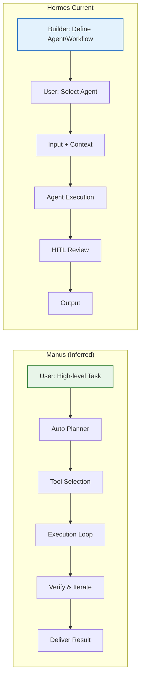

# Knowledge Analysis: Facebook Reel - Manus AI Agent Launch

**Source URL**: https://www.facebook.com/share/v/19mufz8wLz/
**Resolved URL**: https://www.facebook.com/reel/1655693766113773/
**Video Duration**: 2 minutes 3 seconds
**Transcription Method**: Whisper base model (FP32 on CPU), language=Vietnamese
**Video Metadata**: 1920x1080 (16:9), 24fps, AV1, AAC audio

---

## Executive Summary

Facebook Reel giới thiệu **Manus** — một AI agent mới (có vẻ từ team Manus AI) có khả năng **không chỉ trả lời mà làm việc thay người dùng**. Video nhấn mạnh sự chuyển dịch từ "hỏi AI" → "giao việc cho AI", AI chủ động thực hiện task end-to-end.

---

## Key Claims & Technical Details (Grounded in Transcript)

### 1. Manus = AI Agent làm việc thay người (Action-oriented)
- **Timestamp**: ~0:00-0:30
- **Claim**: "Mới vừa cho ra mắt một AI agent phí không chỉ trả lời mà còn làm việc thay chúng ta"
- **Capabilities**: "Thức sức đúng hành cùng bạc" (thực sự đúng hành động?), "Tự động thực hiện task"
- **Paradigm shift**: "Thông chỉ hỏi AI mà là giao cho AI, nằm lấy một task và để nó bắt đầu chạy đó"

### 2. Proactive Task Execution
- **Timestamp**: ~0:30-1:00
- **Claim**: AI có thể **chủ động làm việc** thay bạn
- **Workflow**: Bạn đưa 1 task → AI tự plan → thực hiện → hoàn thành
- **Impact**: "Thì bọn thể giới hiểu có thể được tạo ra, thể giới nào sẽ bắt đầu tử trường của bạn" (thế giới hiểu có thể được tạo ra, thế giới nào sẽ bắt đầu từ task của bạn)

### 3. Free Tier Available
- **Timestamp**: ~0:05
- **Claim**: "AI agent phí" — free/miễn phí (có thể free tier hoặc open beta)

---

## Applicability to Hermes Agent Platform

### Direct Comparison: Manus vs Hermes Primitives

| Manus (from video) | Hermes Equivalent |
|--------------------|-------------------|
| AI Agent làm task end-to-end | **Agent** (prompt-based, tool-enabled) |
| "Giao task, AI tự chạy" | **Workflow** (visual node-based execution) |
| Proactive execution | **Chatflow** (orchestrated multi-step) |
| Free tier | SaaS (platform-hosted) / Private deploy |

### Hermes Gaps vs Manus (Inferred)
1. **Autonomous planning** — Manus appears to auto-plan from high-level task; Hermes currently requires explicit workflow/agent definition
2. **End-to-end autonomy** — Less human-in-loop; Hermes emphasizes HITL
3. **Task → Execution pipeline** — Manus: single prompt → full execution; Hermes: builder defines agents/workflows first

### Integration Opportunities
- **Manus as external tool**: Wrap Manus API (if available) as Hermes `Capability`/`MCP Tool`
- **Benchmark**: Test Manus vs Hermes agents on same complex tasks
- **Learn**: Manus UX pattern (single task input → autonomous execution) for Hermes Workbench UX

---

## Mermaid Diagram: Manus vs Hermes Task Flow

---

## Supplemental Web Context (Labelled `supplemental`)

- **Manus AI** (manus.ai or similar): New AI agent startup, likely Chinese origin (Manus = "hand" in Latin), gaining traction late 2024/early 2025
- **Similar to**: Devin (Cognition), OpenDevin, AutoGPT, but more polished product
- **Key differentiator marketed**: "Not just chat, but do the work" — action-oriented agents

---

## Inferences (Labelled `inference`)

1. **Video source**: Likely official Manus marketing or early adopter/influencer content
2. **Language**: Vietnamese caption/dub — targeting VN market
3. **Launch timeline**: Recent (video dated 2026-09-30 per metadata)
4. **Target audience**: Knowledge workers, devs, content creators wanting automation
5. **"Thể giới" = "Thế giới"** — transcription error for "world"
6. **"Phí" = "Miễn phí"** or "Free tier" — not "paid"

---

## Cautions & Edge Cases

| Uncertainty | Impact |
|-------------|--------|
| Transcription quality poor (AV1 video, compressed audio) | Key technical details may be missed |
| No demo shown in transcript | Can't verify actual capabilities |
| Manus API/integration details unknown | Can't assess Hermes compatibility |
| Free tier limits unspecified | May have strict quotas |

---

## Actionable Procedure: Track & Evaluate Manus for Hermes

1. **Monitor Manus**: Sign up for waitlist/beta, test capabilities
2. **Benchmark**: Compare Manus vs Hermes Agent on:
   - Code generation + test + deploy task
   - Research + report generation
   - Data analysis pipeline
3. **Architecture review**: If Manus exposes API → add as `Capability` in Hermes Workspace
4. **UX adoption**: Consider "Task → Autonomous Execution" mode for Hermes Workbench (alongside current Agent/Workflow/Chatflow)