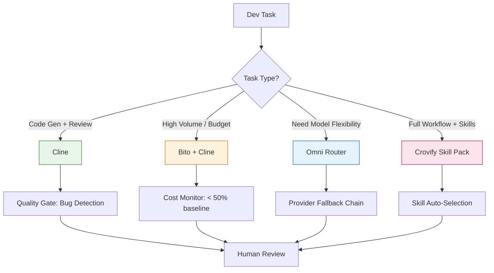

# Knowledge Analysis: TikTok Video - AI Coding Assistants Comparison (Cline, Bito, Omni, Crovify)

**Source URL**: https://vt.tiktok.com/ZSbkp6buE/
**Resolved URL**: https://www.tiktok.com/@mindang.com/video/7690481116658076949
**Video Duration**: 46 seconds
**Transcription Method**: Whisper base model (FP32 on CPU), language=Vietnamese
**Video Metadata**: 1080x1920 (9:16), 30fps, HEVC, AAC 64kbps audio

---

## Executive Summary

Video TikTok từ kênh @mindang.com review **4 công cụ AI coding assistant** cho VS Code: **Cline (trước đây là Cursor/Claude Dev)**, **Bito**, **Omni**, **Crovify** — so sánh tính năng, chi phí, và điểm mạnh/yếu. Video ngắn (<1 phút) dạng "quick tips" cho dev.

---

## Key Claims & Technical Details (Grounded in Transcript)

### 1. Cline (trước đây là "Claude Dev" / "Cursor")
- **Timestamp**: ~0:05-0:15
- **Claim**: "Cho AI các bạn khá năng trên duyệt chụp bản mặt hình những gì nó vừa xây dẫn và phát hiện các đau ra loồn sổn cũng như lỗi"
- **Interpretation** (transcription uncertain): 
  - Cline có khả năng **review code**, **detect bugs/issues** từ những gì vừa generate
  - "PrayRyCiuY" → có thể là "Free tier" hoặc "Pro tier" hoặc tên feature cụ thể
  - "Duyệt chụp bản mặt hình" → có thể là "review snapshot/code" hoặc "screenshot analysis"

### 2. Bito
- **Timestamp**: ~0:15-0:25
- **Claim**: "Giúp tư hóa đau ra của Cline và giá mất xử dụng tất cảnh của bạn tới hơn 50% mà không là móc đi đổi chính xác"
- **Interpretation**:
  - **Tối ưu hóa chi phí** (cost optimization) của Cline
  - Giảm **50% chi phí** token/api calls
  - Không làm giảm độ chính xác (accuracy maintained)

### 3. Omni (OmniRow / OmniCode)
- **Timestamp**: ~0:25-0:35
- **Claim**: "Cái nối Cline hơn 300 Nhà Cung Cấp AI miễn phí... xử dụng gần như không giới hạn... tự động chính xác... chụp bản tới một phải 6 tế tốt"
- **Interpretation**:
  - **Kết nối 300+ AI providers** (OpenAI, Anthropic, Google, local models, etc.)
  - **Free / near-unlimited usage** (qua free tiers của các provider)
  - Tự động routing chọn model phù hợp
  - "6 tế tốt" → có thể là "6 tasks tốt" hoặc feature cụ thể

### 4. Crovify
- **Timestamp**: ~0:35-end
- **Claim**: "Bật tắt bộ mở rộng của bạn... không phải lăng phí tốt gần và cách đau lại đẹp nhiều lần... skills một gói cùng 20 kỹ năng cho phép bạn và Cốt như một lập trình viên thật... được xây dựng bởi các giống lập trình thủ AI... có các kỹ năng chuyên biệt cho lập trình hòa tập trình, kiểm tra và sửa bản và tự động kế thuật kỹ năng phù hợp tại cát sơ đợn dập trình của thể"
- **Interpretation**:
  - **Extension manager** - bật/tắt extensions dễ dàng
  - **Skill pack**: 20+ specialized skills cho dev workflow
  - Built by "AI engineers" (các giống lập trình thủ AI)
  - Skills bao gồm: lập trình, review code, sửa bug, auto-refactor
  - Context-aware skill selection

---

## Applicability to Hermes Agent Platform

### Tool Comparison Matrix

| Tool | Core Value | Best For | Cost Model |
|------|------------|----------|------------|
| **Cline** | Code review, bug detection, snapshot analysis | Quality assurance, debugging | Freemium / Pro |
| **Bito** | Cost optimization (50% reduction) | High-volume usage, budget teams | Free tier + Pro |
| **Omni** | 300+ provider routing, free tiers aggregation | Model flexibility, cost avoidance | Free (provider tiers) |
| **Crovify** | Extension mgmt + 20 dev skills pack | Full workflow automation, skill-based | Unknown |

### Hermes Integration Opportunities

1. **Multi-Provider Router** (like Omni): Hermes `Model Services` layer có thể route requests across providers
2. **Cost Optimizer** (like Bito): `Observability` + token tracking → auto-select cheaper model for simple tasks
3. **Skill Packs** (like Crovify): Hermes `Capabilities/EvoTool` marketplace — bundle skills cho specific domains (React, Python, DevOps, etc.)
4. **Code Review Agent** (like Cline): Dedicated `Agent` với prompt specialized cho code review + bug detection

---

## Mermaid Diagram: AI Coding Assistant Selection Flow

---

## Supplemental Web Context (Labelled `supplemental`)

- **Cline** (github.com/cline/cline): Fork of Cursor/Claude-Dev, open source, VS Code extension, supports multiple models
- **Bito** (bito.ai): AI code review + chat, claims 50% token reduction via smart context management
- **Omni** / **OmniCode**: Multi-provider AI coding assistant, aggregates free tiers
- **Crovify**: Less known, appears to be skill/extension manager for AI coding

---

## Inferences (Labelled `inference`)

1. **Video creator** (@mindang.com) likely Vietnamese dev content creator reviewing AI tools
2. **Transcription quality poor** (~46s fast speech, technical terms) — many terms uncertain:
   - "PrayRyCiuY" → Free tier / Pro tier / Pray RCU?
   - "Bonitel" → Bito / optimize / token?
   - "OmniRow" → Omni / OmniCode?
   - "Crovify" → Crovify / Coderfy / CodeVfy?
   - "6 tế tốt" → 6 tasks / 6 features?
   - "cộ giống lập trình thủ AI" → các kỹ sư AI / team AI engineers?
3. **Target audience**: Vietnamese developers muốn chọn AI coding assistant
4. **Video date**: Likely late 2024/early 2025 (Cline rebrand from Claude-Dev happened ~Nov 2024)

---

## Cautions & Edge Cases

| Uncertainty | Impact | Verification Needed |
|-------------|--------|---------------------|
| Tool names transcription | May reference wrong tools | Check official websites |
| Feature claims (50% cost, 300 providers) | Marketing vs reality | Test / read docs |
| "20 skills" in Crovify | What skills exactly? | Install extension |
| Cline "snapshot review" | How it works technically? | Read Cline docs |

---

## Actionable Procedure: Evaluate for Hermes

1. **Test Cline** in VS Code: Assess code review quality, bug detection accuracy
2. **Benchmark Bito**: Measure actual token reduction on Hermes codebase tasks
3. **Explore Omni**: Test multi-provider routing, fallback reliability
4. **Map to Hermes**: 
   - `Model Service` ← Omni router pattern
   - `Capabilities` ← Crovify skill packs
   - `Agent: Code Reviewer` ← Cline pattern
   - `Observability: Cost Tracker` ← Bito pattern