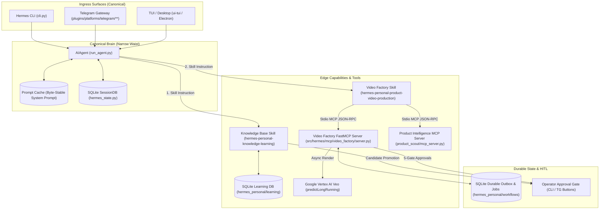

# Target Runtime Flow

**Architecture Profile**: `PERSONAL_HAPPY_PATH_V1`  
**Core Invariant**: Single Canonical Brain (`run_agent.AIAgent`), Edge Capabilities (Knowledge Base, Video Factory), Durable Outbox for async job recovery.

---

## 1. Unified Architecture Topology

---

## 2. End-to-End Turn Execution Flow

### Step 1: User Ingress
1. User sends message via **Telegram Bot** or **Interactive CLI** (`"Tạo video quảng cáo cho sản phẩm X"`).
2. The channel adapter normalizes the message into the standard conversation turn format.
3. The turn is dispatched directly to `run_agent.AIAgent.run_conversation()`.

### Step 2: Canonical Brain & Skill Activation
1. `AIAgent` checks active conversation history and stable system prompt (preserving byte-exact prompt cache).
2. Agent reads matching skill: [`hermes-personal-product-video-production`](file:///d:/work/hermes-upstream-rearchitecture/.agents/skills/hermes-personal-product-video-production/SKILL.md).
3. Skill instructs Agent on the 5-Gate HITL procedure and required MCP tool calls.

### Step 3: Edge MCP Tool Execution
1. **Gate 1 (Product Research & Lock)**:
   - Agent calls PI MCP: `research_product` $
ightarrow$ `build_resource_pack` $
ightarrow$ `lock_resource_pack`.
   - Result: Locked Resource Pack ID (e.g. `rp_vf_live_01`).
2. **Gate 2 (Creative Brief)**:
   - Agent calls VF MCP: `create_brief(product_id=...)`.
   - Operator approves Brief via interactive approval.
3. **Gate 3 (Scene Plan)**:
   - Agent calls VF MCP: `create_scene_plan(scenes=[...])`.
   - Operator approves Scene Plan.
4. **Gate 4 (Storyboard)**:
   - Agent calls VF MCP: `create_storyboard(frames=[...])`.
   - Storyboard assets generated and approved.
5. **Gate 5 (Render & Deterministic Export)**:
   - Agent calls VF MCP: `render(storyboard_result=...)`.
   - VF submits asynchronous job to Vertex AI Veo (`predictLongRunning`).
   - Job is tracked durably in SQLite Outbox / Jobs table (`hermes_personal/workflows`).
   - Polling checks completion $
ightarrow$ decodes inline Base64 video $
ightarrow$ saves local MP4 artifact.
   - Agent calls `export` $
ightarrow$ final MP4 delivered to Operator.

### Step 4: Governed Learning (Knowledge Base)
1. If Operator provides corrections or preferences during the turn:
   - Candidate is recorded in SQLite Learning DB (`hermes_personal/learning`).
   - Candidate remains in `PENDING` status until explicit Operator promotion.
   - Once approved, skill publisher updates local SKILL docs without breaking core prompt caches.

---

## 3. Architectural Invariants Preserved

1. **Sacred Prompt Caching**: No mid-turn tool injection, dynamic prompt restructuring, or synthetic role duplication.
2. **Narrow Core Waist**: Zero video rendering or knowledge database logic inside `run_agent.py`; capability lives entirely in MCP servers, skills, and plugins.
3. **Durable Single-Machine Safety**: SQLite transactions protect state against process crashes; render jobs survive restart.
4. **Zero Live Bypass**: All paid actions require explicit Operator HITL gate approvals.
